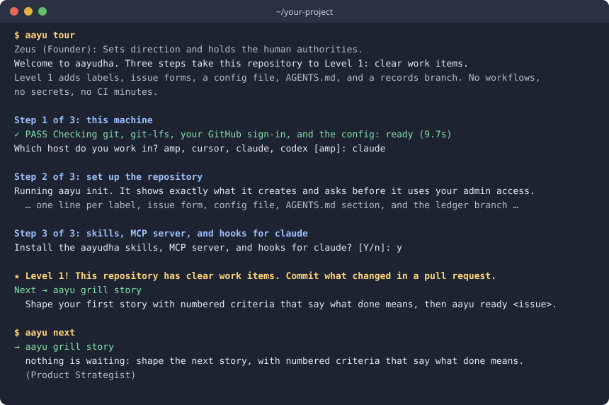

# aayudha

Your coding agent can write a feature in an afternoon. aayudha is the delivery team around it: it turns a vague
idea into clear promises, checks every change against them before it merges, and measures whether the result helped.
It works inside the agent you already use (Claude Code, Codex, Cursor, or Amp), on your GitHub repository.

- **Clear work.** An interview turns "make it faster" into a Goal with a baseline, and stories with numbered promises.
- **Proof before merge.** A merge gate runs fixed checks in your CI and asks a reviewer agent from another vendor.
  It needs no AI keys in your CI.
- **A person decides.** By default, nothing merges without a person's yes. With merge on proof on, a story's pull request
  merges once its checks, proof, and review pass; risky files still wait for a person. Every bypass is recorded.

**New in v0.3.0:** a story's pull request can merge on its own once its checks, proof, and review pass, and each project
names one review tool. Read [what's new](docs/releases/v0.3.0.md#whats-new) and [how to upgrade](docs/releases/v0.3.0.md#upgrade).

It is not a coding agent and it does not run your production. It organises, checks, and records the work your agent
does.



## Install

```sh
curl -fsSL https://raw.githubusercontent.com/rahulnakmol/agentic-ayudha/main/install.sh | sh
```

The script installs the latest signed release as `aayudha`, with the short name `aayu`. It checks
the release's signature and checksum before it copies anything. It needs `git` 2.40 or newer and `git-lfs`. Other
ways to install are in [Install and connect](docs/getting-started.md).

## Your first run

In a clone of your repository, signed in to GitHub (`gh auth login`):

```sh
aayu tour
```

The tour checks your machine, asks which agent you use, then runs `aayu init` and `aayu install`. Each one shows
what it will write and asks first. It adds labels, issue forms, a config file, and a records branch. It adds no CI
workflows and needs no keys. Commit what it wrote in a pull request.

Then open your agent in the repository and ask:

> Use the grill skill to write a story: people should be able to export their report as CSV.

The agent interviews you, one question at a time, until the story has numbered promises a person could check. It
files the story on GitHub. Then run `aayu ready <issue>`: you will see a `status:ready` label and a comment that
freezes what was agreed. Lost at any point? `aayu next` prints the one next step.

## Where to go next

- [Your first hour](docs/guide/start.md): the same steps, with what you should see after each one.
- [The story](docs/guide/journey.md): one real day, from a goal to a measured release, setbacks included.
- [When to use what](docs/guide/when-to-use-what.md): start from your situation and find the command.
- [How it works](docs/guide/how-it-works.md): the architecture, file formats, and guarantees, for engineers.

All of it is on [the docs site](https://rahulnakmol.github.io/agentic-ayudha/). Agents can read the same docs as
Markdown, starting from [llms.txt](https://rahulnakmol.github.io/agentic-ayudha/llms.txt).

What's new: the [v0.3.0 release notes](docs/releases/v0.3.0.md) say what the release does for you, and how to upgrade.

## Adopt at your own pace

1. **Level 1, clear work items.** Free, no keys, no CI changes: what the tour sets up.
2. **Level 2, proof on every pull request.** The merge gate and its fixed checks run in your CI, with no AI key; the
   review comes from an agent app you install, such as Claude or Codex.
3. **Level 3, autonomy and loops.** Scheduled and event-driven work in your agent's own tools, and agents that
   earn more freedom as their record grows.

[Adopt at your own pace](docs/guide/adopt.md) says what each level costs and gives.

## Project

aayudha is free and open source under the BSD-3-Clause licence ([LICENSE](LICENSE),
[THIRD_PARTY_NOTICES.md](THIRD_PARTY_NOTICES.md)). [CONTRIBUTING.md](CONTRIBUTING.md) explains how to send a change,
[SECURITY.md](SECURITY.md) how to report a vulnerability, and [the project reference](docs/README.md) lists the
branches, every verb, and the governance files. Coding agents working on this repository start at
[AGENTS.md](AGENTS.md).
