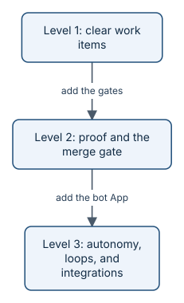

# Adopt at your own pace

You do not have to adopt everything at once. aayudha comes in three levels. Each one is a complete place to stop:
it pays for itself on its own, and you can stay there as long as you like. Move up when the next level solves a
problem you actually have.

*Three levels. Each step up adds one piece of setup.*

## Level 1: clear work items

**What you run:** `init`, `grill`, `ready`, and `status`.

**What it gives you:** every piece of work starts as a well-formed GitHub issue: Goals with a baseline and a target,
Features with a scope, and stories with numbered criteria that say what "done" means. Ready snapshots catch
promises that quietly change. `status` rolls it all up per Goal.

**What it costs:**

| Cost | At Level 1 |
|---|---|
| Keys | None beyond your own GitHub sign-in |
| CI changes | None: `init` adds issue forms, labels, a config file, and a records branch, but no workflows |
| CI minutes | None |
| Model spend | Only what your agent already uses: `grill` runs inside Amp, Cursor, or Claude Code |

**Good for:** trying aayudha on a real project in an afternoon, and teams whose main pain is fuzzy requirements.

> **Well done:** if you finished [your first hour](start.md), you are already at Level 1.

## Level 2: proof and the merge gate

**What you run:** `init --gates`, then `verify`, `inspect`, and `ship` on every pull request. Your agent can now
`build` stories end to end.

**What it gives you:** every story's pull request is checked in CI against fixed floors (coverage, security,
secrets, dependencies, and, for screens, accessibility and speed). Each one gets an authoritative proof pack and a
review against its criteria, and merges only with a person's yes. This is where "trust me" becomes "here is the
evidence".

**What it costs:**

| Cost | At Level 2 |
|---|---|
| Keys | One model key, stored as a repository secret (`AAYU_SECRET_OPENAI`, `AAYU_SECRET_ANTHROPIC`, or a gateway key), for `inspect` in CI |
| CI changes | New workflows: the merge gate, a guard that removes Ready when a story is edited, intake triage, and an incident runner you trigger by hand |
| CI minutes | About 10 minutes per push to a story's pull request in this repository (8 for the floors, 2 for the review); yours depend on your tests |
| Model spend | `inspect` is capped at 5 USD per pull request by default. One review of pull request 148 cost 0.37 USD |
| Storage | None to set up: screenshots and recordings stay in each CI run's `aayudha-pack` file for `[proof] retention_days` (90 by default, GitHub's limit is 90 days on a public repository), and `ship` copies the pack without them to the ledger. A private bucket (S3, R2, Azure Blob Storage, or Google Cloud Storage) is optional, for longer retention |

> **Needs setup:** nothing beyond the model key. Proof needs no bot App, bucket, or secret: the pack waits as a file
> on the CI run with a comment on the pull request, and `ship` checks it came from that run and records it under your
> name.

**Good for:** teams that let agents write real code and need to know it is safe to merge.

## Level 3: autonomy, loops, and integrations

**What you run:** `init --identity` for the bot App, `[autonomy]` settings, scheduled loops, and
`init --integrations` for PostHog, Sentry, and your cloud.

**What it gives you:**

- **A bot identity.** Agents write as a GitHub App, so their work is clearly theirs and a person's approval is
  clearly a person's.
- **Earned autonomy.** After 20 correction-free merges on a layer, agents may merge there without waiting for a
  person. Risky layers (domain policy, stored data, and the platform) always need a person, however long the
  streak. A protected workflow computes the streak, so no agent can fake it.
- **Loops.** Scheduled runs keep the system moving: a daily founder digest, a decision-deadline sweep, a weekly
  retro, a monthly seat review, and a quarterly skill evolution. They run in Amp, Cursor, or GitHub Actions.
- **Integrations.** Baselines and results come straight from PostHog, Sentry, Azure, AWS, or Google Cloud, and
  experiments can run on PostHog feature flags. Cloud access is read-only and keyless (see
  [Azure](../getting-started-azure.md), [AWS](../getting-started-aws.md), and [Google Cloud](../getting-started-gcp.md)).

**What it costs:**

| Cost | At Level 3 |
|---|---|
| Keys | The GitHub App is free; `init` creates it and stores its key as a secret. Read-only tokens for PostHog and Sentry. Read-only cloud access, with no stored key when it runs in GitHub Actions |
| CI changes | The loops workflow, if you run loops in Actions |
| CI minutes | Loops add runs on a schedule; agent-started workflows are capped at 2,000 minutes a month by default |
| Model spend | Loops and autonomous merges use models more often. Default caps: 25 USD per story and 100 USD per day per repository. When a cap trips, agents pause and a person is paged |
| Other | PostHog bills by usage on its side; Sentry adds no cost |

> **Honest status:** this repository runs at Level 2 today. It has no bot App installed yet, so its agents write as
> the founder, tagged as such, and the loops that need to write as the bot cannot run in Actions. The daily digest,
> which needs no bot, does run there, though GitHub's scheduler often starts it late. Level 3 is built; this
> repository has not switched it on.

**Good for:** teams with a steady flow of work who want the agents to carry more of it, with the guard rails
switched on.

## How to move up

| From | To | Run |
|---|---|---|
| Nothing | Level 1 | `aayu init`, then `aayu install --host <your host> --apply` |
| Level 1 | Level 2 | `aayu init --gates`, add a model key secret, and commit the new workflows through a pull request |
| Level 2 | Level 3 | `aayu init --identity`, then `aayu init --integrations` for the services you use |

Every step is idempotent: running it again changes nothing. And `aayu uninit` removes what `init` created.

## What's next

- At Level 1? Follow [the journey](journey.md) up to step 3, and stop there for now.
- Ready for Level 2? Read [Prove it](journey-5-prove.md) to see what the merge gate gives you.
- Want the ideas behind the levels? See [the human pass and solo mode](concepts-human-pass.md) and
  [floors](concepts-floors.md).
