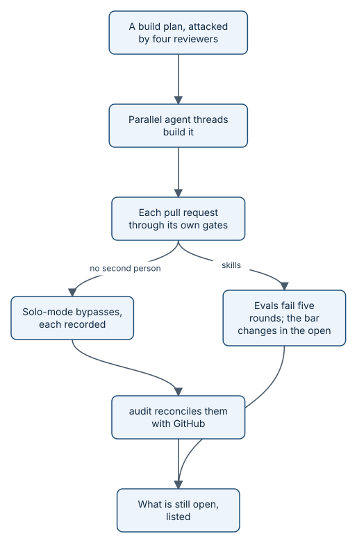

# Epilogue: built with itself

A tool that says "prove it" had better prove itself. aayudha was planned, built, and released with its own process,
in this repository, starting on Sunday 11 October 2026. Its own gates said no to it many times. Here is how that went,
including the parts that are not finished.

*The same loop as the story, one level up: the plan is the Goal, the work packages are the stories.*

## A plan that was attacked before it was built

Before any code, the founder wrote a build plan, [docs/BUILD-PLAN.md](../BUILD-PLAN.md): milestones, work packages,
and the rules every one of them must follow. Then three independent reviewers, each a model told to find what was
wrong, attacked it from three sides:

- **Architecture and feasibility.** Could it be built as described, in that order?
- **The human in the loop.** Do the gates really keep people in charge, and does the loop really close?
- **An adversary.** Credentials, supply chain, prompt injection, operations, personal data, and cost.

They were not gentle. On a scale of 1 to 5, the adversary scored the first plan's defences against injection, its
handling of personal data, and its cost controls at 1 each. Between them, the three raised 62 groups of findings.
None was rejected. Two were adopted in a modified form. The plan changed a lot. Three examples:

- Agents were going to use the founder's own GitHub token. Now they write as a separate bot identity, so an agent's
  approval can never pass for a person's.
- Proof packs were going to be written by the agent that did the work. Now only CI writes the packs that count.
- The streak that earns agents autonomy was going to be a counter on the records branch, which the agents could
  write. Now a protected workflow computes it from the merge history.

A fourth reviewer then re-read the revised plan for consistency and gaps, and found 17 more problems. None was
rejected either. The plan that was built is version 0.3.

## Built by a team of agent threads

The building was done by agents, in parallel. One orchestrating agent thread read the plan, started worker threads
for independent work packages, and sequenced the ones that depended on each other. The first wave ran three threads
at once: the CI and release pipeline, the core command line as a stack of pull requests, and the design system.
Later waves ran four at once. The plan grew from 61 work packages to 64 when the founder added cloud integrations.

The plan also ran on its own process. Once `init` and `ready` existed, every remaining work package was filed as a
Story with a Completion Goal and went through the gates it was building.

## Every bypass, on the record

With one human and no bot App, the rules could not always be met. Protected files, such as the workflows and the
skills, need a second person's review, and there was no second person. So each such merge went through a recorded
solo-mode bypass: a comment first, then the merge.

`audit` then checked the record against GitHub's own history. Its report for 11 October to 06:35 on 12 October
counted 105 times a protection rule was bypassed, and accounted for every one of them, most of them recorded solo-mode
merges and writes to the records branch. One of them needed a second look.

Pull request 86 merged a protected workflow without the "Solo-mode bypass:"
comment first. `audit` caught it as the one genuine lapse. The founder added the comment late and wrote an incident
note on the ledger. `audit` now files it under its own heading, "recorded late", and never counts it as a normal
bypass. A slip that is recorded is a fact; one that is hidden is a problem.

The same report is just as plain about what it cannot vouch for: 717 GitHub writes in that window are not in any
actions log segment, most of them made before the log segments existed.

## The evals that failed five times

Skills are the agents' instructions, and they are tested by evals: the same task run several times, with deterministic
checks first and then a judge model scoring the result. pass^5 is the chance that all five runs of a task pass. The
bar for `brief` was strict: for each audience register, pass^5 of at least 0.8 (in practice, all five runs had to
pass) and a mean judge score of at least 3.5 out of 5.

It failed five rounds in a row, each after a real fix. The registers are `eli5` (explain it simply), `ste`
(Simplified Technical English), `engineer`, and `regulatory`.

| Round | Result |
|---|---|
| 1 | Every register at pass^5 0; two `ste` answers cut off |
| 2 | No errors, still pass^5 0 everywhere; the missing link from each claim to its evidence found |
| 3 | Claims now traced to evidence; `ste` 5 of 5, `eli5` and `engineer` 4 of 5, `regulatory` 3 of 5 |
| 4 | `engineer` and `regulatory` 5 of 5; `eli5` 2 of 5 and `ste` 3 of 5 |
| 5 | `engineer` and `regulatory` 5 of 5; `ste` 4 of 5 and `eli5` 3 of 5; suite pass^5 0.50, mean 4.45 |

The remaining failures were not bugs a rule could decide. The judge marked the simplest register down for everyday
restatements that the register itself asks for, and the controlled-English register down for passive voice. Six
charged runs were recorded at 49.43 USD, at a fallback rate about four times the models' list prices (D-3.4p).

Rather than loosen the test quietly, the founder decided in the open: the `brief` group passes on the mean score, and
pass^5 is still computed and printed, marked advisory. When even the mean failed for the two plain registers on the
next run, those two moved into their own group that is reported but does not block a release. Both decisions are
written in the build plan, with their tests. Separately, the pass rule for every group was clarified to apply to the
group as a whole rather than to each task on its own. The tension in the rubric is filed as Feedback 152 for `evolve` to
work on.

> **Tip:** this is the pattern to copy. When a bar cannot be met, do not lower it in silence. Write down what failed,
> why, who decided, and what stays open.

## The dogfood, and what it found

Then came the story you just read: benefits-qa, built by aayudha's agent seats on 12 October through every gate. It found real
problems in aayudha too. The accessibility check could not run on pages with a strict content security policy, so it
was fixed before the Ask page was built. And the cap on review rounds was hit four times in one day, which made the
cost of a vague promise very concrete: 17 reviews where 10 were planned.

## What is still open

- **No bot App yet.** Agents write as the founder, tagged as such. Proof does not need the App (CI keeps the pack on
  the run and `ship` records it), but separating agent writes from the founder's does. Installing the App is a browser
  step only the founder can take.
- **Package managers.** v0.1.0 shipped on 15 October 2026, signed, with provenance. Its Homebrew, Scoop, and winget
  jobs failed, so at that release only `install.sh` worked. Since v0.2.0, Homebrew and Scoop have aayudha; winget is
  waiting for a moderator in [microsoft/winget-pkgs pull request 454680](https://github.com/microsoft/winget-pkgs/pull/454680).
- **Measurement with real time.** The benefits-qa result is seeded; the real 28-day measurement is due after
  9 November 2026.
- **Reviews owed after the fact.** The founder still has to review the three plan bypasses and five solo ships from
  12 October, and the model's contrast note on the Ask page.
- **Proof coverage of aayudha's own work is low.** At the last audit it was 2 of 33 delivered stories, because most
  work packages merged before the merge gate existed. The report says so instead of hiding it.
- **The ledger branch's own README is out of date.** It names a `packs/` folder, where proof really lives under
  `proof/`. No verb writes that file, so it is left as written; [the ledger branch](how-ledger.md) page describes the
  real layout.

## Read next

- The mechanics behind all of this: [How it works](how-it-works.md).
- The evals in detail: [the eval harness](how-evals.md).
- How `audit` reconciles the log: [configuration, secrets, and the audit trail](how-config-and-audit.md).
