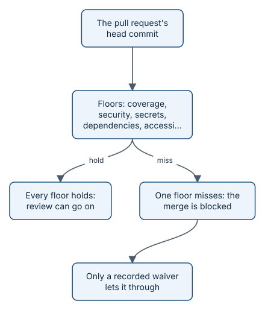

# Floors

A **floor** is a fixed check with a fixed threshold. Tests must cover 90 % of the changed lines. A security scan must
find no high or critical issues. A page must have no serious accessibility problems. Each floor either holds or
misses, and a miss blocks the merge. No model, however persuasive, can overrule it.

*Deterministic checks beat model judgement, every time.*

## The default floors

| Floor | The rule, by default |
|---|---|
| Coverage | Tests cover at least 90 % of the changed lines |
| Security scan | No critical or high findings |
| Secrets | No leaked keys or passwords |
| Dependencies | No critical or high known vulnerabilities |
| Accessibility | WCAG 2.2 AA: no serious or critical violations; every state works by keyboard, with reduced motion, and at 200 % text; touch targets at least 44 by 44 pixels |
| Page speed | Your own budgets, for example a score of at least 90 |
| Optional | Screen reader, web security scan (DAST), API load, and mobile, when you switch them on |

Floors run only where a change can affect them: a story with no screens skips the accessibility and speed floors,
and the pack says so.

## Why floors help you

- **No arguments.** A model reviewer can be confident and wrong. A floor is a number. Disagreements are about the
  threshold, which you set once, not about each pull request.
- **Safe speed.** Agents can move fast because the floors catch the most common ways fast code goes wrong.
- **Visible exceptions.** Sometimes you must ship with a miss. That takes a **waiver**: a recorded Decision, accepted
  by a person with the authority. `audit` counts every waiver, so exceptions never become habits by accident.

> **In the story:** the Ask page (story 134) passed every screen floor: 0 serious or critical accessibility
> violations, every control reachable by keyboard, nothing clipped at 200 % text, no small targets, and a page-speed
> score of 100 against a budget of 90.

The thresholds live in your repository's configuration, and the full list with every default is the
[Constraints reference](../../CONSTRAINTS.md). Terms are defined in the [glossary](../../GLOSSARY.md).
> **Under the hood:** every floor's tool, pinned version, threshold, and skip rule is in
> [floors in detail](how-floors.md).

## What's next

Floors decide whether a change *may* merge. A person decides whether it *should*. See
[the human pass and solo mode](concepts-human-pass.md).
