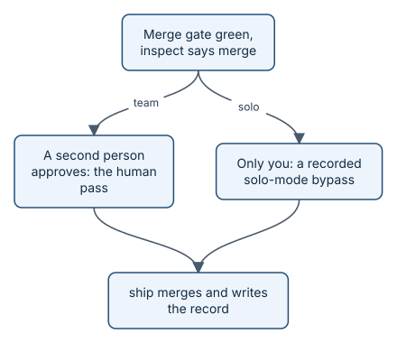

# The human pass and solo mode

Agents do most of the work in aayudha, but some decisions belong to people: merging a change, accepting a
decision, publishing, releasing. The **human pass** is how aayudha makes sure a person really made them, and solo
mode is what happens, honestly recorded, when there is only one person.

*A person always signs off. Working alone, you record that you did.*

## The human pass

A human pass is an approving review on the pull request from a person's GitHub account. aayudha counts it only
when the account is not a bot, and not one of the bot logins you have configured. That is why agents and CI write
as a bot identity at Level 3: so an agent's approval can never be mistaken for yours.

`ship` will not merge without one. Publishing with `tell` refuses agents altogether. `release` lets an agent
promote behind the full gate, but `main` moves only on a person's stable-release request.

## Solo mode

GitHub does not let you approve your own pull request. So on a team of one, a true human pass is impossible. aayudha
does not fake one. Instead:

1. You post a comment on the pull request that starts with "Solo-mode bypass:" and says why.
2. You run `aayu ship <pr> --solo-bypass`. It checks you really are alone: no bot App, and no second person paired
   with a seat.
3. The ship record and the story's Outcome say "Human pass: none possible", with a link to your comment.
4. `audit` lists every solo-mode bypass in its own section.

The same goes for plans on the risky layers: `plan --solo-bypass` records that nobody reviewed the plan, rather than
claiming you did.

> **In the story:** benefits-qa was built in solo mode. Each of the five pull requests merged under a recorded
> solo-mode bypass, and three plans were recorded as bypasses too. None was written down as an approval.

## When you add a second person

Solo mode switches off by itself. Pair a teammate with a seat (`aayu seat add <seat> --human <login>`), and their
approval is required again for the layers that seat owns.

## Earning autonomy

At Level 3, a layer can earn the right to merge without waiting for a person: 20 merges in a row on that layer with
no human correction (no requested changes, no human commits, no reverts, no linked bugs). A protected workflow
computes the streak from the merge history, so no agent can change it. The risky layers, domain policy, stored data,
and the platform, always need a person, whatever the streak.

Terms are defined in the [glossary](../../GLOSSARY.md).
> **Under the hood:** how a person's approval is told apart from a bot's, and what solo mode checks, is in
> [trust and identities](how-trust.md).

## What's next

Once a change is merged, it climbs the release ladder. See [dev, rolling, main](concepts-ladder.md).
