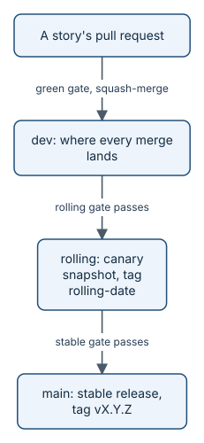

# dev, rolling, main

Every change climbs the same three-rung ladder before it reaches everyone. Each rung is a branch, and each step up
runs a bigger gate. That way, new work reaches early adopters fast, and stable releases stay stable.

*Three rungs. A gate at every step.*

## The three rungs

| Branch | What it is | Who uses it |
|---|---|---|
| `dev` | Where every merged pull request lands. Always builds, but not a release | The team, every day |
| `rolling` | A snapshot of `dev` promoted on a schedule, tagged `rolling-<date>` | Early adopters who want the latest |
| `main` | A stable release, promoted from `rolling` on a deliberate decision, tagged `vX.Y.Z` | Everyone else |

## The gates

- **Into `dev`:** the pull request's own checks, the merge gate, and a person's yes.
- **Into `rolling`:** the rolling gate on the exact merge commit: unit and integration tests, benchmarks, a
  production check, and the evals for the skills.
- **Into `main`:** everything in the rolling gate, plus longer integration tests, security scans, and install tests
  on Linux, macOS, and Windows. Every commit on `main` is tagged and released, with a signed build.

If a gate fails, nothing moves. The fix goes into `dev` and climbs again.

Your product does not have to use all three rungs. If your repository has only `main`, `init` maps it and renames
nothing; add `dev` and `rolling` when you want them.

## Why a ladder helps you

- **Speed and stability together.** People who want the newest work take `rolling`. People who need calm take
  `main`. Nobody waits for everyone.
- **Every release is traceable.** A tag points at one commit, built by one workflow, from one gate run.
- **Measurement starts on time.** `release` schedules the Goal's measurement when the work goes out.

> **In the story:** benefits-qa reached `rolling` as `rolling-2026-10-12.4`. You can install that very snapshot
> today, as [your first hour](start.md) shows. The first stable release, v0.1.0, has not been cut yet.

The procedure, step by step, is in [Contributing](../../CONTRIBUTING.md). Terms are defined in the
[glossary](../../GLOSSARY.md).

## What's next

You have the ideas. Now see them in motion: [the journey at a glance](journey.md).
