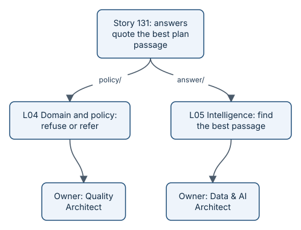

# The nine layers

Every application, however small, has the same kinds of parts: screens, an API, business rules, data, and so on.
aayudha names nine of them, the **layers**. Each one has an owner seat, and each changed file belongs to exactly one
layer, matched by its path. So every story knows which parts it touches, its **footprint**, and who should look at
them.

*Story 131's footprint: two layers, two owners.*

## The layers, in plain words

| Layer | What it is | In benefits-qa |
|---|---|---|
| L01 Experience | What people see and use | `web/`, the Ask page |
| L02 Interaction and API | The doors into the app | `api/` and `cmd/` |
| L03 Application and workflow | The steps that tie things together | `ask/`, the question workflow |
| L04 Domain and policy | The rules of the business | `policy/`, what may be answered |
| L05 Intelligence | Search, ranking, and models | `answer/`, finding the best passage |
| L06 Contracts and integration | Agreements with other systems | `contracts/`, the API schema |
| L07 Operational data and state | What the app stores | `store/`, the plan documents |
| L08 Analytics and reporting | What the app measures | `analytics/`, the event export |
| L09 Platform and operations | How it runs and ships | `deploy/`, the run script |

The five benefits-qa stories touched all nine layers between them.

## Why layers help you

- **Plans you can follow.** A story's plan has one checkpoint per layer, so the agent changes one kind of thing at a
  time, and each checkpoint is checked on its own.
- **The right reviewer.** Each layer's owner seat, and its paired person if there is one, reviews changes there.
- **Extra care where it counts.** Three layers are marked "never" by default, meaning agents never merge there on
  their own: domain policy (L04), stored data (L07), and the platform (L09). Changes there always need a person's
  review of the plan and a person's approval to merge, however good the agents' record is.
- **Only the checks that matter.** The screen-reader floor, for example, runs only for stories that touch L01, the
  experience layer.

Which folders belong to which layer is yours to set: a product lists its path patterns in its own `LAYERS.md`, so
any folder layout works. The rules for this repository are in the [Layers reference](../../LAYERS.md). Terms are defined in the
[glossary](../../GLOSSARY.md).

## What's next

How does a story prove it kept its promises in each layer? See [proof packs](concepts-proof.md).
