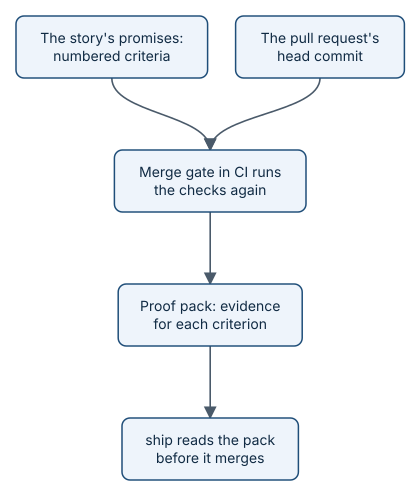

# Proof packs

When an agent says "done", how do you know? A **proof pack** is the answer. It is a small file, written by CI for
one exact commit, that maps every promise in the story to the evidence that it was kept, and records every check
that ran.

*CI writes the pack, not the agent that did the work.*

## What is in a pack

- The story, the pull request, and the exact commit it describes.
- The fingerprint of the story's Completion Goal at Ready, so the pack is checked against what was agreed.
- For each criterion, the evidence: API traces, screenshots, recordings, screen-reader transcripts, or metrics.
- Every floor result, with the tool, its version, the value, and the threshold.
- Who wrote it, and from which CI run.

## Two kinds of pack

| Kind | Written by | Counts for shipping |
|---|---|---|
| Authoritative | The merge gate, in CI, using the base branch's workflow | Yes |
| Advisory | An agent, on its own machine | No: it helps the agent, but it is a claim, not proof |

This split is the whole point. The agent that did the work never gets to certify it.

## Why proof packs exist

"It works on my machine" and "the model says it is fine" are not evidence. A pack is. It lets you:

- **Ship with confidence.** `ship` refuses to merge without an authoritative pack for the head commit.
- **Answer questions later.** Months on, anyone can open the pack and see what was checked, and how.
- **Claim only what is true.** The docs, release notes, and briefs link a Feature only when every story under it
  has an authoritative pack.

> **In the story:** here is the
> [real pack for story 131](https://github.com/rahulnakmol/agentic-ayudha/blob/ledger/proof/131/b046d1a1d113339eb80e130c9dc0008fa223e76f/authoritative/pack.json).
> It maps three criteria to three API-trace files and records the floors: 116 of 116 changed lines covered, no
> security findings, no secrets, no vulnerable dependencies.

## Where packs live

Packs live on the `ledger` branch: a separate branch in your own repository that holds records, never code. Large
files, such as screenshots and recordings, go to Git LFS in private repositories, or to a private bucket for public
ones, so they can be deleted after 90 days while the pack and its fingerprints stay.

Terms are defined in the [glossary](../../GLOSSARY.md).
> **Under the hood:** the `pack.json` format, field by field, is in [proof packs](how-proof-packs.md); where packs are
> stored is in [the ledger branch](how-ledger.md).

## What's next

The checks inside a pack are called floors. See [floors](concepts-floors.md).
