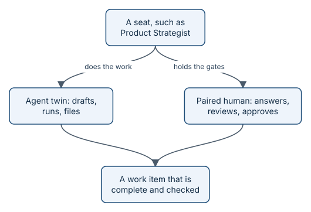

# Seats and pairing

A delivery team works because everyone knows their job. aayudha gives its agents the same clarity: fourteen **seats**,
each a role with its own responsibilities, such as Product Strategist or Engineering Manager. Every verb belongs to
exactly one seat, so there is never a question of who is accountable for a step.



*Every seat has an agent twin. A paired human holds the gates.*

## Twins and humans

Each seat has an **agent twin**: the agent half that does the seat's work in your host, such as interviewing,
drafting, building, or checking. A seat runs in one of two modes:

- **Solo:** the twin works alone, and anything that needs a person goes to the founder.
- **Paired:** a person is attached to the seat. They answer the twin's questions, review its work in their layers,
  and give the approvals that only a person may give.

You pair a person with a seat in one command, and you can see every seat's mode at any time:

```sh
aayu seat add product-strategist --human <github-login>
aayu seat list
```

## The fourteen seats

| Seat | In plain words | Some of its verbs |
|---|---|---|
| Founder | Final authority; sets up repositories and accepts decisions | `init`, `decide` |
| Product Strategist | Turns ideas into clear, checked work | `grill`, `slice`, `ready`, `triage` |
| Code Architect | Plans how each story is built, layer by layer | `plan` |
| Data & AI Architect | Designs the data and evidence behind numbers and AI answers, and measures them | `chart`, `measure` |
| Engineering Manager | Reviews, ships, and keeps delivery healthy | `inspect`, `ship`, `status`, `retro` |
| AI Native Engineer | Builds the software and runs the checks | `build`, `verify`, `evolve` |
| Production Engineer | Runs the software in production: incidents, SLOs, runbooks, rollbacks | `respond` |
| Quality Architect | Owns the floors and the proof packs | `proof` |
| UX Researcher | Designs and reviews the screens | `research`, `wireframe`, `review`, `polish` |
| DevOps Tinkerer | Releases, installs, and keeps the tooling working | `release`, `install`, `doctor` |
| Revenue Architect | Sets the targets and runs experiments | `experiment`, `readout` |
| Mentalist | Explains work to any audience | `brief` |
| Marketer and Documenter | Writes docs and launch copy from proven work | `tell` |
| Auditor | Checks the record and reports on it | `audit` |

> **In the story:** in benefits-qa, the Product Strategist's twin interviewed the founder for Goal 125, the AI Native
> Engineer's twin built the stories, and the Engineering Manager's twin, running in CI, reviewed each pull request.
> Every seat ran solo, because the repository has one person.

## Why seats help you

- **No gaps.** Every step has an owner, so nothing falls between two agents.
- **Different eyes.** The seat that reviews is not the seat that built, and its model comes from a different vendor.
- **Room to grow.** Start solo. Pair a teammate with the seats they care about when they join, and their reviews
  become required for their layers.

On a small team you do not manage fourteen seats. They all run solo by default; you pair a person only where you want
their review.

Every twin, its layers, and its model lanes are on [your agentic team](concepts-team.md). Full details are in the
[RACI table](../RACI.md). Terms are defined in the [glossary](../../GLOSSARY.md).
> **Under the hood:** seats, verbs, and their RACI are declared once in the verb registry; see
> [the verb registry and code generation](how-registry.md).

## What's next

Seats own parts of the code, called layers. See [the nine layers](concepts-layers.md).
