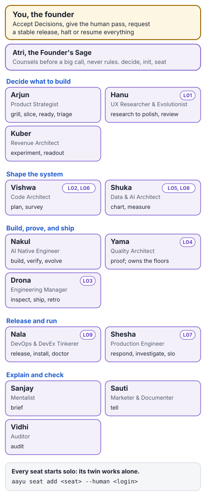

# Your agentic team

One or two people cannot be the product strategist, the architect, the engineer, the reviewer, the release engineer,
and the person on call, all at once. aayudha gives you a delivery team of fourteen **seats**, each a role with clear
work, and each seat has an **agent twin** that does that work in your agent. You stay the person who decides.

*Fourteen seats, fourteen twins, one founder who decides.*

## Twins and their personas

Each twin has a name from the Hindu epics or the rishi tradition, and a **persona**: its purpose, its voice, its
values, how it pushes back, what it never does, and a practice playbook drawn from published software practice. Arjun,
the Product Strategist's twin, writes in plain customer language and ends on a number. Yama, the Quality Architect's
twin, states a floor miss once, plainly, without apology.

Every twin follows the same **evidence rule**: a claim about the code, the risk, or progress cites its source in the
same paragraph, such as a file and line, a proof pack, or a Decision. An analogy may illustrate a point, labelled as
one, but never replaces the evidence. A twin never fakes, implies, or pre-announces an approval that did not happen.

The persona lives in `seats/<seat>/persona.toml` and is rendered into the seat's charter, the top of each of its
skills, and your repository's `AGENTS.md`. Each seat's charter is in [seats/](../../seats/README.md).

## Who answers for what

Every verb has exactly one **Accountable** seat, and that seat's twin does the work, in the verb's model lane. Some
verbs also **Consult** other seats before they act and **Inform** others after. A few split ownership from execution:
Nakul runs [`verify`](skills/verify.md), but against floors that Yama owns.

| Seat | Twin | Accountable for |
|---|---|---|
| Founder | Atri | [`decide`](skills/decide.md), [`init`](skills/init.md), and the `halt`, `resume`, `seat`, `tour`, and `inbox` commands |
| Product Strategist | Arjun | [`grill`](skills/grill.md), [`slice`](skills/slice.md), [`triage`](skills/triage.md), [`ready`](skills/ready.md) |
| Code Architect | Vishwa | [`plan`](skills/plan.md), [`survey`](skills/survey.md) |
| Data & AI Architect | Shuka | [`chart`](skills/chart.md), [`measure`](skills/measure.md) |
| Engineering Manager | Drona | [`inspect`](skills/inspect.md), [`ship`](skills/ship.md), [`status`](skills/status.md), [`retro`](skills/retro.md), `next` |
| AI Native Engineer | Nakul | [`build`](skills/build.md), [`verify`](skills/verify.md), [`evolve`](skills/evolve.md) |
| Production Engineer | Shesha | [`respond`](skills/respond.md), [`investigate`](skills/investigate.md), [`slo`](skills/slo.md), [`runbook`](skills/runbook.md) |
| UX Researcher & Evolutionist | Hanu | [`research`](skills/research.md), [`wireframe`](skills/wireframe.md), [`mockup`](skills/mockup.md), [`prototype`](skills/prototype.md), [`review`](skills/review.md), [`polish`](skills/polish.md), [`baseline`](skills/baseline.md) |
| DevOps & DevEx Tinkerer | Nala | [`release`](skills/release.md), [`install`](skills/install.md), [`doctor`](skills/doctor.md), and the setup commands |
| Quality Architect | Yama | [`proof`](skills/proof.md), and the floors in `CONSTRAINTS.md` |
| Mentalist | Sanjay | [`brief`](skills/brief.md) |
| Auditor | Vidhi | [`audit`](skills/audit.md) |
| Marketer & Documenter | Sauti | [`tell`](skills/tell.md) |
| Revenue Architect | Kuber | [`experiment`](skills/experiment.md), [`readout`](skills/readout.md) |

Atri, the Founder's Sage, is a counsellor: it frames a hard call, recommends one option, and names the question
only you can answer. It never rules, approves, or acts. The full table, with every Consulted and Informed seat, is
the [RACI](../RACI.md).

## Who owns which layer

Your code is split into nine **layers**, from the screens to the platform ([the nine layers](concepts-layers.md)).
Each layer has exactly one owner seat. When you pair a person with that seat, they review changes in its layers.

| Layer | Owner seat (twin) |
|---|---|
| L01 Experience | UX Researcher & Evolutionist (Hanu) |
| L02 Interaction / API boundary | Code Architect (Vishwa) |
| L03 Application / workflow | Engineering Manager (Drona) |
| L04 Domain / policy | Quality Architect (Yama) |
| L05 Intelligence | Data & AI Architect (Shuka) |
| L06 Contracts / integration | Code Architect (Vishwa) |
| L07 Operational data / state | Production Engineer (Shesha) |
| L08 Analytics / reporting | Data & AI Architect (Shuka) |
| L09 Platform / operations | DevOps & DevEx Tinkerer (Nala) |

L04, L07, and L09 are the risky layers by default: they never earn autonomy, however well the agents have done
before. A change there always waits for a person: their review, or, working alone, your recorded solo-mode bypass.

## Which model does the work

A twin works in a **model lane**, a kind of work with a default model per agent host. The reviewer's model always
comes from a different vendor than the builder's, so the agent that wrote the code never marks its own work.

| Lane | The work | Used by, for example |
|---|---|---|
| `spec` | Specs, decisions, briefs, and copy | `grill`, `decide`, `brief`, `tell` |
| `plan` | Slicing and planning | `slice`, `plan`, `survey` |
| `build` | Code and artifacts | `build`, `evolve`, `wireframe` |
| `review` | Adversarial code and spec review | `inspect`, `audit` |
| `ui-review` | Visual and interaction critique | `review` |
| `chore` | Cheap mechanical work | `ready`, `verify`, `ship`, `status` |

The default model for each lane on each host is in [the model gateway and lanes](how-models.md). You can change any
of them in `[models]`.

## From solo to paired

Every seat starts **solo**: its twin works alone, and anything that needs a person goes to the founder. When someone
joins, pair them with the seats they care about, one command each:
`aayu seat add <seat> --human <github-login>`. A paired person reviews their seat's layers, and the twin keeps doing the work. Once two people are in the
repository, protected paths need a CODEOWNER's approval and the solo-mode bypass is refused. The steps, with a
picture, are in [when a second person joins](guide-solo-founder.md#when-a-second-person-joins).

`aayu seat remove <seat>` returns a seat to solo and hands its person's open stories back to the twin.

Terms are defined in the [glossary](../../GLOSSARY.md).
> **Under the hood:** seats, verbs, layers, and lanes are declared once in the verb registry and checked by a lint
> that fails the build on a verb without one Accountable seat; see [the verb registry](how-registry.md).

## What's next

Working alone for now? See [run it alone: the solo founder](guide-solo-founder.md).
