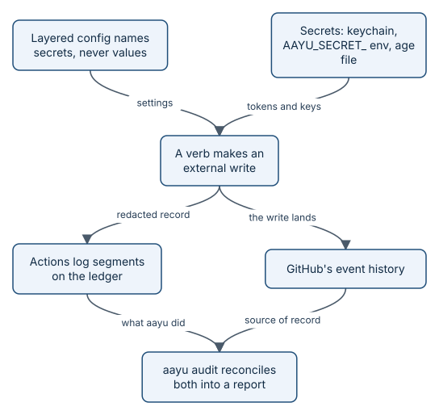

# Configuration, secrets, and the audit trail

Three parts of aayudha decide what it is allowed to do and let you check, later, what it actually did. Configuration
sets the thresholds and policies. The secrets store holds keys so that no file ever does. The actions log records every
external write, and `aayu audit` checks that log against GitHub's own history, so a write that bypassed aayudha still
shows up.



*Config names secrets but never holds them. The log says what aayudha did; GitHub's history is the source of record.*

## Configuration layers

Why layers? A floor threshold belongs to the repository, a model preference belongs to a person, and a one-off
experiment belongs to one command. `config.Load` in [internal/config/load.go](../../internal/config/load.go) merges six
layers, lowest precedence first:

| Layer | Source |
|---|---|
| `default` | `internal/config/defaults.toml`, embedded in the binary |
| `user` | `~/.config/aayudha/config.toml` (or under `XDG_CONFIG_HOME`) |
| `repo` | `.aayudha/config.toml`, committed |
| `local` | `.aayudha/config.local.toml`, ignored by Git |
| `env` | `AAYU_<SECTION>__<KEY>` variables, with a double underscore between levels |
| `flag` | `--set key=value` |

Each file layer may also be JSON; TOML wins when both exist. Every layer is checked on its own before it is merged, so
an unknown key is an error that names the file, variable, or flag it came from, not a silent no-op. Files carry a
schema `version`; an older file is migrated in memory with a notice, and a newer one is refused. `[fleet]` is accepted
only in the user layer.

`aayu config show --origin` prints every merged key with the layer and source that set it, for example
`autonomy.streak = 20  # default: defaults.toml (embedded)`. `aayu config validate` loads and checks without printing.

### What protects the policy keys

The keys that decide what agents may do, such as floors, `[autonomy]`, and `[models]`, are protected by protecting the
files that hold them. `internal/config/defaults.toml` and `.aayudha/config.toml` are both in `.github/CODEOWNERS`, so a
change needs a human CODEOWNER's approval (see [trust model and identities](how-trust.md)). `CONSTRAINTS.md` is
generated from `defaults.toml`, and the `generate-drift` check fails when the two disagree, so a default cannot be
loosened quietly. The `local`, `env`, and `flag` layers can still change these keys on one machine; that changes what
an agent on that machine does, but not what the protected files or CI's gate workflows say.

One key is stricter. `[decisions] solo_provisional_after_hours` (default 24, Story #432) is read only from
`.aayudha/config.toml` and the embedded defaults: a value in the user, `local`, `env`, or `flag` layer fails the load,
and so does a value under 12, the hard minimum in code (`config.MinSoloProvisionalHours`). With at most one human
configured (paired seats' humans and `[autonomy] approver`), a reversible, Decision-ready Decision's recommendation
then applies provisionally after the shorter of it and `provisional_after_hours` (rule V8); `provisional_after_hours = 0`
still turns provisional application off. No mode ever applies a waiver of any kind (by label, a `waives #N` link, or a
title or question that says waive), a seat change, or a step the trust model keeps human-only (approving a PR,
publishing, `aayu init`, a protected path, a floor, or a ratchet) (`decide.Decision.Excluded`). `aayu status` and
`aayu inbox` list the provisional Decisions with their ratify-or-revert deadline, so a person can reverse one with
`aayu decide <n> --accept <option>`.

From `internal/config/defaults.toml`:

```toml
# Autonomy: when an agent may merge without a human pass.
[autonomy]
streak = 20
never = ["L04", "L07", "L09"]
approver = ""
correction_days = 14
…
# Proof media and retention (V3, WP4.2; run artifacts since S-4.2b).
[proof]
media = ""
retention_days = 90
```

## Secrets

Configuration names a secret; it never holds one. A `secret` field accepts only a name (lowercase letters, digits, `-`
and `_`), so a pasted key fails validation with a message that ends "never the key". Values live in one of three backends in
[internal/secrets](../../internal/secrets), tried in this order:

1. **`keychain`:** the operating system keychain (macOS Keychain, Windows Credential Manager, or Secret Service on
   Linux).
2. **`env`:** read-only `AAYU_SECRET_<NAME>` variables, for CI and headless machines. `ai-gateway` becomes
   `AAYU_SECRET_AI_GATEWAY`.
3. **`file`:** an [age](https://age-encryption.org)-encrypted JSON file, `~/.local/share/aayudha/secrets.age`,
   encrypted to an identity in `~/.config/aayudha/age-identity.txt`. Both are written with mode 0600.

`aayu auth set-secret <name>` reads the value from standard input, never from arguments, and stores it in the first
writable backend. It is refused for an agent lane (`AAYU_AGENT=1` or a host's agent marker); it needs no terminal, so
a person can pipe the value in. `aayu auth list-secrets` reports which backend each name resolves
to, never the value. `[integrations.<name>] scope` marks a key `read` or write-capable, and a read-only verb refuses a
write-capable key (`secrets.CheckScope`).

Tools that a floor runs do not inherit any of this. `Sandbox.Env` in
[internal/verify/exec.go](../../internal/verify/exec.go) builds each child's environment from a short allowlist
(`PATH`, locale, temp directories, Go and Node paths) and a fresh, throwaway `HOME`. No `AAYU_*`, `GITHUB_TOKEN`,
`GH_*`, or cloud key reaches a child, and the parent's `HOME`, where `gh` and `git` keep tokens, is hidden. On Linux a
floor that does not need the network runs in its own network namespace with only loopback.

## The actions log

Ground rule 6 in the build plan says every external write goes through `internal/actions`. `Log.Do` wraps each write:

- **Capability policy first.** A write the action's capability does not allow, such as a comment from the
  `labels-only` triage client, is refused before any request and logged as `refused`.
- **Dry run.** With `--dry-run`, the action is logged as `planned` and not performed.
- **Idempotency.** An action with an `idempotency_key` that already completed returns the earlier record and does
  nothing.
- **Redaction.** Payload keys containing `secret`, `password`, `authorization`, `api_key`, `private_key`, `cookie`,
  `credential`, or ending in `token` become `[REDACTED]`, and credential-shaped strings (GitHub tokens, `sk-` keys,
  Slack tokens, private key blocks) are replaced wherever they appear, including in results and errors.
- **One line per action**, with the outcome, wall time, tokens, and cost.

Each line has a `seq`, the `prev` hash of the line before, and its own `hash`: SHA-256 over the record's JSON with
`hash` empty. Editing, removing, inserting, or reordering a line breaks the chain. `aayu actions verify-chain` walks the
local log and names the first broken line; `aayu actions tail` and `aayu actions grep` read it.

The local log is `.aayudha/telemetry/actions.jsonl` in the main checkout, shared by every worktree of the clone. At the
end of a run, `checkpoint` appends that run's new lines to the ledger as
`actions/<date>/<host>-<run>.jsonl`, pushed with the verb's own token. Without a ledger branch the segment waits in
`.aayudha/ledger-outbox`. A real line, from
`git show origin/ledger:actions/2026-10-12/cli-20261012T095222Z.jsonl`, the merge of story 131:

```json
{"seq":142,"time":"2026-10-12T09:52:32.270597827Z","run":"20261012T095222Z","kind":"github.pull.merge","target":"rahulnakmol/agentic-ayudha#148","story":"#131","identity":"human","request":{"method":"PUT","path":"/repos/rahulnakmol/agentic-ayudha/pulls/148/merge"},"payload":{"human_pass":"solo-bypass","method":"squash","sha":"b046d1a1d113339eb80e130c9dc0008fa223e76f"},"status":"done","result":{"sha":"f56dc67169f8fe1716d37f16703548bc0f44eef6"},"tokens_in":0,"tokens_out":0,"cost_usd":0,"wall_time_ms":2695,"attempts":1,"prev":"ec0823259553cb8826686af1006c49d56ce3722829f839d350996cf074f70b60","hash":"990aaa90087aa1df5fbbdf9d231a7d9dd96d1d7a10bf7b5288ba67b93fe38a1c"}
```

## The audit

The actions log is aayudha's own account, and a log can be incomplete: a direct `gh` write, a web edit, or a run whose
segment never reached the ledger leaves no line. So the log is never the source of record. GitHub's event history is.
`aayu audit` in [internal/audit](../../internal/audit) reads both and reconciles them for a time window:

- **Rule-suite bypasses.** Every push a ruleset would have refused but a bypass actor made, classified as a solo-mode
  bypass (only `protected-paths` failed, and a `Solo-mode bypass:` comment came first), a solo-mode bypass **recorded
  late** (the comment or an incident note came after the merge), a ledger write under the founder identity, a
  promotion, a tag bypass, or other. Any it cannot explain is counted as unexplained.
- **Solo-mode human passes** from ship records, and plan-review bypasses.
- **Human-fallback writes**, from actions records and ledger commit trailers.
- **Unlogged writes.** Each write in GitHub's history (timelines, creations, workflow dispatches, ledger commits) is
  matched to an actions record with the same request and target within 10 minutes (`Tolerance`). Workflow and App
  writes are counted separately, since their runs record them.
- **Proof coverage, floors, and waivers.** Which delivered stories have an authoritative pack that maps every Ready
  criterion, matches its hashes, and whose floors hold.
- **Decision SLAs** in business hours, **autonomy exceptions** (corrections, agent merges on never layers), and a
  **licence scan** of `go.mod`.

The report goes to `audit/<date>/audit-<time>.md` on the ledger, beside an `.inputs.json` snapshot of what GitHub
returned. GitHub's history changes and rule suites are listed for only about a month, so
`aayu audit --replay <snapshot>` regenerates the report byte for byte from the snapshot, and `--since`, `--until`, and `--ledger` re-read
GitHub with the same inputs. The report's config hash covers only what audit reads (`[identity] bot_logins`,
`[decisions]`, `[time]`, `[autonomy]`, `[proof]`, `[budget] per_story_usd`, the dev branch), so a key added for another
feature leaves a report replayable; a replay refuses when one of those changed. Reports written before 15 October 2026
recorded a hash of the whole configuration, which no later binary can recompute, so their replay is checked by the
byte comparison alone. The next run starts where the last report's cursor stopped.

The summary of the latest report on this repository's ledger,
`audit/2026-10-12/audit-20261012T063500Z.md`:

```text
## Summary

- Rule-suite bypasses: 105; accounted for 105; **unexplained 0**
  - solo-mode bypasses (protected-path merges): 41
  - ledger writes under the founder identity (D1 day-one rule): 57
  - promotions to rolling or main: 3
  - tag ruleset bypasses: 2
  - solo-mode bypasses whose record came after the merge (recorded late): 1
- Solo-mode human passes (`ship --solo-bypass`): 2
- Human-fallback writes: 171
- GitHub writes in the window: 827; in an actions segment 100; by workflows and Apps 10; **not in any actions segment 717**
- Proof coverage: 2/33 delivered stories and bugs; merged without proof (pre-gate) 19; merged without proof (post-gate) 12
- Floor misses in authoritative packs: 0; waived floors: 0
- Decisions over their SLA: 0
- Autonomy exceptions: 0 corrections; 0 agent merges on never-layers
- Licence findings: 0 (68 go.mod modules); CI `security` job on the code commit: no completed run
```

The rest of the report has one section per line of the summary, each listing the items behind the count.

## Invariants

1. An unknown configuration key is an error that names its source. Enforced in `internal/config/load.go`
   (`TestRejects`, `TestPrecedence`).
2. A secret value is never accepted where config expects a name, never read from a command-line argument, and never
   written to disk in plain text. Enforced in `internal/config/config.go` and `internal/cli/auth.go`
   (`TestSecretCanary`).
3. A floor's child process sees no credential variable and not the user's `HOME`. Enforced in
   `internal/verify/exec.go` (`TestChildEnvironmentIsScrubbed`).
4. Dry run performs nothing, a repeated idempotency key performs nothing, and secrets are redacted before a line is
   written. Enforced in `internal/actions/actions.go` and `internal/actions/policy.go`
   (`TestDryRunPlansAndPerformsNothing`, `TestIdempotencyRedactionAndSegments`, `TestLabelsOnlyCapability`).
5. Any edit, removal, or reordering of a log line is detected. Enforced by `VerifyChain` (`TestChainDetectsTampering`).
6. A GitHub write with no matching actions record is reported, not hidden, and a report can be regenerated byte for
   byte. Enforced in `internal/audit/reconcile.go` and `internal/cli/audit.go` (`TestAuditFlagsUnloggedWrite`,
   `TestLoggedMatching`, `TestAuditRerunByteIdentical`).
7. A solo-mode bypass whose comment came after the merge is reported as recorded late. Enforced in
   `internal/audit/audit.go` (`TestClassifyBypasses`, `TestAuditBypassRecordedLate`).

## Where it lives in the code

- [internal/config](../../internal/config): layers, schema, validation, and
  [defaults.toml](../../internal/config/defaults.toml).
- [internal/cli/config.go](../../internal/cli/config.go): `aayu config`.
- [internal/secrets](../../internal/secrets): the three backends.
- [internal/cli/auth.go](../../internal/cli/auth.go): `aayu auth`.
- [internal/verify/exec.go](../../internal/verify/exec.go): the scrubbed child environment.
- [internal/actions](../../internal/actions): `Log.Do`, redaction, capabilities, and the hash chain.
- [internal/cli/actions.go](../../internal/cli/actions.go): `aayu actions` and the checkpoint to the ledger.
- [internal/audit](../../internal/audit) and [internal/cli/audit.go](../../internal/cli/audit.go): `aayu audit`.
- [CONSTRAINTS.md](../../CONSTRAINTS.md): the defaults, generated.

> **Honest status:** actions segments only reached the ledger from 2026-10-12 onward. Of the 717 writes the latest audit
> counts as "not in any actions segment", about 590 were made before the first segment (2026-10-12T02:33Z), while
> this repository was being bootstrapped; the rest are direct `gh`, web, or ledger writes that no segment recorded. `audit` counts them as unlogged rather than hiding them. Only 2 of 33
> delivered stories had an authoritative pack in that window: 19 merged before the merge gate was registered, and 12
> merged after it without one; the report lists both groups as uncovered. There is no bot App here, so audit runs, and every other agent write, go out under the founder's token tagged
> `identity:human-fallback`.

## Read next

- [The ledger branch](how-ledger.md): where segments and reports are stored.
- [Security](how-security.md): the threat model these controls answer.
