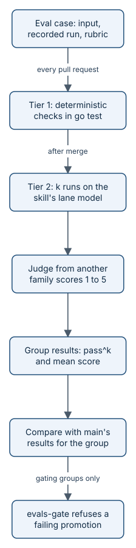

# The eval harness

Skills are prompts, and a prompt can get worse without anyone noticing. The **eval harness** catches that. It keeps
recorded runs of each skill as test cases, checks them on every pull request without calling a model, and on a
schedule runs the skills again on real models and has a judge from another model family score the results. A
promotion to `rolling` or `main` is refused when the scores fall below the bar or below `main`'s baseline.



*Tier 1 is cheap and runs everywhere; tier 2 costs money, so it runs where the key is and gates promotions.*

## Cases

A case is a directory, `evals/cases/<skill>/<name>/`, with a `case.toml`. It names the skill, the input given to it,
and the artifacts a recorded run produced under `output/`. There are 48 cases today, for the `stub`, `grill`, `slice`,
`plan`, `ready`, `brief`, `retro`, `decide`, `proof`, and `inspect` skills. Nineteen of them have a `[tier2]` section
and a rubric, so tier 2 runs them again. The 13 `inspect` cases are seeded-defect pull requests, scored by precision
and recall against their planted defects, with no judge.

A case can also carry:

- `schemas`: artifacts that must validate against a JSON Schema.
- `ready`: artifacts holding a work item that must pass Ready validation.
- `calls`: the recorded run's `aayu` calls, replayed against a fake GitHub that serves the case's `github/` files.
- `injection`: the input carries a prompt injection, so no recorded call may write.
- `scope`: **scope guards**, regular expressions for requirements the input never stated. When a judge once caught a
  skill inventing a requirement, the case keeps that defect as a deterministic rule, checked before any judge.
- `brief`: a `brief` case, whose draft must pass `aayu brief`'s deterministic checks (structure, citations, the
  register's lint).

## Tier 1: deterministic, every pull request

`Tier1` in `internal/evals/tier1.go` runs these checks on the recorded run: artifacts exist, schemas validate, work
items pass Ready, scope guards find nothing, brief drafts pass their checks, recorded calls exit 0, and an injection
case writes nothing. `TestTier1` runs every case inside `go test`, so the required `build` job in `ci.yml` runs tier 1
on every pull request. No model is called.

## Tier 2: model-judged, on a schedule

Tier 2 runs each `[tier2]` case `k` times (5 today) on the skill's real model: the registry lane of the verb the skill
is, or stands in for, on the direct host (Claude Code). The pinned judge, `gpt-6.1-sol`, then scores each run from 1 to
5 against the case's rubric. A run passes at a score of 4 or more.

Why a judge from another family: a model grading its own vendor's output tends to forgive the same mistakes. The
harness calls `models.CheckFamilies` with the skill model and the judge, and refuses to start when they match. The
judge's calls go through [the model gateway](how-models.md) on the `review` lane, and must return JSON that validates
against a small schema (`score`, `reason`), with one retry.

Deterministic checks still come first. A reply of the wrong shape, one that fails Ready, or one a scope guard catches
scores 1 without asking the judge. A `brief` draft that fails `aayu brief`'s checks gets the findings once to revise,
as it would in a host; if it still fails, it scores 1.

A run that cannot be completed (the judge's reply never validates, a reply stops at its token cap, the spend cap is
reached) is an `error`. Errors are kept out of the scores but counted: more than one errored run in a case fails it,
so a broken endpoint cannot pass quietly.

## Scores, groups, and the bar

For each case the harness records two numbers over its completed runs:

- **pass^k**: 1 when every completed run passed, else 0. A case with one weak run in five has pass^5 of 0.
- **mean rubric score**: the average score.

For a suite, pass^k is the mean of the cases' pass^k, and the mean is over every completed run.

Cases run in **groups**, defined by `[[groups]]` in `evals/eval.toml`. A case belongs to the first group with a prefix
of its ID. Each group runs as its own job with its own spend cap (`max_usd`), so one group cannot use up another's
money. The groups today are `brief-plain` (the `eli5` and `ste` brief cases), `brief` (`engineer-ideate` and
`regulatory-close`), `personas` (the `retro` and `decide` cases), `review` (the `inspect` cases), `conversations` (six
grill conversations), and `skills` (every other case).

`Compare` in `internal/evals/tier2.go` applies the bar to one group's results:

- **Always enforced:** the mean of at least 3.5 for every case and for the suite; at most one errored run per case;
  and, against `main`'s baseline, a suite mean no more than 0.3 lower.
- **pass^k is a suite bar.** A pass^k of at least 0.8 is enforced for the group as a whole, and a case's pass^k may not
  fall below its own baseline. A case's pass^k below 0.8 is printed as an advisory and does not fail. Pull request 154
  made this change, because one off run in five failed whole promotions while the suite stood at pass^5 0.80 and mean
  4.80. The comment in `compare` and `TestCompareSuitePassK` hold it.
- **`pass_k = "advisory"`** (the `brief`, `brief-plain`, and `review` groups): pass^k findings, at the suite and
  against the baseline, are printed as advisories. These groups pass on the mean bar, the error limit, and the drop
  rule. Pull request 143 added this; `TestGroupPassKPolicy` covers it.
- **`gate = "advisory"`** (`brief-plain`, `personas`, `review`, and `conversations`): results are computed and
  printed, but never block a promotion. Pull request 153 added this; `TestGroupGatePolicy` and
  `TestCompareAdvisoryGate` cover it.

## How the gates run

- **`evals.yml`** runs tier 2, one matrix job per group, in the `ai-gateway` environment, which only `dev`, `rolling`,
  and `main` may use. It runs nightly, on dispatch, on pushes to `rolling` and `main`, and on pushes to `dev` that touch
  skills, the harness, or the model gateway. The two brief groups skip pushes to `dev`, because they cost the most. The
  advisory `personas` and `conversations` groups run only on dispatch and on pushes to `dev` that change their own
  files, and `review` only on dispatch. Each group writes
  `evals/results/<sha>-<group>.json` and uploads it as the artifact `eval-results-<sha>-<group>`. Its baseline is the
  results file for `main`'s commit and the same group: a committed file under `evals/results/` if one exists, else
  that commit's artifact.
- **`evals-gate`** in `ci.yml` runs when a promotion candidate is gated (`gate=rolling` or `gate=stable`). For each
  gating group (`eval -groups -gating`), it fetches the promoted commit's results and `main`'s, runs `eval -compare`,
  and fails when any group's results are missing or fail.
- **The evolve gate.** `aayu evolve` changes a skill in answer to accepted Feedback. Its pull request must first add a
  case that names the Feedback and reproduces it: the old skill's recorded run (in the `reproduce` directory) must fail
  tier 1, and the new run in `output/` must pass. The `build` job runs `eval -evolve-gate` on every pull request and
  refuses an evolve pull request (an `evolve/` branch or an `Aayudha-Evolve:` trailer) without such a case.

## Key data and file formats

A case with scope guards, from `evals/cases/stub/csv-export/case.toml` (trimmed):

```toml
skill = "stub"
description = "Draft a Ready Story for a CSV export request."
input = "input.txt"
artifacts = ["output/issue.json"]
schemas = [{ file = "output/issue.json", schema = "evals/schemas/workitem.json" }]
ready = ["output/issue.json"]
…
scope = [
  { pattern = '(?i)content[- ]?type|\btext/csv\b|\bmime\b', why = "a content type the request does not state" },
  …
]
…
[tier2]
rubric = "rubric.md"
verb = "grill" # the stub drafts a Story as `grill story` does, so it runs on grill's lane (spec)
```

The bar and the groups, from `evals/eval.toml` (comments trimmed):

```toml
judge = "gpt-6.1-sol" # openai; the stub skill runs on grill's spec lane, claude-opus-5-5 (anthropic) today
k = 5                 # runs per case
pass_score = 4        # a run passes at this rubric score (1-5) or above
min_pass_k = 0.8
min_mean = 3.5
max_drop = 0.3
…
[[groups]]
name = "brief-plain"
prefixes = ["brief/eli5-", "brief/ste-"]
max_usd = 4.0 # run 39012708292 (70559ea): 1.70 USD for 9 of 10 runs, …
pass_k = "advisory"
gate = "advisory"

[[groups]]
name = "brief"
prefixes = ["brief/"]
max_usd = 3.0 # engineer-ideate and regulatory-close (the plain registers moved to brief-plain, D-7.3h); …
…
pass_k = "advisory"

[[groups]]
name = "skills" # every other case
max_usd = 4.0 # run 39017055049 (dae0662): 1.97 USD
```

The pass^k computation, from `Tier2` in `internal/evals/tier2.go`:

```go
var done []int
cr.PassK = 1
for _, r := range cr.Runs {
    if r.Status == RunError {
        cr.Errors++
        continue
    }
    done = append(done, r.Score)
    if !r.Pass {
        cr.PassK = 0
    }
}
if len(done) == 0 {
    cr.PassK = 0
}
cr.Mean = mean(done)
…
for _, cr := range res.Cases {
    res.PassK += cr.PassK / float64(len(res.Cases))
}
```

And where a group's pass^k policy is applied, from `compare` in the same file:

```go
passK := &reasons
if g, ok := cfg.Group(cur.Group); ok && g.PassK == PassKAdvisory {
    passK = &advisory
}
```

## The brief group's honest history

The `brief` skill writes one-page briefs in four registers: `eli5`, `ste` (Simplified Technical English), `engineer`,
and `regulatory`. Its original bar was the full one, pass^5 of at least 0.8 for every register. It failed that bar in
five consecutive repair rounds (eval runs 38200697472, 38202244333, 38207049608, 38216409539, and 38222172014; the
build record also lists a sixth charged run, 38210971285). The last scored suite pass^5 0.50 and mean 4.45: the
`regulatory` and `engineer` registers passed 5 of 5 runs, `ste` 4 of 5, and `eli5` 3 of 5. Every deterministic check
held on every judged run; what remained were judgement calls no rule decides.

Rather than hide the shortfall, the team recorded it and changed only the `brief` group's gate: it passes on the mean,
per register and for the suite, with pass^k reported as advisory (pull request 143). The next rolling candidate then
failed `eli5` and `ste` even on the mean, mostly where the rubric asks for everyday restatement and then marks it down
for fact fidelity. So pull request 153 moved those two registers into `brief-plain`, which is reported but does not
gate. The plain-language rubric conflicts are tracked as an open issue, Feedback 152, for `evolve` to fix. The other
gating group, `skills`, keeps the full bar, which since pull request 154 applies pass^k per group at the suite level
rather than to each case on its own. The design rows are in [the build plan](../BUILD-PLAN.md); search it for
"advisory".

## Retro, evolve, and the coverage ratchet

Three later additions sit around the harness. Two shape how skills learn from delivery: retro measures the flow of
work, and evolve changes a skill only on repeated evidence. The third holds this repository's own test coverage.

### Flow, reported and not gated

`aayu retro` reviews the stories delivered in a window and files what it finds as Feedback issues. Every retro report
also has a "Flow (reported, not gated)" section after the estimate table, and `retro --json` carries the same numbers
as `flow`. They come from data aayu already keeps (issue timelines, the merge gate's runs, build records and
dismissals on the ledger, merged pull requests), with no model:

- **Time per stage**, as P50 and P90 hours: queue (Ready to the first checkpoint), build (to the merge gate going
  green), human wait (gate green to ship), and total (Ready to ship). A stage counts only stories with both ends.
- **Touches per story:** comments and reviews by a person on the story or its pull request between Ready and ship,
  plus each later `status:ready`. Bots, comments with an aayudha marker, and ship's approving review do not count.
- **inspect advice acted on:** the share of the finding IDs inspect posted that are gone from its latest inspection.
  A finding a person dismissed, or one still open at merge, does not count as acted on.
- **Escape rate:** stories with a Bug opened after the merge and within `[autonomy] correction_days`, whose body links
  the story or its pull request, and which that pull request does not itself fix.
- **Change mix:** the Conventional Commit type of every pull request title merged into `dev` in the window.

Nothing gates on these numbers. No finding, Feedback issue, config key, or `status` line comes from them. They are a
baseline, and the retro skill tells the agent not to change a story, a split, or a review to move one.

The `flow` object of `retro --json`, from `internal/audit/flow.go`:

```go
type Flow struct {
    Stories []StoryFlow `json:"stories"`
    Stages  []Stage     `json:"stages"`
    Touches Stage       `json:"touches"`
    Inspect InspectFlow `json:"inspect"`
    Escaped int         `json:"escaped"`
    Mix     []TypeCount `json:"change_mix"`
    Merged  int         `json:"merged_prs"`
    Days    int         `json:"escape_days"` // [autonomy] correction_days
}
```

> **Honest status:** the first dry run on this repository (1 to 16 October 2026, 46 stories and Bugs) showed a human
> wait P50 of 0.0 hours, because in solo mode the agent ships as soon as the gate is green. Only 6 stories had a build
> record, so the queue and build stages cover 6 stories. inspect had recorded one posted finding.

### evolve's rules

`aayu evolve` turns accepted retro Feedback about a skill into a skill change, through the eval-first gate above.
Three rules keep it from chasing one-off noise:

- **Two Feedback issues.** It proposes a change only when at least two accepted Feedback issues (labelled
  `needs:grill`) name the same skill in their titles (`EvolveMinFeedback` = 2). With fewer it exits 4 and writes
  nothing, and the pull request it opens cites every issue. Run without `--feedback`, it lists which skills are
  ready and which are still waiting.
- **Once a month per skill.** It refuses when an `evolve/<skill>-…` pull request was opened in the last 30 days
  (`EvolveCooldownDays`), in any state.
- **Rewrite, not append.** The eval-first gate refuses a skill diff that adds lines and removes none: "the skill diff
  only appends". A fix rewrites the section the Feedback is about rather than adding a rule beside it. Because the
  gate runs in the `build` job, CI enforces this rule, not only the verb.

Retro checks that a fix held. Each report lists the evolve pull requests merged into `dev` in the 30 days before its
cursor (`RecurrenceDays`). If a retro Feedback issue opened after the merge, or a finding of this window, names the
same skill, the problem came back. Retro then files "evolve did not hold: skill `<s>` (…) came back" with the
`aayu install --pin` rollback. That title names the skill, so it counts as evidence for the next evolve.

### Fix layer first: only prose goes to evolve

A skill rewrite is the third layer of the fix, not the first (ETHOS 10). Before evolve sees it, each Feedback issue is
classified by the highest layer that can fix its correction for good, with the reason:

| Layer | The fix | What aayu files |
|---|---|---|
| `codebase` | a type, an invariant, or a boundary makes the mistake impossible | a Story whose Completion Goal names that proof in backticks |
| `check` | a lint rule, a test, a CI check, or a `verify` floor catches it | a Story whose Completion Goal names the rule or test |
| `prose` | guidance in a skill or `AGENTS.md`, for what needs judgement | nothing: evolve's eval-first rewrite |
| `review` | a change to what the environment surfaces for a person | a Story about the proof comment, the review plan, or the risk line |

`aayu retro --classify <feedback> --layer <layer> --reason "…"` records it: a `fix:<layer>` label on the Feedback issue
and one replace-in-place comment holding the reason. For `prose` and `review` it also needs `--not-catchable`, why no
type, invariant, lint rule, or test can catch it. For the other three layers it needs `--criterion`, the Story's
Completion Goal criterion, and files the Story once. The Story carries the same `fix:<layer>` label, so fix work is
filterable by layer. The layer is a model judgement; aayu checks only that the record is complete. Running the
command again reclassifies, and the Story's label follows (a Story loses it when the correction moves to `prose`).

Unclassified Feedback does not wait for evolve to refuse it. `aayu doctor`'s `feedback-layers` row, the home screen,
the status line, and the session-start hook list every open Feedback issue without a `fix:<layer>` label, with the
command that classifies it. The hook reads the last home screen and makes no network call, so it is as fresh as the
last `aayu` or `aayu next`.

evolve then refuses (exit 4) a Feedback issue that is unclassified, a `review` correction, or a `codebase` or `check`
correction whose classification gives no `--not-catchable` reason, and only the Feedback it accepts counts toward
the two-issue rule. Every retro report ends with a "Fix layer of Feedback" table that counts every Feedback issue by
its label, unclassified included, with the fix Stories that carry each layer's label and those shipped by the
cursor.

The `evolve` loop in `loops/evolve.toml` runs monthly, on the 2nd at 10:00 in `[time] tz`. It only lists the skills
that have the evidence; it changes no skill itself.

### The coverage ratchet (this repository only)

A ratchet is a floor that can only move up. This repository keeps one for its own test coverage. It is not a product
feature: no verb, config key, or `init` template brings it to a repository aayudha sets up, and it uses no model.

`ratchets.toml` at the repository root holds the floor (comments trimmed):

```toml
[coverage]
floor = 63.4
margin = 0.5
```

The required `build` job in `ci.yml` measures the statement coverage of `go test ./...` on every pull request and
push, then runs `internal/ratchet`. `Check` in `internal/ratchet/ratchet.go` applies three rules:

1. Coverage below the floor minus the margin (the measurement noise the floor tolerates) fails.
2. On a pull request, coverage at the floor plus twice the margin or more fails until the pull request tightens the
   floor with `-update`. A push to `dev` checks only rule 1, so two pull requests that each raised coverage a little
   do not turn `dev` red; the next pull request tightens.
3. A floor lower than the base's fails, unless `waiver = <n>` names a new floor-waiver Decision that a person accepted
   (`aayu decide --waiver coverage <story-or-bug>`, then `--accept waive`). The job reads it with its own read token.
   A waiver the base already named does not count again.

The tightening never loosens, from `Tighten` in the same file:

```go
func Tighten(cur Ratchet, measured float64) float64 {
    return math.Max(cur.Floor, math.Floor((measured-cur.Margin)*10)/10)
}
```

## Invariants

1. Every recorded run passes tier 1 on every pull request, without a model call. Enforced by `TestTier1` in
   `internal/evals/evals_test.go`, run by the `build` job in `.github/workflows/ci.yml`.
2. The judge's family differs from the skill model's, and from its fallback's. Enforced in `Tier2`,
   `TestTier2RefusesSameFamilyJudge`.
3. Deterministic checks beat the judge: a wrong shape, a Ready failure, or a scope guard hit scores 1 first. Enforced
   in `internal/evals/tier2.go`, `TestTier2ScopeGuardAndOpenQuestions` and `TestTier2ReadyFloor`.
4. More than one errored run in a case fails its group, and a spend cap turns the remaining runs into recorded errors.
   Enforced by `MaxErrors` and `Tier2`, `TestTier2SpendCap`.
5. pass^k is enforced per group at the suite level, never per case; the per-case mean, the error limit, and the
   baselines stay enforced. Enforced in `compare`, `TestCompareSuitePassK`.
6. Only `brief`, `brief-plain`, and `review` relax pass^k, and only `brief-plain`, `personas`, `review`, and
   `conversations` do not gate; an unknown group gates. Enforced by `Config.Gates` and `compare`,
   `TestGroups`, `TestGroupPassKPolicy`, `TestGroupGatePolicy`, `TestCompareAdvisoryGate`.
7. An evolve pull request adds a reproducing case before any skill diff. Enforced by `EvolveGate` in
   `internal/evals/evolve.go`, `TestEvolveGateCI` and `TestEvolveGateAfterTestMergeRecomputed`.
8. An evolve skill diff that only appends lines is refused, beside the same change as a rewrite, which passes.
   Enforced by `EvolveGate` in `internal/evals/evolve.go`, `TestEvolveGateCI` in
   `internal/evals/cmd/eval/main_test.go`.
9. `aayu evolve` changes a skill only on at least two accepted Feedback issues that name it, and at most once in 30
   days. Enforced by `runEvolve` in `internal/cli/evolve.go` (`EvolveMinFeedback`, `EvolveCooldownDays`),
   `TestEvolveVerb` in `internal/evals/evolve_test.go`.
10. Retro reports when a problem an evolve pull request fixed came back within 30 days, and files it under the skill's
    name. Enforced by `recurrences` in `internal/audit/retro.go`, `TestRetroRecurrence` in
    `internal/audit/audit_test.go`.
11. Retro's flow numbers are computed from recorded data, with no model, and survive a snapshot round trip, so
    `retro --replay` reproduces them; they file nothing. Computed by `flow` in `internal/audit/flow.go`,
    `TestRetroFlow` in `internal/audit/audit_test.go`.
12. This repository's coverage floor only tightens: coverage below the floor fails, a stale floor fails a pull
    request, and a lower floor needs a new floor waiver a person accepted. Enforced by `Check`, `Tighten`, and
    `AcceptedWaiver` in `internal/ratchet/ratchet.go`, `TestCheck`, `TestTotal`, and `TestAcceptedWaiver` in
    `internal/ratchet/ratchet_test.go`, run by the `build` job in `.github/workflows/ci.yml`.

## Where it lives in the code

- [internal/evals/evals.go](../../internal/evals/evals.go): cases, groups, and `eval.toml` loading.
- [internal/evals/tier1.go](../../internal/evals/tier1.go): the deterministic checks.
- [internal/evals/tier2.go](../../internal/evals/tier2.go): runs, the judge, pass^k, and `Compare`.
- [internal/evals/evolve.go](../../internal/evals/evolve.go): the eval-first gate.
- [internal/evals/cmd/eval/main.go](../../internal/evals/cmd/eval/main.go): the `eval` command CI runs.
- [evals/](../../evals/): cases, schemas, `eval.toml`, and results.
- [internal/audit/flow.go](../../internal/audit/flow.go) and [internal/audit/retro.go](../../internal/audit/retro.go):
  retro's flow section and the recurrence check.
- [internal/cli/evolve.go](../../internal/cli/evolve.go) and [loops/evolve.toml](../../loops/evolve.toml): evolve's
  evidence rule, monthly cap, and loop.
- [internal/ratchet/ratchet.go](../../internal/ratchet/ratchet.go) and [ratchets.toml](../../ratchets.toml): the
  coverage ratchet.
- [.github/workflows/evals.yml](../../.github/workflows/evals.yml) and [.github/workflows/ci.yml](../../.github/workflows/ci.yml).

> **Honest status:** tier 2 needs the `ai-gateway` key, so it never runs on pull requests, and a fork cannot run it.
> The two results files committed under `evals/results/` are from earlier runs on `dev`, so the baseline comes from
> `main`'s workflow artifact. No evolve case exists in `evals/cases/` yet, so the evolve gate has only run in tests and
> on pull requests that were not evolve pull requests. The `eli5` and `ste` registers do not gate any promotion until
> Feedback 152 is resolved.

## Read next

- [The model gateway and lanes](how-models.md): how the judge and the skill models are chosen and paid for.
- [Releases](how-releases.md): where `evals-gate` sits in a promotion.
