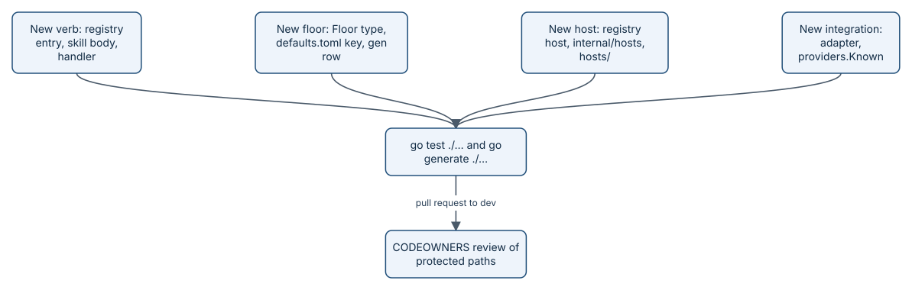

# Extending aayudha

aayudha grows in four ways: a new verb, a new floor, a new host, or a new integration. Each one has a single place
where it is declared, and the rest follows from tests and `go generate ./...`. This page names those places, using
how the existing ones are wired, so a change lands complete and passes CI the first time.



*Declare it once, let the generators and tests do the rest, and expect a human review on protected paths.*

## Before you start

Work in a worktree cut from `origin/dev` and open the pull request to `dev`. Run the same checks CI runs:

```sh
go build ./... && go vet ./... && go test ./... && go generate ./...
golangci-lint run ./...            # the CI `lint` job, config in .golangci.yml
markdownlint-cli2                  # the CI `docs` job, config in .markdownlint-cli2.yaml
```

*From `AGENTS.md`.* Commit the generated files together with their source; the `generate-drift` job fails
otherwise. A new dependency needs its licence in `THIRD_PARTY_NOTICES.md` in the same pull request.

## Add a verb

The verb set is a design decision, not just code. `TestRegistry` pins the list: "32 verbs in plan order". So a new
verb starts with a change to [the build plan](../BUILD-PLAN.md) and the `wantVerbs` list in
`internal/verbs/registry_test.go`. A new plumbing command is lighter: add a `plumb(...)` line to `Plumbing` and
update `wantPlumbing`.

1. **Registry entry.** Add a `Command` to `Verbs` in `internal/verbs/registry.go`. Fill in `Name`, a one-line
   `Summary` of at most 200 characters, `WP`, `Stage`, the Accountable `Seat` (and `Owns` if another seat owns the
   thresholds), `Lane`, `Layers`, typed `Inputs`, `Outputs`, `Gates`, `Surfaces`, `Identity`, `Mode`, and
   `Exposure`. Mark inputs that act as the human with `humanOnly(...)`.
2. **RACI.** Add the verb's Consulted and Informed seats to `RACI` in `internal/verbs/raci.go`. `verbs.LintRACI`
   fails generation without it.
3. **Handler.** Add `internal/cli/<verb>.go` with a `Handler` and register it by name. The CLI builds the cobra
   command, flags, and validation from the registry, so the handler only reads `Values`. Route every external write
   through `internal/actions`. If `Mode` is `direct` or `hybrid`, call models only through `internal/models`, and
   only for a host-independent pass (ground rule 5).
4. **Skill body.** Run `go generate ./...` once. It writes `skills/<verb>/SKILL.md` with the generated frontmatter
   and a placeholder body. Replace the body with what the host's model should do and which `aayu` calls to make.
   Keep it under 500 lines; put detail in `references/`.
5. **Tests.** Add `internal/cli/<verb>_test.go` against the fake GitHub server the other CLI tests use.
   `TestSkillLint` in `embed_test.go` checks that every `aayu` call in the skill names a real command and real flags.
6. **Evals.** For a host-reasoning skill, add cases under `evals/cases/<verb>/<name>/case.toml`. Tier 1 runs in
   `go test` (`TestTier1` in `internal/evals`); add a `[tier2]` section with a rubric so `evals.yml` can judge it on
   a model.

Handler registration looks like this:

```go
func init() { register("ship", runShip) }
```

*From `internal/cli/ship.go`.* The signature is `func(ctx context.Context, e *Env, in Values) error`, declared in
`internal/cli/env.go`. A registry command with no handler appears in `aayu --help` marked "lands in" its work
package and exits with code 2, so you can merge the registry entry before the handler.

`go generate ./...` then writes the README row, the verb map in `docs/guide/when-to-use-what.md`, `docs/RACI.md`,
the seat charters, `AGENTS.md`, and, when `Exposure` is not `never`, `internal/mcp/schemas/<verb>.json`. See
[the verb registry](how-registry.md).

## Add a floor

A floor is a deterministic check with a fixed threshold. No model takes part (ground rule 7). Every floor
implements one interface:

```go
// Floor is one deterministic floor.
type Floor interface {
    Name() string
    // Applies says whether the floor runs on this change; when not, the
    // reason is recorded as a skipped check (e.g. "no-L01").
    Applies(r *Run) (bool, string)
    Run(ctx context.Context, r *Run) (Result, error)
}
```

*From `internal/verify/verify.go` (tabs shown as spaces).*

1. **Type.** Write the floor in `internal/verify`, as `Secrets` in `internal/verify/scanners.go` does: check the
   tool exists with `r.need`, record its version, run it through `r.Sandbox.Run` (a scrubbed child environment),
   parse the output, and fill `proof.Check` with the tool, version, value, and threshold. A missing tool or an error
   makes the floor `blocked`, never a pass.
2. **Order.** Add it to `Standard()` in `internal/verify/scanners.go`, the list `verify` runs in order.
3. **Threshold.** Add a field to `config.Floors` in `internal/config/config.go`, and its default under
   `[verify.floors.<name>]` in `internal/config/defaults.toml`.
4. **Documentation row.** Add a row with the key, its meaning, and its source to the Floors section in
   `internal/config/gen/main.go`. Without it `go generate` fails, so `CONSTRAINTS.md` cannot omit a default.
   Regenerating also updates `internal/config/schema.json`.
5. **CI tools.** If the floor needs a new tool, pin its version and SHA-256 in the merge gate. There are two copies:
   `.github/workflows/aayudha-merge-gate.yml` for this repository and `internal/initrepo/aayudha-merge-gate.yml`,
   the template `aayu init --gates` installs.
6. **Tests.** Follow `TestCoverageFloorBoundary` and `TestScannerFloorsFindings` in
   `internal/verify/verify_test.go`: a value just inside the threshold passes and one just outside fails.

```toml
[verify.floors.secrets]
max_findings = 0
```

*From `internal/config/defaults.toml`.* See [floors](how-floors.md).

## Add a host

Hosts are registry data plus an adapter.

1. **Registry.** Add a `HostID` constant and an entry to `Hosts` in `internal/verbs/registry.go`, with `Excludes`
   for model families it cannot run. `TestRegistry` then requires a default for every lane on the new host, so add
   one to each `Lanes` entry.
2. **Adapter.** In `internal/hosts/install.go`, set where the host reads skills (`SkillDir`), and extend
   `hostFiles` to register the MCP server (`"command": <aayu>, "args": ["mcp"]`) and the two hooks, `session-start`
   and `pre-tool`. Every hook command comes from `HookCommand`, and the `ourHook` pattern lists the host IDs it
   recognises. In `internal/hosts/hook.go`, give `Deny` and `RunHook` the host's output format; Cursor, for
   example, wants JSON with a `permission` field.
3. **Templates.** A whole-file template, like the Amp plugin `hosts/amp/aayudha.ts`, goes in `hosts/<host>/`, which
   `embed.go` embeds. JSON settings are merged into what is already there instead.
4. **Detection.** Add the environment variable the host sets to `hostEnv` in `internal/doctor/checks.go`.
5. **Loops.** `internal/loops` renders loops for Amp (JSON), Cursor (a Terraform file), and a GitHub Actions
   fallback, and Claude Code gets none; decide what the new host gets.
6. **Tests and docs.** Add a golden tree under `internal/hosts/testdata/golden` (`TestGoldenTrees`), extend
   `TestHooks`, and update the host tables in `hosts/README.md` and `docs/getting-started.md`.

## Add an integration

Integrations are read-only adapters to outside services, used for baselines, design references, and `measure`.

1. **Adapter.** Add `internal/integrations/<name>` with a constructor and a client that implements `Scope` (the
   reachability and key-scope check `doctor` runs), plus `Baseline` or `Export` if it serves those. Wrap its HTTP
   transport in `integrations.ReadOnly`, which keeps every adapter read-only.
2. **Catalog.** Add a `Provider` to `Known` in `internal/integrations/providers/providers.go`, with `Need` listing
   the `[integrations.<name>]` fields it requires.
3. **Config.** Values live in `[integrations.<name>]` (`config.Integration`). They name secrets, never hold them,
   and `scope = "write"` is refused before any call.
4. **Init.** To offer it in `aayu init --integrations`, add an `Integration` with its cost and scope to
   `Integrations` in `internal/initrepo/extras.go`.
5. **Tests.** Replay recorded fixtures through `Deps.Transport`, as `TestBaselinesGolden` does.

```go
{
    Name: "posthog", Purpose: "product analytics baselines", Need: posthog.Need,
    open: func(d Deps, c integrations.Conn) (scoper, error) { return posthog.New(c, d.Transport, d.now) },
},
```

*From `internal/integrations/providers/providers.go`.*

## Protected paths

`.github/CODEOWNERS` lists the paths that need a human CODEOWNER review. The `protected-paths` check fails by design
when a pull request touches one without that review.

```text
/.github/                @rahulnakmol
/skills/                 @rahulnakmol
/ops/                    @rahulnakmol
/seats/                  @rahulnakmol
/CONSTRAINTS.md          @rahulnakmol
/internal/config/defaults.toml  @rahulnakmol
/.aayudha/config.toml    @rahulnakmol
/.agents/                @rahulnakmol
/.claude/                @rahulnakmol
```

*From `.github/CODEOWNERS`.* So a new verb (its `skills/` body), a new floor (`defaults.toml`, `CONSTRAINTS.md`,
the workflow), and a new host whose files land in `.agents/` or `.claude/` all need a human review. A new
integration needs one when it touches `.aayudha/config.toml` or a workflow.

> **Honest status:** this repository runs in solo mode (one human). A protected-path pull request merges only
> through the founder's recorded admin bypass, after a PR comment starting `Solo-mode bypass:`, and only when every
> other check is green.

## Invariants

1. A registry change keeps its RACI complete. Enforced by `verbs.LintRACI` in `internal/verbs/raci.go`
   (`TestLintRACI`).
2. Every lane has a default on every host, and every verb has a valid stage, lane, and surfaces. Enforced in
   `internal/verbs/registry_test.go` (`TestRegistry`).
3. Skills call only real commands and flags. Enforced by `internal/skills.Lint` (`TestSkillLint` in `embed_test.go`).
4. Every config default has a documented row. Enforced by `internal/config/gen/main.go`, run by `generate-drift`.
5. A floor that cannot run is blocked, never passed. Enforced by `verify.Execute` in `internal/verify/verify.go`.
6. Adapters cannot write. Enforced in `internal/integrations` (`TestReadOnlyTransport`) and
   `internal/integrations/providers` (`TestWriteScopedKeyRefusedBeforeAnyCall`).
7. Protected paths get a human review. Enforced by `.github/workflows/protected-paths.yml` against
   `.github/CODEOWNERS`.

## Where it lives in the code

- [internal/verbs/registry.go](../../internal/verbs/registry.go) and [internal/verbs/raci.go](../../internal/verbs/raci.go)
- [internal/cli](../../internal/cli)
- [skills](../../skills) and [evals](../../evals)
- [internal/verify](../../internal/verify)
- [internal/config/defaults.toml](../../internal/config/defaults.toml) and [internal/config/gen](../../internal/config/gen)
- [internal/hosts](../../internal/hosts) and [hosts](../../hosts)
- [internal/integrations](../../internal/integrations)
- [internal/initrepo/extras.go](../../internal/initrepo/extras.go)
- [.github/CODEOWNERS](../../.github/CODEOWNERS)

## Read next

- [The verb registry and code generation](how-registry.md)
- [Floors](how-floors.md)
