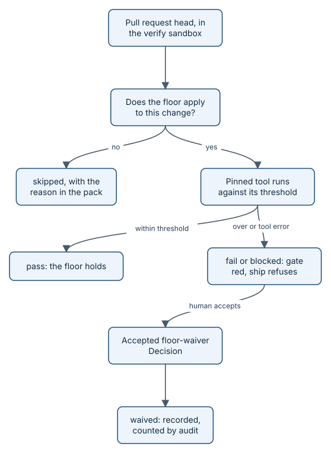

# Floors in detail

A floor is a deterministic check with a fixed threshold that `aayu verify` runs on a commit: a pinned tool, a
number, and a comparison. No model is involved, and no model can overrule the result. Floors exist so the most
common ways fast code goes wrong (untested lines, injection bugs, leaked keys, vulnerable dependencies, inaccessible
screens) are caught by machines that cannot be talked out of it. This page lists every floor, its tool, its
threshold, when it runs, and what a miss does.



*A miss is a number over a threshold, or a tool that could not run. Neither one is ever a pass.*

## How it works

`verify.Standard()` runs ten floors in a fixed order: coverage, sast, secrets, deps, a11y, perf, screen-reader,
dast, api, mobile. Each floor answers two questions:

1. **Does it apply?** `Applies` looks at the change's footprint (the layers its changed paths fall in), the Ready
   snapshot's criteria kinds, and the configuration. If not, the pack records `skipped` with the reason, such as
   `skipped: no screenshot or recording criteria`.
2. **Does it hold?** The tool runs in the verify sandbox (scrubbed environment, no network when the tool does not need
   it; see [the merge gate](how-merge-gate.md)), and its output is compared with the threshold from
   `[verify.floors]`.

A check ends in one of five results: `pass`, `fail` (over the threshold), `blocked` (the tool is missing, errored, or
refused to produce evidence), `skipped`, or `waived`. A missing tool is `blocked`, never a silent pass.

The a11y floor's one browser run also produces five more checks: `keyboard`, `reduced-motion`, `text-scale`,
`targets`, and `redaction`. Each is a separate row in the pack.

### Every floor

Thresholds are the keys under `[verify.floors]` (and `[verify]`) with their defaults from
`internal/config/defaults.toml`, also listed in [CONSTRAINTS.md](../../CONSTRAINTS.md).

| Floor | Tool and pinned version | Threshold key: default | Runs when |
|---|---|---|---|
| coverage | aayudha diff coverage over `go test -coverprofile` (or your command's lcov or Cobertura report); Go 1.25.x in CI | `coverage.min_diff_percent`: 90.0 | Always |
| sast | semgrep 1.180.0, language rule packs such as `p/golang`; a scan that leaves a file unanalysed (a syntax error, timeout, or out of memory) is blocked | `sast.max_critical`: 0, `sast.max_high`: 0 | Always |
| secrets | gitleaks 8.30.1 (SHA-256 checked), commits from base to head, `--redact` | `secrets.max_findings`: 0 | Always |
| deps | osv-scanner 2.6.0 (SHA-256 checked), every lockfile git tracks | `deps.max_critical`: 0, `deps.max_high`: 0 | Always |
| a11y | Playwright 1.64.0 and axe-core 4.14.0, tags WCAG 2.0 to 2.2 A and AA | `a11y.standard`: "WCAG 2.2 AA", `a11y.max_critical`: 0, `a11y.max_serious`: 0 | A web target URL and screenshot or recording criteria |
| keyboard | Playwright: every control reachable by Tab | `a11y.keyboard_only`: true | With a11y |
| reduced-motion | Playwright: no animation with `prefers-reduced-motion` | `a11y.reduced_motion`: true | With a11y |
| text-scale | Playwright: no clipped text at the scale | `a11y.text_scale_percent`: 200 | With a11y |
| targets | Playwright: no target under the size | `a11y.min_target_px`: 44 | With a11y |
| redaction | aayudha PII scan of the DOM, plus tesseract OCR when installed | None: any personal data blocks | With a11y |
| perf | Lighthouse 13.5.0 on each state URL | `perf.min_score`, `max_lcp_ms`, `max_cls`, `max_tbt_ms`: no default | Budgets set, plus the a11y conditions |
| screen-reader | Guidepup 0.35.0 with VoiceOver or NVDA | `screen_reader.layers`: ["L01"], `screen_reader.max_missing_phrases`: 0 | L01 in the footprint, sr-transcript criteria, a macOS or Windows runner; in CI only with the `aayudha:screen-reader` label or nightly |
| dast | OWASP ZAP stable 2.17.0, image pinned by digest, under Docker or else Podman | `[verify] dast`: true, `dast.max_high`: 0, `dast.skipped_blocks_ship`: true | web or api in `[verify] platforms` (otherwise `n/a`) |
| api | k6, running your script's thresholds | `api.script`: empty | A script is set |
| mobile | None yet | `mobile.skipped_blocks_ship`: true | ios or android in `[verify] platforms` |

The Playwright, axe-core, Lighthouse, and Guidepup versions are pinned in
[packages/floors/package.json](../../packages/floors/package.json) and `pnpm-lock.yaml`. The semgrep, gitleaks, and
osv-scanner versions and hashes are pinned in the merge-gate workflow. Each check records the version that actually
ran, so the pack shows drift.

A few details matter in practice:

- **Coverage** counts only changed executable lines. It compares in integers so 89.9 % never rounds up to 90 %, and
  a failing test command fails the floor whatever the percentage.
- **Web target.** The a11y and perf floors capture the URL of `[verify.environments.<env>]`, where `<env>` is
  `AAYU_ENV` (default `local`). `verify` refuses a production target before it seeds or captures anything.
- **Redaction** runs first. If a capture holds personal data, the pack is blocked and no capture is kept.
- **DAST** (Decision #485) runs a spider and the passive rules, plus the active cross-site scripting and injection
  rules only against an app `[verify] seed` started in this run on a loopback host. Any other URL gets a passive
  scan, which cannot see a reflected XSS, unless its `[verify.environments.<env>]` sets `active_scan = true`; only
  `.aayudha/config.toml` can set that. A CLI or library is `n/a`. A web or api story with no target records a
  `skipped: dast: no runnable target` that blocks `ship` like the mobile skip, and names the fix: a `[verify] seed`
  and a `[verify.environments.local] url`, or a waiver. ZAP runs under Docker, or Podman (rootless too) when there is
  no Docker. With neither, a local run skips and leaves the scan to CI; in CI it is `blocked`. A high-risk alert is
  advisory until `[verify] new_floors_blocking_from` (2026-11-14), then it fails. `aayu doctor` shows the target,
  the scan mode, and the runtime.

### What a miss does

A `fail` or `blocked` check makes `FloorsHold()` false. Then:

- `verify` exits 3 (floor miss), so the `aayudha/merge-gate` check is red;
- `inspect` cannot return `merge`: `Enforce` turns it into `fix`;
- `ship` refuses: it requires `FloorsHold()` on the authoritative pack.

This is ground rule 7 of the [build plan](../BUILD-PLAN.md): deterministic checks beat model judgement, and no model
disposition can override a floor miss.

### Waivers

Sometimes a team must ship with a miss. The only way is a recorded human decision:

1. `aayu decide <story> --waiver <floor>` files a floor-waiver Decision: a sub-issue of the story, labelled
   `decision:waiver`, not reversible. Any of the floors except `redaction` can be named; personal data in a capture
   is never waivable.
2. A human accepts it with `aayu decide <decision> --accept waive`. This is refused for agents and bot identities.
3. On the next run, `verify` looks for accepted waivers under the story: closed as completed, by a non-bot, with
   `waive, accepted by @<login>` in the Decision section, linking `waives` the story and naming the floor. It turns
   the matching check into `waived` and stores the Decision number in the check's `waiver` field.
   When the floor-waiver authority resolves to a login (`[decisions.authority]`, a seat's paired human, or
   `[autonomy] approver`), that login must have closed the Decision and be the one it names; `verify` lists any other
   closed waiver as `waiver ignored`, with the authority it lacked. With no login configured, any person's acceptance
   counts. The coverage ratchet and its eval-bar check apply the same rule to their waivers.

A filed but unaccepted waiver waives nothing. `ship` copies every waiver into its ship record, and `aayu audit` counts
waivers and lists them per pack in its "Floors and waivers" table.

### The mobile rule

The mobile floor has nothing to run yet: native UI test runners (XCUITest, Espresso) are planned, not built. A story
on a mobile platform records `skipped: mobile`. With `mobile.skipped_blocks_ship = true` (the default), that skip
blocks `ship` like a miss until a waiver is accepted. Setting it to `false` records a non-blocking skip instead.

> **Honest status:** the merge gate runs on Linux, so the screen-reader floor is always skipped in gate packs. This
> repository runs it in a separate `screen-reader` workflow on macOS and Windows runners, which is not a required
> check. The gate template installs only semgrep, gitleaks, and osv-scanner; a product that sets an api script
> must provide k6, or that floor is `blocked`. GitHub's Linux runners have Docker, which the dast floor uses. tesseract is not installed in this
> repository's gate, so redaction scans the DOM only.

## Key data and file formats

The floor defaults, from [internal/config/defaults.toml](../../internal/config/defaults.toml):

```toml
# Floors run by `verify` (rule 7: no model disposition can override a floor miss).
[verify]
# DAST on by default for web and api platforms (Decision #485): active rules only against an app verify starts itself.
dast = true

[verify.floors.coverage]
min_diff_percent = 90.0

[verify.floors.sast]
max_critical = 0
max_high = 0

[verify.floors.secrets]
max_findings = 0

[verify.floors.deps]
max_critical = 0
max_high = 0

[verify.floors.a11y]
standard = "WCAG 2.2 AA"
max_critical = 0
max_serious = 0
keyboard_only = true
reduced_motion = true
text_scale_percent = 200
min_target_px = 44

[verify.floors.screen_reader]
layers = ["L01"]
max_missing_phrases = 0

[verify.floors.dast]
max_high = 0
skipped_blocks_ship = true

[verify.floors.mobile]
skipped_blocks_ship = true
```

This repository sets its own perf budget in `.aayudha/config.toml`:

```toml
[verify.floors.perf]
min_score = 0.9
max_lcp_ms = 2500
max_cls = 0.1
max_tbt_ms = 200
```

The `checks` array of story 134 (the Ask page), from
`git show origin/ledger:proof/134/8e01a42142d028066c3026ca9201bb640b0e6914/authoritative/pack.json`, trimmed:

```json
  "checks": [
    {
      "floor": "coverage",
      "result": "pass",
      "value": 92.4,
      "threshold": 90,
      "tool": "aayudha diff coverage (go test -coverprofile)",
      "version": "go1.25.14",
      "detail": "86 of 93 changed executable lines covered (go coverprofile)",
      "network": "isolated"
    },
    …
    {
      "floor": "a11y",
      "result": "pass",
      "value": 0,
      "threshold": 0,
      "tool": "playwright + axe-core",
      "version": "playwright 1.64.0, axe-core 4.14.0",
      "detail": "WCAG 2.2 AA: 0 critical, 0 serious",
      "network": "allowed"
    },
    …
    {
      "floor": "targets",
      "result": "pass",
      "value": 0,
      "threshold": 44,
      "tool": "playwright",
      "version": "1.64.0",
      "detail": "targets under 44x44 px: none",
      "network": "allowed"
    },
    {
      "floor": "redaction",
      "result": "pass",
      "value": 0,
      "threshold": 0,
      "tool": "aayudha PII scan",
      "version": "1",
      "detail": "DOM scan; OCR unavailable (tesseract not installed)"
    },
    {
      "floor": "perf",
      "result": "pass",
      "value": 100,
      "threshold": 90,
      "tool": "lighthouse",
      "version": "13.5.0",
      "detail": "3 URL(s) within budget",
      "network": "allowed"
    },
    {
      "floor": "screen-reader",
      "result": "skipped",
      "value": 0,
      "threshold": 0,
      "tool": "aayudha",
      "version": "-",
      "detail": "skipped: no sr-transcript criteria"
    },
    …
    {
      "floor": "mobile",
      "result": "skipped",
      "value": 0,
      "threshold": 0,
      "tool": "aayudha",
      "version": "-",
      "detail": "skipped: no ios or android in [verify] platforms"
    }
  ],
```

The full array has 15 checks: the four always-on floors, a11y and its five sub-checks, perf, and four skipped floors.

## Invariants

1. A floor whose tool is missing or errors is `blocked`, never `pass`. Enforced by `Execute` in
   [internal/verify/verify.go](../../internal/verify/verify.go), `TestScannerFloorsFindings`.
2. Coverage never rounds up: 89.9 % fails a 90 % floor. Enforced in
   [internal/verify/coverage.go](../../internal/verify/coverage.go), `TestDiffCoverageBoundary` and
   `TestCoverageFloorBoundary`.
3. Scanner findings over the threshold fail the floor. Enforced in
   [internal/verify/scanners.go](../../internal/verify/scanners.go), `TestScannerFloorsFindings` and (with the
   real tools) `TestFloorsWithRealTools`.
4. Personal data in a capture blocks the pack and no capture is kept. Enforced in
   [internal/verify/web.go](../../internal/verify/web.go), `TestWebFloorsWithBrowser`.
5. A failed, blocked, or blocking-skipped floor never holds, and no model disposition changes that. Enforced by
   `FloorsHold` in [internal/proof/pack.go](../../internal/proof/pack.go) and `Enforce` in
   [internal/inspect/inspect.go](../../internal/inspect/inspect.go), `TestVerifyDetects` and
   `TestInspectDispositions`.
6. Captures never run against production. Enforced by `ResolveTarget` in
   [internal/verify/web.go](../../internal/verify/web.go), `TestVerifyRefusesProduction`.
7. Only an accepted floor-waiver Decision waives a floor; `skipped: mobile` blocks until one exists; redaction is
   never waivable. Enforced in [internal/verify/mobile.go](../../internal/verify/mobile.go),
   [internal/cli/verify.go](../../internal/cli/verify.go), and [internal/cli/decide.go](../../internal/cli/decide.go),
   `TestVerifyMobileSkipAndWaiver` and `TestDecideWaiver`.

## Where it lives in the code

- [internal/verify](../../internal/verify): every floor (`coverage.go`, `scanners.go`, `web.go`, `sr.go`,
  `dast.go`, `mobile.go`) and the sandbox.
- [internal/config/defaults.toml](../../internal/config/defaults.toml): thresholds and defaults.
- [internal/config/config.go](../../internal/config/config.go): the `Floors` configuration type.
- [packages/floors/package.json](../../packages/floors/package.json): pinned browser and screen-reader tools.
- [internal/decide](../../internal/decide) and [internal/cli/decide.go](../../internal/cli/decide.go): waivers.
- [internal/audit](../../internal/audit): the waiver count.

## Read next

- [Proof packs](how-proof-packs.md): where the checks are recorded.
- [Floors](concepts-floors.md): the friendly version of this page.
