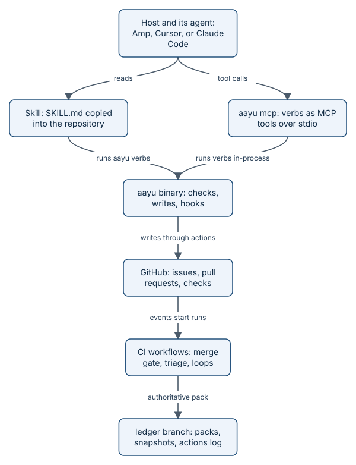

# How it works

This track is for engineers. [The story](journey.md) shows what aayudha does on a real day; these pages show exactly
how: the parts, the file formats, the guarantees, and where each one is enforced in the code. Every page has a
diagram, real excerpts from this repository, a list of invariants, and links into the source.

*The whole system on one page. [Architecture](how-architecture.md) walks through it.*

## Start with the shape

| Page | What you will learn |
|---|---|
| [Architecture](how-architecture.md) | One static binary, four hosts, four surfaces per verb, which steps your agent's model reasons in versus the binary's own model calls, and the vagueness gate |
| [The verb registry and code generation](how-registry.md) | How 32 verbs are declared once, what `go generate` builds from them, and how CI catches drift |

## Who may do what

| Page | What you will learn |
|---|---|
| [Trust model and identities](how-trust.md) | Humans, the bot App, CI, and untrusted input; the human pass; solo mode; the token broker |
| [The ledger branch](how-ledger.md) | Where Ready snapshots, plans, proof, ship records, and logs live, who writes them, and how writes stay consistent |
| [Configuration, secrets, and the audit trail](how-config-and-audit.md) | Config layers, secret backends, the hash-chained actions log, and how `audit` reconciles it with GitHub |

## Proof

| Page | What you will learn |
|---|---|
| [Proof packs](how-proof-packs.md) | The `pack.json` format, how promises map to evidence, and advisory versus authoritative packs |
| [The merge gate](how-merge-gate.md) | Why the gate runs from the base branch, the sandbox `verify` runs in, and inspect's structured verdict and fix cycle |
| [Floors in detail](how-floors.md) | Every floor, its tool and pinned version, its threshold, when it is skipped, and how waivers work |
| [Verify skills, feature maps, and behaviour checks](how-verify-maps.md) | The feature map format, the drift check, how behaviour checks run with no model, the maintain hand-off, and red-on-base proof for Bugs |

## Models and quality of the agents

| Page | What you will learn |
|---|---|
| [The model gateway and lanes](how-models.md) | Lanes and their default models, the different-vendor rule for reviewers, wire formats, cost accounting, budgets, and the breaker |
| [The eval harness](how-evals.md) | How skills are tested: tiers, groups, pass^k, judges, baselines, and the gates that use them; retro's flow numbers, evolve's rules, and the coverage ratchet |
| [Hand-offs, agent environments, and loops](how-agents.md) | Handing a story to another agent's cloud, the environment it builds in, and scheduled and event loops on each host |

## Shipping it safely

| Page | What you will learn |
|---|---|
| [Releases and the supply chain](how-releases.md) | The promotion gates, goreleaser, cosign signatures, provenance, and what `install.sh` checks |
| [Security and the threat model](how-security.md) | The threats aayudha is built against, the control for each, and the kill switch |
| [Extending aayudha](how-extending.md) | Adding a verb, a floor, a host, or an integration, and which paths need a human review |

> **Honest status:** these pages describe the code as it is today, including the parts that wait on setup in this
> repository: no bot App installed, no package-manager publishing yet, and one human, so solo mode applies. Each page says where.

## Read next

Start with [Architecture](how-architecture.md). If you would rather see it all happen first, read
[the story](journey.md).
