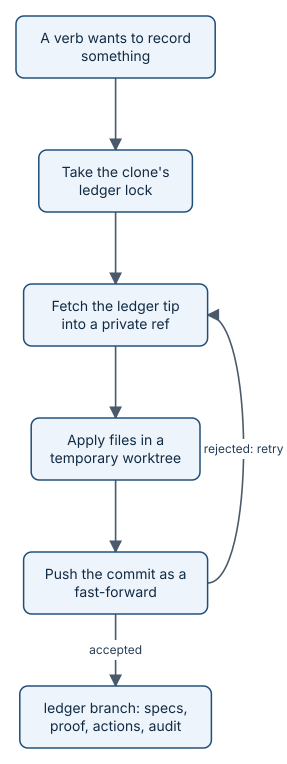

# The ledger branch

The ledger is an orphan branch named `ledger` in the product's own repository. It holds records: Ready snapshots,
plans, proof packs, ship records, build state, actions segments, audit reports, and release records. It never holds
code and is never merged. This page explains why it is a branch, what is on it, who writes it, and how many writers
share it without losing a record.



*One write is one commit. A writer that loses the race fetches the new tip, re-applies its change, and tries again.*

## Why a branch in the same repository

- **The records travel with the repository.** Fork it, mirror it, or move it to another host and the evidence comes
  along. There is no database to run and no service to keep alive.
- **Git already gives integrity.** Every record is content-addressed by Git, every change is a commit with an author
  and time, and history cannot be rewritten without a force push, which the ruleset forbids.
- **It stays apart from the product.** An orphan branch shares no history with `dev`, `rolling`, or `main`, so a
  record never shows up in a code diff, a release, or a merge.
- **GitHub permissions apply.** A repository ruleset decides who may push it, the same way rulesets guard `main`.

`git` and `git-lfs` are required for ledger work: the Go Git library has no support for linked worktrees or LFS.

## Layout

The real layout today, from `git ls-tree -r --name-only origin/ledger`, grouped:

| Path | Contents | Written by |
|---|---|---|
| `specs/<n>/ready.md` | Ready snapshot: the body and Completion Goal hashes at Ready | `aayu ready` |
| `specs/<n>/plan.json` | The story's plan: footprint, checkpoints, plan-time review or bypass | `aayu plan` |
| `proof/<story>/<sha>/<authority>/pack.json` | A proof pack for one head commit; `<authority>` is `authoritative` or `advisory` | the merge gate in CI, or `aayu proof push` |
| `proof/<story>/<sha>/<authority>/artifacts/…` | Evidence, coverage, and floor reports the pack hashes | same as the pack |
| `proof/<story>/<sha>/authoritative/ship.json` | The ship record: merge commit, human pass, streak | `aayu ship` |
| `build/<n>/state.json` | Where `aayu build` is in a story | `aayu build` |
| `actions/<date>/<host>-<run>.jsonl` | Actions segments: the hash-chained write log | every verb that writes |
| `audit/<date>/` | Audit reports and their GitHub input snapshots | `aayu audit` |
| `retro/` | Retro reports and `retro/incidents.jsonl` | `aayu retro`, `aayu respond` |
| `releases/<n>/<target>.json` | One promotion: commits, gate runs, artifacts, stories released | `aayu release` |
| `measure/due/<n>/<tag>.json` | When a Goal or Initiative is due to be measured | `aayu release` |
| `tell/release/<tag>.json` and `.md` | Release notes and their sources | `aayu tell` |

Helpers such as `ready.LedgerPath`, `proof.Dir`, and `actions.Log.SegmentPath` build these paths. This repository's
ledger has no `retro/` directory yet, because no retro has run here.

## How a write works

Every write goes through `ledger.Writer.Write` in [internal/ledger/ledger.go](../../internal/ledger/ledger.go). A
`Commit` carries whole files to replace, bytes to append, and paths to delete. The writer:

1. Checks every path is clean and relative.
2. Takes a lock file, `aayudha-ledger.lock`, in the clone's shared Git directory, so two processes on one machine,
   even in different worktrees, never race. A lock older than 10 minutes is taken over, since its holder died.
3. Fetches the remote ledger tip into a private ref, `refs/aayudha/ledger-tip/<random>`.
4. Checks out that tip in a temporary linked worktree, outside the user's checkout, and applies the change.
5. If nothing changed, returns the tip and pushes nothing. Otherwise it commits, adding an `Aayudha-Identity:` trailer
   when the writer carries a tag such as `identity:human-fallback`.
6. Pushes the new commit to `refs/heads/ledger` as a plain push. With LFS enabled, it pushes LFS objects first.

The push is the compare-and-swap. It succeeds only as a fast-forward of the tip it was built on. If another writer got
there first, Git rejects it, and the writer fetches the new tip, resets the worktree, re-applies the same change, and
pushes again. It tries up to 10 times, waiting 100 ms doubling each time, with jitter, capped at 5 seconds, then fails
with `ErrContended`. A ruleset refusal is a different error and is not retried.

Two design choices make retries safe:

- **Appends, not rewrites, for logs.** Actions segments and `retro/incidents.jsonl` use `Commit.Append`, so a retry
  adds its lines to whatever is at the new tip.
- **One path per fact.** Packs live under their story, head commit, and authority. Two writers almost never touch the
  same file, and `ledger.ContentPath` gives content-addressed names where two writers might.

Two builders on one story are kept apart by a **lease** on GitHub, not on the ledger: `aayu build` sets the story's
assignee and a lock comment with an expiry four hours out (`LeaseTTL` in `internal/cli/lease.go`), `aayu gc` reclaims
expired leases, and `aayu ship` releases it.

Every ledger push is itself an action (`ledger.push`) in the actions log, with the paths and message, except the push
of an actions segment, which carries the log itself.

## Key data

The ledger's own README, from `git show origin/ledger:README.md`, trimmed:

```text
# `ledger` branch

This orphan branch holds aayudha's own proof record for this repository. It
shares no history with `dev`, `rolling` or `main` and is never merged into them.
…
## Who writes here

Only CI and the bot identity write to this branch (see BUILD-PLAN.md §0.1,
Trust model). The bot identity does not exist until WP1.4. Until then, under the
WP0.1 day-one rule, the founder's identity may also push here. The `ledger-writers`
ruleset enforces this. `init --identity` tightens it once the bot exists.

## No media in LFS

This repository is public, so proof media never goes into Git LFS on this
branch (decision V3). LFS objects cannot be purged from GitHub, and recordings
and transcripts can contain PII. Git holds `pack.json` and hashes only. Media
lives in the private bucket configured as `[proof] media`.
```

A Ready snapshot, from `git show origin/ledger:specs/131/ready.md`, trimmed:

```text
# rahulnakmol/agentic-ayudha#131: Answers quote the best plan passage; policy refuses or refers the rest

### Ready snapshot

| | |
|---|---|
| Schema | work items v1, story |
| Body hash | `8cb726034148c5b09e52e62608a4e051745005556e9fd7c7ab7fea94bd1a02dc` |
| Completion Goal hash | `e6e99c0c0e6aa4c1d6044a1ae26d91d9df3530e0a18d9d0b5883bd0d796e28cb` |
| Technical Owner | the Code Architect twin |
| Written by | rahulnakmol (`identity:human-fallback`) |
| Ledger | `specs/131/ready.md` |
…
Editing the body after Ready removes `status:ready` (Ready guard); run `aayu ready` again to re-snapshot.
```

A release record, from `git show origin/ledger:releases/144/rolling.json`, trimmed:

```json
{
  "repo": "rahulnakmol/agentic-ayudha",
  "release": 144,
  "source": "dev",
  "target": "rolling",
  "source_sha": "a631247bd29c6e3252bd82a9d4a07f796f594448",
  "commit": "9991cd392d282692aa9f5309d67ecc5c3362627a",
  "message": "Rolling snapshot: 20261012T1447Z",
  "tag": "rolling-2026-10-12.4",
  "candidate": "promote/rolling-20261012T1447Z",
  …
  "stories_released": [
    132,
    133,
    134
  ],
  "already_released": [
    130,
    131
  ],
  "release_notes": "tell/release/rolling-2026-10-12.4.md",
  …
  "promoted_by": "rahulnakmol",
  "promoted_at": "2026-10-12T14:47:06Z"
}
```

## Who may write

`aayu init` makes sure a ruleset protects `refs/heads/ledger` with the `deletion`, `non_fast_forward`, and `update`
rules. It adopts an existing ruleset that already does this, or creates one named `aayudha-ledger`. On day one the only
bypass actor is the repository admin role. `aayu init --identity` creates the bot GitHub App and makes it the bypass
actor in place of the admin role. From then on only the App's installation tokens can push the ledger: the merge gate
in CI with the App token, and agent lanes with broker tokens. Today `aayu ship` writes the ship record, and lands CI's
pack, with the human's own token, which the admin-role bypass allows.

Why not the built-in Actions token? On a personal repository the GitHub Actions app cannot be a ruleset bypass actor,
so `GITHUB_TOKEN` can never write the ledger. See [trust model and identities](how-trust.md).

## Retention and purge

Pack JSON and hashes stay forever. Media (screenshots, recordings, screen-reader transcripts) does not:

- **Private repositories:** media goes to Git LFS on the ledger.
- **Public repositories:** media goes to the private bucket named by `[proof] media`. `aayu proof push` refuses media
  on a public repository, or one whose visibility is unknown, until a bucket is set. LFS objects cannot be deleted from
  GitHub short of deleting the repository, and media can contain personal data.

`[proof] retention_days` defaults to 90. `aayu proof purge` deletes media in packs older than that;
`aayu proof purge <story>` deletes all of one story's media now. Bucket objects are deleted, LFS files are removed from the ledger tip,
and each `pack.json` is rewritten so the artifact carries a tombstone (`purged_at`, `reason`) while its SHA-256 stays.
`aayu proof verify` does not try to open a tombstoned artifact. A bucket's own lifecycle rule can expire objects too (`EnsureLifecycle` in `internal/proof/bucket.go`).

## Invariants

1. A ledger write never overwrites another writer's commit: pushes are fast-forward only, and a lost race re-applies on
   the new tip. Enforced in `internal/ledger/ledger.go` (`TestConcurrentWritersAllLand`, `TestLiveConcurrentWriters`)
   and by the ruleset's `non_fast_forward` rule.
2. A write that changes nothing pushes nothing, and `--dry-run` writes nothing. Enforced in `internal/ledger/ledger.go`
   (`TestNoopDryRunAndErrors`).
3. Actions segments are appended, never replaced. Enforced in `ledger.Sink` (`TestSink`).
4. The ledger cannot be deleted or force-pushed, and only the bypass actor can update it. Enforced by the ruleset that
   `internal/initrepo/init.go` creates or adopts (`TestInitAdoptsLedgerAndUninit`).
5. Proof media never goes to LFS on a public repository, and a purge keeps every hash. Enforced in
   `internal/proof/ledger.go` (`TestPublicRepoRefusesMedia`, `TestPrivateRepoMediaInLFS`, `TestPushVerifyPurgeBucket`).
6. Tokens never appear on a Git command line: the writer passes them as an HTTP header through `GIT_CONFIG_*`
   environment variables, in a scrubbed environment. Enforced in `Writer.git` in `internal/ledger/ledger.go`.

## Where it lives in the code

- [internal/ledger/ledger.go](../../internal/ledger/ledger.go): the writer, reads of the tip, and the actions sink.
- [internal/proof/ledger.go](../../internal/proof/ledger.go): pack push, best pack, and purge.
- [internal/cli/lease.go](../../internal/cli/lease.go): story leases.
- [internal/cli/release.go](../../internal/cli/release.go): release records.
- [internal/initrepo/init.go](../../internal/initrepo/init.go) and
  [internal/initrepo/extras.go](../../internal/initrepo/extras.go): the ledger branch, its ruleset, and the App bypass.

> **Honest status:** no bot GitHub App is installed on this repository yet, so its ruleset, `ledger-writers`, still
> lists the repository admin role as the only bypass actor. CI cannot write the ledger: the merge gate leaves the
> authoritative pack as a run artifact, and `aayu ship` lands it under the founder's identity, saying so in
> `pack_landed`. 91 ledger commits so far carry the `identity:human-fallback` trailer. The ledger README predates the
> current layout: its table still names `packs/`, where the code writes `proof/`. No verb writes that file (it was
> written by hand when the branch was created), so it is left as it is and this page describes the real layout. This repository is public and
> `[proof] media` is empty, so no media has been pushed here. No workflow runs `aayu proof purge` on a schedule yet; a
> human runs it.

## Read next

- [Proof packs](how-proof-packs.md): what is inside `pack.json`.
- [Configuration, secrets, and the audit trail](how-config-and-audit.md): how actions segments are reconciled.
