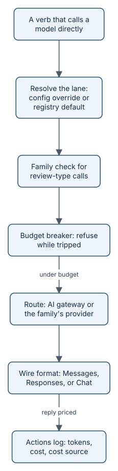

# The model gateway and lanes

Every verb that needs judgement runs in a **lane**: a named class of model work, such as `build` or `review`, with a
settled default model for each host. Most of the time the host's own model does the reasoning inside a skill. A few
verbs call a model directly from the `aayu` binary, and those calls go through one **model gateway**: it picks the
model, keeps the reviewer in a different model family from the builder, speaks the provider's wire format, prices every
reply, and stops all agent lanes when spend reaches the budget.



*Each priced reply adds to the breaker's count, so the call that reaches the limit is the last one.*

## Lanes and their defaults

The registry in `internal/verbs/registry.go` declares six lanes. Each verb names exactly one lane, and each lane has a
default for each host. The table shows Amp, Cursor, and Claude Code; `aayu models show` lists every host, OpenAI Codex
included.

| Lane | What it does | Amp | Cursor | Claude Code |
|---|---|---|---|---|
| `build` | Writes code and artifacts | Amp medium | Claude Opus 5.5 | Claude Opus 5.5 |
| `spec` | Specs, decisions, briefs, copy | Amp medium | Claude Opus 5.5 | Claude Opus 5.5 |
| `plan` | Slices and plans work | Amp medium | Claude Opus 5.5 | Claude Opus 5.5 |
| `review` | Adversarial code and spec review | GPT-6.1 Sol | Grok 4.7 | GPT-6.1 Sol |
| `ui-review` | Visual and interaction critique | Amp high | Gemini 3.1 Pro | Gemini 3.1 Pro |
| `chore` | Cheap mechanical work | Amp low | Haiku 5.5 | Haiku 5.5 |

Three rules shape this table:

- **The family rule.** A reviewer must come from a different model family than the builder. A model that wrote the
  code is a poor judge of it, and two models from the same vendor tend to share blind spots. `review` and `ui-review`
  are marked `Adversarial`, and their defaults are never in the builder's family.
- **Host exclusions.** A host lists the families it cannot run. Cursor excludes the `openai` family, so the `review`
  lane on Cursor defaults to Grok 4.7 (`xai`) instead of GPT-6.1 Sol.
- **Host-managed modes.** On Amp, the default is a mode (Amp low, medium, high) and the host picks the model behind
  it. The binary cannot call a mode, so a direct call from an Amp session uses the Claude Code default for that lane
  (`DirectHost`).

The `review` default also names an escalation: GPT-6 Astra at high reasoning effort, used when a caller marks a
review as heavy. The `ui-review` default on Cursor, Claude Code, and Codex is Gemini 3.8 Flash at high reasoning
effort (`gemini-3.8-flash`, `google` family), so it is never in the family of an anthropic or OpenAI builder. Every
model judgement of a UI goes through this lane: `aayu review`'s lane A, `polish`, which re-runs it, and `aayu verify`'s
advisory look at its screenshots, which never decides whether a floor holds. It is
interim until the AI gateway routes the target, `gemini-4-argon-high`, which needs a paid Google plan.

> **Needs setup:** the ui-review lane needs a model key: the AI gateway's (`[models.gateway]`) or Google's. Without
> one, and in the merge gate, which has no model key, `aayu verify` records `screenshot_review.skipped` with the reason
> instead of findings, and `aayu review` stops. Set the key with `aayu auth set-secret <name>`.

## How `aayu models` resolves a lane

`aayu models` prints the model, family, source, and route for every lane on every host (or only one host with
`--host`). It uses the same resolver as a real call, in `internal/models/resolve.go`:

1. Look up the registry default for the lane and host.
2. If `[models.<lane>.<host>]` exists in config, take its `model`. The family is the `family` key, or it is inferred
   from the model ID prefix (`claude-`, `gpt-`, `gemini-`, `grok-`). An unknown family is a configuration error.
3. If the host excludes that family, fall back to the registry default, set the source to `fallback`, and log one line
   that explains the substitution.
4. For a direct call, if the result is a host-managed mode, resolve the lane again for the direct host (source
   `direct`). A heavy call then swaps in the escalation model, unless config chose the model.

The source column tells you which rule won: `default`, `config`, `fallback`, or `direct`.

## Who calls models from the binary

Ground rule 5 in [the build plan](../BUILD-PLAN.md) says that inside a host, the host's model reasons. The binary calls
a model itself only where the work must not depend on the host:

- `inspect` with `[inspect] reviewer = "model"` (registry mode `direct`); by default the merge gate reads an agent
  app's review instead.
- `review` lane A (`hybrid`: the host reasons, then the binary makes one direct pass).
- The `brief` adversarial pass (`hybrid`), which checks the draft for claims its sources do not support.
- `triage` when a person runs it without `--as` and holds a key (`hybrid`); it never runs in product CI, where the
  host's model or an agent app you @-mention classifies the issue.
- The eval judge in the eval harness, which is not a verb.

`inspect`, `review`, and `brief` call `models.CheckFamilies` before they call the model. It refuses a reviewer whose
family equals the builder's, and a reviewer with no concrete family at all.

## The gateway: routes and wire formats

`RouteFor` in `internal/models/client.go` decides where a call goes. When `[models.gateway] base_url` is set, every
model goes to that one AI gateway, with the key from the secret that `[models.gateway] secret` names, sent as a Bearer
token. Otherwise each family goes to its own provider, with a key in a secret named after the family.

The client speaks three wire formats:

| Style | API | Path | Default for |
|---|---|---|---|
| `messages` | Anthropic Messages | `POST /messages` | `anthropic` |
| `responses` | OpenAI Responses | `POST /responses` | `openai` |
| `chat` | OpenAI Chat Completions | `POST /chat/completions` | `google`, `xai` |

Through the gateway, the style is chosen per model: a `styles` entry for the model ID, then one for its family, then
`api_style`, then the family default. The family always comes from the model ID, never from the endpoint, so the family
rule holds even when every model sits behind one URL.

Keys never live in config. Config names a secret, and `internal/secrets` resolves the name across the OS keychain, an
environment variable, and an encrypted file. The environment variable is `AAYU_SECRET_` plus the name in upper case,
with `-` as `_`: the secret `ai-gateway` is `AAYU_SECRET_AI_GATEWAY`, and a direct Anthropic key is
`AAYU_SECRET_ANTHROPIC`.

## Cost and budgets

Every direct call is one `model.call` record in the actions log, with input and output tokens, the cost in US dollars,
and where the cost came from. `Cost` in `internal/models/gateway.go` picks the first figure it has:

1. `reported`: the cost the endpoint returned in `usage.cost`.
2. `price-table`: tokens times the `[[models.prices]]` entry for the model ID.
3. `list-price`: tokens times the model's published price in `models.ListPrices` (`internal/models/prices.go`), each
   with its provider's pricing page and the date it was read. The AI gateway the evals use reports no cost, so this
   is what they are charged (Appendix B D-3.4p).
4. `fallback-rate`: 15 USD per million input tokens and 75 USD per million output tokens. This is deliberately high,
   so an unpriced model trips the breaker early rather than never; the evals name such a model in their results'
   warnings.

Cache reads and cache writes are charged at their own rates when the price has them, and a prompt past a model's
long-context threshold is charged at its long-context rates.

The **breaker** enforces `[budget]`. Before each call, `Check` refuses if agent lanes are paused, or if the story or
the local day has already reached its limit. After each call, `Add` adds the spend. When a story reaches
`per_story_usd` or the day reaches `per_day_usd` (reaching the limit exactly counts), it writes the pause file
`.aayudha/state/paused`, pages through `[notify]`, and returns `ErrBudget`. The CLI maps that error to exit code 6.
Pages are keyed by scope, and `[notify]` sends each key at most once per local day, so a tripped breaker pages once.
While the pause file exists, every direct call is refused, and the loop guard (`aayu hook loop:<name>`, the first step
of every scheduled loop) exits 6 too. `aayu resume` removes the pause file.

The other `[budget]` keys are enforced elsewhere. `per_pr_inspect_max` caps `inspect` spend on one pull request across
all its cycles. `ci_minutes_month` makes the loop guard exit 6 in GitHub Actions once the loops' runs this month have
used that many minutes. `[autonomy.budget]` is a different budget: the wall time, spend, and failed attempts one `build` of a story may use.
When `build` exceeds it, the story moves to `status:blocked`, the owner is paged, and `build` exits 4.

## Key data and file formats

The lane types and table, from `internal/verbs/registry.go`:

```go
// Lane is a class of model work with per-host defaults.
type Lane struct {
    ID          LaneID
    Summary     string
    Adversarial bool // reviewer lanes: the model family must differ from the builder's
    Defaults    []ModelDefault
}
…
// Lanes lists the model lanes with their settled per-host defaults.
var Lanes = []Lane{
    {ID: LaneBuild, Summary: "Writes code and artifacts.", Defaults: builderDefaults()},
    {ID: LaneSpec, Summary: "Authors specs, decisions, briefs, and copy.", Defaults: builderDefaults()},
    {ID: LanePlan, Summary: "Slices and plans work.", Defaults: builderDefaults()},
    {ID: LaneReview, Summary: "Adversarial code and spec review.", Adversarial: true, Defaults: []ModelDefault{
        reviewDefault(HostAmp),
        {Host: HostCursor, Model: "Grok 4.7", ID: ModelGrok, Family: FamilyXAI},
        reviewDefault(HostClaude),
    }},
    …
}
```

The `ModelDefault` type, from the same file (trimmed):

```go
type ModelDefault struct {
    Host             HostID
    Model            string // display name, or the host mode (e.g. "Amp medium")
    ID               string // model ID at the AI gateway or provider; empty for host-managed modes
    Family           Family
    Effort           string // reasoning effort to request; empty means the provider default
    Escalation       string // what to use on escalation or for heavy work; empty if none
    EscalationID     string // model ID of the escalation, when it is a model rather than a host mode
    …
}
```

The budget defaults, from `internal/config/defaults.toml`:

```toml
[autonomy.budget]
wall_hours = 8
cost_usd = 25.0
attempts = 3

# Spend limits enforced by the model gateway's circuit breaker (WP1.6).
[budget]
per_story_usd = 25.0
per_day_usd = 100.0
per_pr_inspect_max = 5.0
ci_minutes_month = 2000
```

The provider-neutral reply every wire format decodes into, from `internal/models/client.go`:

```go
// Response is a provider-neutral reply.
type Response struct {
    Text      string
    Model     string
    TokensIn  int
    TokensOut int
    CostUSD   float64 // reported by the endpoint, when it reports one; else 0
    …
    StopReason string
    Truncated  bool
}
```

## Invariants

1. Every lane has a default on every host; a default's model ID belongs to its declared family; an escalation never
   changes family; no default uses a family its host excludes; and an adversarial lane's default is never in the
   builder's family. Enforced by `internal/verbs/registry_test.go`, `TestRegistry`.
2. A configured model whose family the host excludes falls back to the registry default, and the substitution is
   logged. Enforced in `internal/models/resolve.go`, `TestLaneResolution`.
3. A reviewer's family differs from the builder's on every story, and a host-managed reviewer is refused. Enforced by
   `CheckFamilies` in `internal/models/resolve.go`, `TestReviewerFamilyMustDiffer`; called from `internal/cli/inspect.go`,
   `internal/cli/review.go`, `internal/cli/brief.go`, and `internal/evals/tier2.go`.
4. A host-managed mode is never called directly. Enforced by `RouteFor` in `internal/models/client.go`, `TestRouting`.
5. A reported cost wins over the price table, which wins over the fallback rate; an unpriced model is charged at 15 and
   75 USD per million tokens. Enforced by `Cost` in `internal/models/gateway.go`, `TestBudgetBreaker`.
6. Spend that reaches a limit trips the breaker once, pauses agent lanes, pages once, and refuses every later call
   before it reaches the provider. Enforced by `Breaker` in `internal/models/gateway.go`, `TestBudgetBreaker` and
   `TestNotifyGatingAndDedupe`; exit 6 is mapped in `internal/cli/root.go`.
7. Each wire format sends the right body and reads tokens, stop reason, and truncation from its own reply shape.
   Enforced in `internal/models/client.go`, `TestWireFormats`, `TestStopReasons`, and `TestCacheTokensCount`.

## Where it lives in the code

- [internal/verbs/registry.go](../../internal/verbs/registry.go): lanes, hosts, families, model IDs, `DirectHost`.
- [internal/models/resolve.go](../../internal/models/resolve.go): lane resolution and the family check.
- [internal/models/client.go](../../internal/models/client.go): wire formats, routing, direct providers.
- [internal/models/gateway.go](../../internal/models/gateway.go): the gateway call, cost, and the breaker.
- [internal/models/structured.go](../../internal/models/structured.go): JSON replies validated against a schema.
- [internal/cli/models.go](../../internal/cli/models.go): `aayu models`.
- [internal/config/defaults.toml](../../internal/config/defaults.toml): `[budget]` and `[autonomy.budget]`.
- [internal/secrets/secrets.go](../../internal/secrets/secrets.go): secret names and `AAYU_SECRET_*` variables.
- [.github/workflows/models-live.yml](../../.github/workflows/models-live.yml): live calls through the AI gateway.

> **Honest status:** this repository's only model key is the secret of the `ai-gateway` environment, which only the
> `dev`, `rolling`, and `main` branches may use. Neither the founder's machine nor an agent's sandbox holds a key, so
> `review` lane A and the `brief` adversarial pass run in the `aayudha-model-lanes.yml` workflow, and live gateway
> tests never run on pull requests. Each process seeds the breaker from its clone's actions log when it builds the
> gateway (`Breaker.SeedLog`), so the budgets count every process in that clone; a CI run starts from a fresh clone, so
> its breaker sees only that run's spend. The breaker also cannot see what a host's own model spends inside a skill.

## Read next

- [The eval harness](how-evals.md): the judge is a direct call through this gateway.
- [The merge gate](how-merge-gate.md): where `inspect` makes its direct call.
