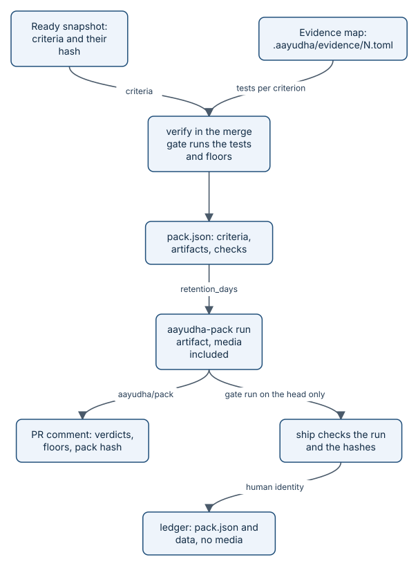

# Proof packs

A proof pack is one `pack.json` file, plus the artifacts it names, that records what CI observed about one exact
commit of one story. It exists so that "done" is a checkable claim: every Completion Goal criterion points at
evidence, every evidence file has a SHA-256 hash, and every floor result is written down with its tool and
threshold. This page covers the schema, how criteria get their evidence, what makes a pack count, and where packs
and their media are kept.



*The pack that counts is built by CI, from what CI ran, and landed by a human's `ship`.*

## How it works

A builder agent can say anything about its own work. The pack design keeps the agent from certifying it: the
evidence for a criterion is the output of a test that `verify` ran itself, the pack is tied to one head commit and
one Completion Goal hash, and only the pack that the base-branch merge gate built on that head counts for `ship`.
The agent still chooses which of its tests prove each promise, in the evidence map it commits; that is why `inspect`
reads the pack and judges whether the mapped tests really show each promise. In this repository's Go stories, an
`api-trace` evidence file holds the `go test` events of the mapped test.

The flow for one pull request:

1. `aayu ready` freezes the story's numbered criteria in a Ready snapshot on the `ledger` branch, at
   `specs/<story>/ready.md`, with a hash of the Completion Goal.
2. While building, the agent commits `.aayudha/evidence/<story>.toml`: which tests prove which criterion. `aayu build`
   tells the agent to write it.
3. `aayu verify` runs every floor in a sandbox. The coverage floor runs `go test -json`, and `verify` keeps that
   event stream.
4. `TestEvidence` reads the evidence map and selects the events of each mapped test. A criterion gets an artifact
   `evidence/criterion-N.jsonl` only when every named test ran and passed in this run. Otherwise the criterion gets
   nothing and the problem is reported.
5. Web floors add screenshots and recordings for screenshot and recording criteria (`screens/N.png`,
   `recordings/N.webm`), and every scanner adds its report.
6. `verify.Pack` assembles the pack and `proof.WriteLocal` writes it to `.aayudha/proof/<story>/` (git-ignored).
7. In CI, the merge gate's `aayudha/merge-gate` job uploads that directory, media included, as the `aayudha-pack`
   workflow artifact. GitHub keeps it for `[proof] retention_days`, at most the repository's artifact retention limit
   (90 days on a public repository, up to 400 on a private one); `proof.ArtifactRetention` applies the limit, which
   Actions passes as `GITHUB_RETENTION_DAYS`.
8. The `aayudha/pack` job downloads the artifact, runs `aayu proof comment`, and keeps one comment on the pull
   request: each Ready criterion's verdict, the floor results, the SHA-256 of `pack.json`, and links to the artifact
   and the run. It fails when the pack does not verify (exit 4) or a floor does not hold (exit 3). It uses only the
   workflow token and writes nothing to the ledger.
9. A human runs `aayu ship`. It finds the artifact through the Actions API, checks where it came from (below), and
   lands `pack.json` and its data artifacts (text, no media) on the ledger as the authoritative pack, under the
   human's identity, next to the ship record.

The proof needs no bot App, no media bucket, no secret, and no purge job in a product repository: the run artifact
expires on its own, and the ledger keeps only text.

### Advisory and authoritative

`authority.kind` is `advisory` or `authoritative`. Only `aayu ship` writes an authoritative pack, and only the one
the merge gate built. Before it lands anything, `ship` (`gatePack` in [internal/cli/ship.go](../../internal/cli/ship.go)):

- lists the runs of `.github/workflows/aayudha-merge-gate.yml` for the pull request's branch and takes the newest one
  that is a `pull_request_target` run (so the workflow file came from the base branch, not the pull request), on
  exactly the pull request's head commit, completed with `success`;
- downloads that run's `aayudha-pack` artifact, refuses an expired one, and checks with `proof.LoadLocal` that every
  artifact's bytes match their SHA-256 and size in `pack.json`;
- checks that the pack names the same story, pull request, and head, then runs `proof.VerifyLocal` against the Ready
  snapshot and requires the floors to hold.

When nothing qualifies, `ship` exits 4 and lists every run it passed over and why: a `pull_request` run of the pull
request's own copy of the gate, a run that proves another commit, a run that failed or is still running, a missing or
tampered artifact. An artifact another workflow uploaded is never looked at, and a pack already on the ledger never
counts. The authoritative pack on the ledger records the run (`workflow`, `run_id`) and `writer: "<login> (aayu ship)"`;
the ship record adds `gate_run`, `artifact`, and `pack_sha256`, the same hash the pull request comment shows.

Every other pack is advisory: `aayu proof push` from a laptop or an agent lane lands one, with its own comment, so an
agent's preview (local, or screenshots and video in an Amp, Claude Code, Cursor, or Codex thread) never replaces the
gate's comment and never satisfies `ship`. `proof push` refuses `--ci`: CI writes nothing to the ledger.

> **Honest status:** the authoritative packs on this repository's ledger from before 0.2 (stories 130 to 134) were
> landed by `aayu ship` from run artifacts too, under the 0.1 code, which checked the run's head and event but not the
> artifact hashes before landing. They still read and verify. The provenance check binds a run to the head commit
> and the base branch's workflow file, but GitHub's run record does not say which base branch a
> `pull_request_target` run used; a pull request into another branch that carries an edited gate could produce a
> qualifying run for the same commit. See [the threat model](../threat-model.md), T4.

### Validation

`aayu proof verify <story>` takes the story's best pack on the ledger (newest authoritative, else newest advisory)
and checks:

- every stored artifact's bytes match its `sha256` and `size`, and no path is listed twice or escapes the pack;
- every evidence path in `criteria` names an artifact of the pack;
- every criterion in the Ready snapshot has at least one evidence path, and no criterion is outside it;
- `completion_goal_hash` equals the Ready snapshot's hash, so a story edited after Ready fails;
- `pr_head_sha` equals the pull request's current head.

Media on the ledger copy are `"store": "none"`: their hashes are kept and counted as `artifacts_not_stored`, and the
bytes are in the run artifact until it expires. Floor results are reported as `floors_hold` but are not integrity
problems. A pack can verify and still not ship.

### Media and retention

Each artifact has a `store`. Data artifacts (traces, metrics, reports) are `git`: committed to the ledger by `ship`.
Media (screenshots, recordings, screen-reader transcripts, and image, video, audio, or PDF files) never go to the
ledger or Git LFS. They live in the run artifact, and the ledger copy says `none`. The one opt-in exception is a
bucket:

- `bucket`, when `[proof] media` names a private bucket (`s3://`, `r2://`, `azblob://`, or `gs://`, with the
  credential in the `proof-media` secret): `ship` and `proof push --media` copy media there, and `object` holds the
  key. The push sets the bucket's lifecycle rule to `[proof] retention_days` where its credential can.
- `none`: only the hash and size are kept. Without a bucket, `proof push --media` is refused (`ErrMediaRefused`).

There is no purge job: a run artifact expires after its retention, and a bucket's lifecycle rule expires its objects.
To remove media sooner, delete the run's artifact on GitHub.

Packs from before 0.2 stay readable. Their media may be `lfs` (Git LFS on a private ledger, read through `git lfs
smudge`) or carry a `tombstone` (`purged_at`, `reason`) from the 0.1 `proof purge`. `proof verify` hashes the first
and counts the second as not stored.

## Key data and file formats

The Go types, from [internal/proof/pack.go](../../internal/proof/pack.go) (the JSON Schema is
`internal/proof/schema/pack.v1.json`):

```go
// SchemaVersion is the pack schema this binary writes. Readers for every
// version shipped since 0.1 stay in Decode (WP1.9 grandfathering).
const SchemaVersion = 1
…
// Pack is pack.json v1.
type Pack struct {
    Schema             int         `json:"schema_version"`
    Repo               string      `json:"repo"`
    Story              int         `json:"story"`
    PR                 int         `json:"pr,omitempty"`
    PRHeadSHA          string      `json:"pr_head_sha"`
    BaseSHA            string      `json:"base_sha,omitempty"`
    Checkpoint         string      `json:"checkpoint,omitempty"` // n/N from the Aayudha-Checkpoint trailer
    Seat               string      `json:"seat"`
    Host               string      `json:"host"`
    Model              string      `json:"model,omitempty"` // the builder model, when known
    Identity           string      `json:"identity"`        // bot, human, human-fallback, or ci
    Authority          Authority   `json:"authority"`
    CompletionGoalHash string      `json:"completion_goal_hash"`
    Footprint          []string    `json:"footprint,omitempty"` // layers the PR's changed paths fall in
    Criteria           []Criterion `json:"criteria"`
    Artifacts          []Artifact  `json:"artifacts"`
    Checks             []Check     `json:"checks"`
    Cost               Cost        `json:"cost"`
    Links              Links       `json:"links"`
    CreatedAt          string      `json:"created_at"`
}
…
// Artifact is one evidence file.
type Artifact struct {
    Path      string     `json:"path"` // relative, always "/"-separated
    Kind      string     `json:"kind"`
    SHA256    string     `json:"sha256"`
    Size      int64      `json:"size"`
    Store     string     `json:"store"`
    Object    string     `json:"object,omitempty"` // bucket: the object key
    Tombstone *Tombstone `json:"tombstone,omitempty"`
}
```

`Decode` reads `schema_version` first, validates the document against that version's schema, and refuses a newer
version with a hint to run `aayu self-update`. Artifact `kind` is one of `screenshot`, `recording`,
`sr-transcript`, `api-trace`, `metric`, or `report`. `footprint` lists the layers (L01 to L09) whose path globs in
`LAYERS.md` match a changed file. Check `result` is `pass`, `fail`, `skipped`, `waived`, or `blocked`; see
[floors in detail](how-floors.md).

The evidence map for story 131, from `.aayudha/evidence/131.toml`:

```toml
[[criterion]]
id = 1 # the dental question is answered from the dental-deductible passage, quoted with its plan and section, and grounded
tests = ["examples/benefits-qa/answer:TestAnswerCitesPassage"]

[[criterion]]
id = 2 # questions about another person's records or asking for advice are refused before retrieval (never looked up), with a reason and a message
tests = ["examples/benefits-qa/policy:TestScreenRefuses", "examples/benefits-qa/answer:TestRespondScreensFirst"]
…
```

The real authoritative pack for story 131 (pull request 148), from
`git show origin/ledger:proof/131/b046d1a1d113339eb80e130c9dc0008fa223e76f/authoritative/pack.json`, with most
artifacts and checks trimmed:

```json
{
  "schema_version": 1,
  "repo": "rahulnakmol/agentic-ayudha",
  "story": 131,
  "pr": 148,
  "pr_head_sha": "b046d1a1d113339eb80e130c9dc0008fa223e76f",
  "base_sha": "b5359bd5c041820193b6dcadc0f0b10d5aff1836",
  "checkpoint": "3/3",
  "seat": "ai-native-engineer",
  "host": "cli",
  "model": "claude-opus-5-5",
  "identity": "ci",
  "authority": {
    "kind": "authoritative",
    "workflow": ".github/workflows/aayudha-merge-gate.yml",
    "run_id": 38231401215,
    "writer": "rahulnakmol (aayu ship)"
  },
  "completion_goal_hash": "e6e99c0c0e6aa4c1d6044a1ae26d91d9df3530e0a18d9d0b5883bd0d796e28cb",
  "footprint": [
    "L04",
    "L05"
  ],
  "criteria": [
    {
      "id": 1,
      "evidence": [
        "evidence/criterion-1.jsonl"
      ]
    },
    …
  ],
  "artifacts": [
    …
    {
      "path": "evidence/criterion-1.jsonl",
      "kind": "api-trace",
      "sha256": "43d40ade5147918903107d06ccfef7876cb920602f8dc2755a3ea947ee89ce62",
      "size": 615,
      "store": "git"
    },
    …
  ],
  "checks": [
    {
      "floor": "coverage",
      "result": "pass",
      "value": 100,
      "threshold": 90,
      "tool": "aayudha diff coverage (go test -coverprofile)",
      "version": "go1.25.14",
      "detail": "116 of 116 changed executable lines covered (go coverprofile)",
      "network": "isolated"
    },
    …
  ],
  "cost": {
    "tokens_in": 0,
    "tokens_out": 0,
    "usd": 0
  },
  "links": {
    "issue": "rahulnakmol/agentic-ayudha#131",
    "pr": "rahulnakmol/agentic-ayudha#148",
    "ready_snapshot": "specs/131/ready.md"
  },
  "created_at": "2026-10-12T09:48:42Z"
}
```

The first line of its evidence for criterion 1, from
`git show origin/ledger:proof/131/b046d1a1d113339eb80e130c9dc0008fa223e76f/authoritative/artifacts/evidence/criterion-1.jsonl`.
`Time` and `Elapsed` are dropped so identical runs give identical bytes and hashes:

```json
{"Action":"run","Package":"github.com/rahulnakmol/agentic-ayudha/examples/benefits-qa/answer","Test":"TestAnswerCitesPassage"}
```

> **Honest status:** `verify` does not fill `cost` yet, so packs record zero spend. Model spend is tracked by the
> model gateway and shown by `inspect`. This repository is public and `[proof] media` is empty, so the screenshots in
> story 134's pack have `"store": "none"`: their hashes are kept, and their bytes were in the run artifact.

## Invariants

1. Evidence comes only from this run: a criterion gets a test artifact only if every mapped test ran and passed
   in the same `go test -json` run. Enforced in [internal/verify/evidence.go](../../internal/verify/evidence.go),
   `TestTestEvidence`.
2. Only `ship` lands an authoritative pack, and only from the `aayudha-pack` artifact of a successful
   `pull_request_target` run of the merge gate on the exact head, with every hash matching. A run of the pull
   request's own copy of the gate, a run on another commit, a failed run, or a tampered artifact is refused, and a
   refused ship lands nothing. Enforced by `gatePack` in [internal/cli/ship.go](../../internal/cli/ship.go),
   `TestShipRefusals` and `TestBuildAndShip`.
3. Every other push is advisory, CI never pushes, and an advisory comment never replaces the gate's. Enforced in
   [internal/cli/proof.go](../../internal/cli/proof.go), `TestProofPushVerifyCLI` and `TestProofCommentInMergeGate`.
4. The gate's `aayudha/pack` check fails when the pack does not verify or a floor does not hold, and writes nothing to
   the ledger. Enforced by `proofComment` in [internal/cli/proof.go](../../internal/cli/proof.go),
   `TestProofCommentInMergeGate`.
5. Every stored artifact matches its hash and size, every Ready criterion has evidence, and the pack matches the
   pull request head and the Ready Completion Goal hash. Enforced by `Verify` and `VerifyLocal` in
   [internal/proof](../../internal/proof), `TestVerifyDetects`.
6. Media never reach the ledger or Git LFS; without a bucket they are refused. Enforced by `Push` in
   [internal/proof/ledger.go](../../internal/proof/ledger.go), `TestMediaNeedABucket` and `TestPushVerifyBucket`.
7. The run artifact is kept `[proof] retention_days`, never more than the repository allows. Enforced by
   `ArtifactRetention` in [internal/proof/pack.go](../../internal/proof/pack.go), `TestArtifactRetention`.
8. Packs from before 0.2 still verify, including LFS media and tombstones. `TestVerifyReadsPacksFromBefore02`.
9. Every pack validates against the JSON Schema of its `schema_version`. Enforced by `Decode` in
   [internal/proof/pack.go](../../internal/proof/pack.go), `TestSchemaValidatesSamples`.

## Where it lives in the code

- [internal/proof/pack.go](../../internal/proof/pack.go): types, schema decode, `FloorsHold`, media rules,
  artifact retention.
- [internal/proof/verify.go](../../internal/proof/verify.go): `proof verify` integrity checks.
- [internal/proof/ledger.go](../../internal/proof/ledger.go): push, list, best pack, local verification.
- [internal/proof/bucket.go](../../internal/proof/bucket.go) and
  [internal/proof/cloudmedia.go](../../internal/proof/cloudmedia.go): the opt-in S3, R2, Azure Blob, and GCS stores.
- [internal/proof/schema](../../internal/proof/schema): the JSON Schema.
- [internal/verify/evidence.go](../../internal/verify/evidence.go): the evidence map and test evidence.
- [internal/verify/verify.go](../../internal/verify/verify.go): pack assembly.
- [internal/cli/proof.go](../../internal/cli/proof.go): the CLI and the merge gate's comment;
  [internal/cli/ship.go](../../internal/cli/ship.go): finding, checking, and landing the gate's pack.

## Read next

- [The merge gate](how-merge-gate.md): the workflow that builds the pack and comments on it.
- [Floors in detail](how-floors.md): every check in the `checks` array.
