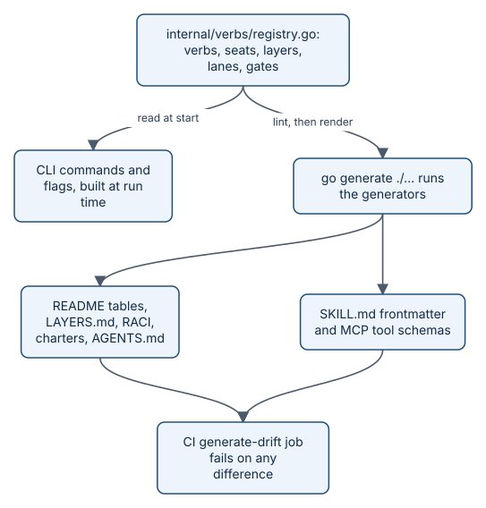

# The verb registry and code generation

Every command aayudha has is declared once, as Go data, in `internal/verbs/registry.go`. The CLI reads that data
when it starts, and `go generate ./...` writes the verb and plumbing tables in `docs/README.md`, the RACI (who is Responsible, Accountable,
Consulted, and Informed), the layer map, the skill frontmatter, and the MCP tool schemas from it. CI fails when any
generated file differs from what the generators would write. This exists so that the docs, the skills, and the
binary cannot disagree about what a verb is, who owns it, or what it may touch.



*Change the registry, regenerate, commit both. Never edit a generated file by hand.*

## Why one source

Ground rule 4 in [the build plan](../BUILD-PLAN.md) makes the registry the single source. Without it, a verb's
seat could say one thing in the README, another in a seat charter, and a third in the skill a host loads. With it,
there is one Go value per command, unit tests check that value, and every other copy is derived from it.

The registry holds more than verbs:

- `Verbs`: the 34 verbs: the 32 of the plan, in plan order, then `chart` (WP5.1g) and `survey` (WP5.9).
- `Plumbing`: the 15 plumbing commands, built with the `plumb` helper (no lane, no layers, CLI only).
- `Seats`: the fourteen seats.
- `LayerTable`: the nine layers (L01 to L09), each with one owner seat and the path globs that place a file in it.
- `Hosts`: Amp, Cursor, Claude Code, and OpenAI Codex, with model families a host cannot run.
- `Lanes`: the six model lanes (`build`, `spec`, `plan`, `review`, `ui-review`, `chore`) with per-host defaults.
- `Gates`: the named preconditions a command may declare, such as `merge-gate` and `human-pass`.
- `Stages`: the journey stages, in reading order. Every verb has exactly one.

The Consulted and Informed seats of each verb live beside it in `internal/verbs/raci.go`.

## The Command struct

```go
// Command is a verb or a plumbing command.
type Command struct {
    Name     string
    Summary  string  // one line, <= 200 chars; the SKILL.md description
    Reader   string  // one plain sentence for people new to aayudha: the docs site's verb map and journey pages; verbs only
    WP       string  // the work package that implements the command
    Stage    StageID // the journey stage (verbs only; empty for plumbing)
    Seat     SeatID  // the single Accountable seat
    Owns     SeatID  // seat that owns thresholds or policy when it differs from Seat; empty otherwise
    Lane     LaneID  // empty for plumbing
    Layers   Layers
    Inputs   []Input
    Outputs  []string
    Gates    []GateID
    Surfaces []Surface
    Identity Identity
    Mode     Mode
    ModeNote string // qualifies Mode, e.g. where the direct pass runs
    Exposure Exposure
    ReadOnly bool // never writes; still runs on a repo whose schema is newer than the binary (WP1.9)
    // Paths are glob patterns that limit when a host loads the skill on its own
    // (SKILL.md `paths`, WP3.1). Empty means no restriction and the key is omitted.
    Paths []string
}
```

*From `internal/verbs/registry.go` (tabs shown as spaces).* The fields that matter most:

- **Summary and Reader.** Two descriptions with two audiences. `Summary` is written for agents: it becomes the
  skill's description and the MCP tool's description. `Reader` is one plain sentence for people, used by the docs
  site's verb map and the "verbs in this step" table of each story chapter. A registry test requires every verb to
  have one, under 160 characters, different from its `Summary`.
- **Seat and Owns.** Exactly one Accountable seat. `Owns` names the seat that owns the thresholds when it differs:
  `verify` is run by the AI Native Engineer against floors the Quality Architect owns.
- **Layers.** `AllLayers()`, `NoLayers()`, or `OnlyLayers(L09)`.
- **Inputs.** Typed arguments and flags. `TypeIssue` and `TypePR` are checked against `IssuePattern` and
  `PRPattern`. `HumanOnly` inputs are never exposed over MCP; `ReadOnlyValues` pins an input to its read-only
  values while MCP writes are off.
- **Identity.** `human` or `bot`: the GitHub identity the command writes under.
- **Mode.** Who reasons: `none`, `host`, `direct`, or `hybrid` (ground rule 5).
- **Exposure.** `read`, `write`, or `never` on MCP.

Here is a real entry:

```go
{
    Name: "ship", WP: "WP5.5", Stage: StageShip,
    Summary: "Squash-merge a PR after a green merge gate and a human pass, write the Complete section, and clean up.",
    Reader:  "Merges a proven pull request after your yes, and writes down who approved what, on which evidence.",
    Seat:    EngineeringManager, Lane: LaneChore, Layers: AllLayers(),
    Inputs: []Input{
        pos("pr", TypePR, "Pull request to ship."),
        humanOnly(flag("solo-bypass", TypeBool, "Solo mode only (one human, no bot App): merge without a second person's approval, recorded in the PR, the ship record, and the actions log (Appendix B D2).")),
    },
    Outputs:  []string{"merge-commit", "complete-section", "status:merged"},
    Gates:    []GateID{GateMergeGate, GateHumanPass},
    Surfaces: cliSkill, Identity: IdentityHuman, Mode: ModeNone, Exposure: ExposeNever,
},
```

*From `internal/verbs/registry.go`.*

## At run time: the CLI

The CLI is not generated. `newRoot` in `internal/cli/root.go` loops over `verbs.Verbs` and `verbs.Plumbing` and
builds one cobra command for each. `newCommand` derives the usage line, the positional argument count, every flag,
and enum and pattern validation from `Inputs`. Handlers register by name in an `init` function, for example
`func init() { register("ship", runShip) }` in `internal/cli/ship.go`. A registry command with no handler still
appears in `aayu --help`, marked "lands in" its work package, and exits with code 2.

## At build time: go generate

`embed.go` and `internal/loops/doc.go` hold the `go:generate` directives. Each generator runs from the repository
root (or reaches it), writes only when bytes differ, and is deterministic.

| Generator | Source | Writes |
|---|---|---|
| `internal/verbs/gen` | the registry and `raci.go` | `docs/README.md` verb and plumbing tables; the verb map in `docs/guide/when-to-use-what.md`; `LAYERS.md`; `docs/RACI.md`; the RACI region of each `seats/<seat>/CHARTER.md`; the `aayudha:raci` section of `AGENTS.md`; `skills/<verb>/SKILL.md` frontmatter; `internal/mcp/schemas/<verb>.json`; `internal/config/schema.json` from the config structs |
| `internal/config/gen` | `internal/config/defaults.toml` | `CONSTRAINTS.md` |
| `internal/workitems/gen` | the work-item schema in `internal/workitems` | `work-items/forms/aayudha-<type>.yml` and a region of `work-items/README.md` |
| `internal/loops/gen` | `loops/*.toml` | `.github/workflows/aayudha-loops.yml`, `loops/amp/<name>.json`, `loops/cursor/aayudha-loops.tf` |
| `internal/tell/gen` | `docs/guide/img/*.diagram` | the `.svg` beside each, drawn by the brief diagram renderer |

Partial files are edited only between markers, such as `<!-- BEGIN GENERATED: verbs -->` in `docs/README.md`. A
`SKILL.md` keeps its hand-written body: the generator replaces only the leading frontmatter block. Stale outputs
are handled on purpose. Stale MCP schemas and SVGs are deleted. A `SKILL.md` for a command without the skill
surface makes generation fail, because its body is hand-written and should not vanish silently. The config
generator fails when `defaults.toml` has a key with no row in its table, or a row names a missing key.

This is the frontmatter generated for `ship`:

```yaml
---
# Code generated by go generate (internal/verbs/gen); DO NOT EDIT.
# Source: internal/verbs/registry.go. Only this frontmatter is generated; the body below is hand-authored.
name: ship
description: "Squash-merge a PR after a green merge gate and a human pass, write the Complete section, and clean up."
disable-model-invocation: true
user-invocable: true
version: "0.0.0"
aayu:
  seat: engineering-manager
  lane: chore
  layers: all
  inputs:
    - name: pr
      type: pr
      required: true
      positional: true
      description: "Pull request to ship."
    - name: solo-bypass
      type: bool
      required: false
      positional: false
      description: "Solo mode only (one human, no bot App): merge without a second person's approval, recorded in the PR, the ship record, and the actions log (Appendix B D2)."
  outputs:
    - "merge-commit"
    - "complete-section"
    - "status:merged"
  gates:
    - "merge-gate"
    - "human-pass"
  identity: human
  mode: none
---
```

*From `skills/ship/SKILL.md`.* `disable-model-invocation: true` comes from `Exposure: ExposeNever`, so hosts do not
load the skill on their own. `ship` has no MCP schema for the same reason. For an exposed verb, such as `verify`,
the schema in `internal/mcp/schemas/verify.json` carries each input's type, the pull request pattern, and
`x-aayu-exposure: write`.

## Lint, tests, and the drift check

Before it writes anything, `internal/verbs/gen` runs `verbs.LintRACI`. The lint requires one known Accountable seat
per command, a RACI entry for every verb whose Consulted and Informed seats are known, unique, and distinct from the
Accountable seat, and one known owner seat per layer. A registry that breaks it fails `go generate` and CI.

`TestRegistry` in `internal/verbs/registry_test.go` checks the rest: exactly 34 verbs and 15 plumbing commands in
plan order, unique names, one stage per verb, fourteen seats, nine layers, known gates and lanes, one-line summaries
of at most 200 characters, valid modes and exposures, surfaces that follow exposure, input rules (an enum has
values, a human-only input is never required), and a default for every lane on every host.

The `generate-drift` job in `.github/workflows/ci.yml` is a required check on `dev`. It runs `go generate ./...`,
fails if `git status --porcelain --untracked-files=all` shows any change, then runs the generators again and fails
if the second run changes anything.

```yaml
      - name: Regenerate
        run: go generate ./...
      - name: Fail on drift
        run: |
          drift="$(git status --porcelain --untracked-files=all)"
          if [ -n "$drift" ]; then
            echo "::error::Generated files are out of date. Run 'go generate ./...' and commit the result; do not edit generated files by hand."
…
```

*From `.github/workflows/ci.yml`.*

## Invariants

1. Every command has exactly one Accountable seat, and every layer exactly one owner. Enforced by `verbs.LintRACI`
   in `internal/verbs/raci.go` (`TestLintRACI`), run first by `internal/verbs/gen/main.go`.
2. The registry holds 34 verbs and 15 plumbing commands, each with valid fields. Enforced in
   `internal/verbs/registry_test.go` (`TestRegistry`).
3. Generated files match the registry byte for byte. Enforced by the `generate-drift` job in
   `.github/workflows/ci.yml`.
4. Generation is deterministic. Enforced by the second-run step of `generate-drift`.
5. A skill's `paths` key appears only when the registry sets globs. Enforced in `internal/verbs/gen/main.go`
   (`TestFrontmatterPaths`).
6. Every skill has the generated frontmatter keys and calls only real registry commands and flags. Enforced by
   `internal/skills.Lint` (`TestSkillLint` in `embed_test.go`).
7. Every documented config default exists and every rendered key is documented. Enforced by
   `internal/config/gen/main.go`.
8. The CLI lists every registry command, and an unbuilt one names its work package. Enforced in
   `internal/cli/cli_test.go` (`TestHelpNamesAayuAndListsRegistry`, `TestNotImplementedNamesWP`).

> **Honest status:** `SkillVersion` is still `"0.0.0"`, so every generated frontmatter says `version: "0.0.0"`,
> even in the v0.1.0 release: the skill version is not yet tied to the release version.

## Where it lives in the code

- [internal/verbs/registry.go](../../internal/verbs/registry.go) and [internal/verbs/raci.go](../../internal/verbs/raci.go)
- [internal/verbs/registry_test.go](../../internal/verbs/registry_test.go)
- [internal/verbs/gen](../../internal/verbs/gen)
- [internal/config/gen](../../internal/config/gen)
- [internal/workitems/gen](../../internal/workitems/gen)
- [internal/loops/gen](../../internal/loops/gen)
- [internal/tell/gen](../../internal/tell/gen)
- [internal/cli/root.go](../../internal/cli/root.go)
- [internal/mcp/schemas](../../internal/mcp/schemas)
- [.github/workflows/ci.yml](../../.github/workflows/ci.yml)

## Read next

- [Extending aayudha](how-extending.md)
- [Architecture](how-architecture.md)
