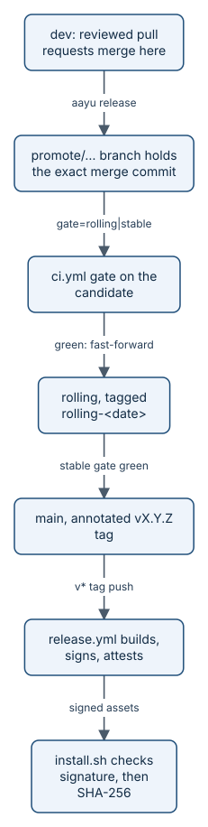

# Releases and the supply chain

A release moves code from `dev`, where pull requests land, to `rolling`, a snapshot for early adopters, and then to
`main`, where every commit is a signed, versioned release. Each step runs a gate on the exact commit that will
land, and the last step signs what it builds so that a user's machine can check where a binary came from before it
runs it. This page covers the promotion gates, `aayu release`, the tags, the signed build, and the install check.



*The gate tests the same commit that lands; the signature names the workflow and tag that built it.*

## The ladder and its gates

Why gate a promotion at all, when every pull request already passed CI? Because the merge of `dev` into `rolling`
is a new commit that nobody has tested yet. So the gate runs on that merge commit itself, before any branch moves:

1. Build the candidate. A `promote/…` branch holds the exact non-fast-forward merge commit that will land, with
   the message `Rolling snapshot: <timestamp>` or `Release: vX.Y.Z`, signed off.
2. Gate it. Dispatch `ci.yml` on the candidate with `gate=rolling` (for `dev` to `rolling`) or `gate=stable`
   (for `rolling` to `main`).
3. Land it. Push that same commit to the target branch, which is a fast-forward, then tag it.

A dispatched `ci.yml` always runs the whole pull request suite: `build` (vet, unit tests, the build matrix, and
the binary size budget), `generate-drift`, `lint`, `commits`, `security`, `docs`, and `release-snapshot`. The
path filters that let a pull request skip jobs are off for dispatches. On top of that suite:

| Gate | Extra jobs |
|---|---|
| `rolling` | `integration` (build tag `integration`, race detector), `benchmarks`, `evals-gate` |
| `stable` | everything in `rolling`, plus `extended-integration` (live tests with `AAYU_LIVE=1`) and `smoke` on Ubuntu, macOS, and Windows |

- **`release-snapshot`** is the production validation. It runs a real signed goreleaser snapshot, then runs
  `install.sh` against it: the genuine archive must install, and a flipped byte, a checksum rewritten to match the
  flipped byte, and a signature from a workflow other than `release.yml` must all be refused.
- **`evals-gate`** reads tier-2 eval results (tests of the agents' own skills, run by `evals.yml`) for the commit
  being promoted, and compares each gating group with `main`'s baseline. Missing results fail the gate.
- **Security scans** (gitleaks, semgrep, osv-scanner, and the licence scans) run in the `security` job, which
  is part of the suite in both gates.

> **Tip:** the founder policy for this repository is that promotions need no human approval. The gate is the
> control, and it is never skipped. Promotion still happens only on the release schedule or an explicit request.

## What `aayu release` does

`aayu release <release> --to rolling|main` drives those three steps for one Release work item, then does the
bookkeeping. It lives in `internal/cli/release.go`.

- **Refusals first.** It refuses CI, and refuses a token that belongs to a bot or to a login in
  `[identity] bot_logins`. An agent may run it under a person's account (founder policy, Story #430): there
  is no TTY prompt for agents, because the gate is the control. A person at a terminal is still asked to confirm,
  or passes `--yes`. The registry marks it human identity, stable-request, and halt gate, and exposes it over MCP
  (the Model Context Protocol server that hosts call) only where `expose_writes` allows writes.
- **The stable-release request.** `--to main` needs an explicit request that an agent cannot make. Either a person
  confirms at their own terminal, or a comment on the Release issue has the first line `Stable release: vX.Y.Z`
  and is written after the Release's rolling snapshot, by an account that is not a bot and has write, maintain,
  or admin access, with no `<!-- aayudha:` marker. aayu never writes such a comment, and the pre-tool hook refuses
  an agent's shell command that would. Without one the rung exits 4 and promotes nothing; the ledger records who
  asked and where.
- **Checks before anything moves.** The Release issue must pass Ready. Every story it lists must be in the
  promoted range or already shipped. Promoting to `main` needs a `vX.Y.Z` version that has no tag yet, and the
  Release's `rolling` rung must be on the ledger with its commit still on `rolling`.
- **Dry run.** With `--dry-run` it stops after computing the plan: the candidate, the tag, the stories it would
  stamp, and the release notes. Nothing is pushed.
- **The gate.** For `rolling`, it first dispatches `evals.yml` on the source tip and waits. Then it dispatches
  `ci.yml` on the candidate. A gate that fails is re-run once for its failed jobs (a transient failure); if it
  is still red, nothing is promoted and the candidate branch is deleted.
- **Bookkeeping.** After the push and the tag it stamps every shipped story `released`, writes release notes
  through `tell` (which cites only proven Features and refuses avoided words), and makes each Goal and Initiative
  above those stories due for `measure` 28 days later.
- **Records.** It writes `releases/<n>/<target>.json` and `measure/due/<issue>/<tag>.json` to the ledger branch,
  and the Shipping evidence section of the Release issue.

## Tags

| Branch | Tag | Kind | Example |
|---|---|---|---|
| `rolling` | `rolling-<date>`, then `rolling-<date>.<n>` for the n-th snapshot of a day | lightweight | `rolling-2026-10-12.4` |
| `main` | `vX.Y.Z` | annotated, `Release vX.Y.Z: <title>` | none yet |

`.goreleaser.yaml` ignores `rolling-*` tags, so a snapshot tag is never parsed as a version.

## The signed build

A `v*` tag push runs `release.yml`. Its `verify-tag` job refuses a tag that is not `vMAJOR.MINOR.PATCH[-PRE]`,
whose commit is not on `main`, or that is lightweight. Then goreleaser builds six targets (Linux, macOS, and
Windows on amd64 and arm64) with `CGO_ENABLED=0`, so each is one static binary. From `.goreleaser.yaml`:

```yaml
builds:
  - id: aayudha
    main: ./cmd/aayudha
    binary: aayudha
    env:
      - CGO_ENABLED=0 # ground rule 2: one static binary
    goos: [linux, darwin, windows]
    goarch: [amd64, arm64]
    flags: [-trimpath]
…
checksum:
  name_template: checksums.txt
  algorithm: sha256

sboms:
  - artifacts: archive # syft, one SPDX SBOM per archive

signs:
  - id: cosign-keyless
    cmd: cosign
    artifacts: checksum
    signature: "${artifact}.sigstore.json"
    args: ["sign-blob", "--bundle=${signature}", "--yes", "${artifact}"]
    output: true
```

Signing is keyless: cosign gets a short-lived certificate from Sigstore for the workflow's GitHub OIDC (OpenID
Connect) identity, so there is no private key to steal. The certificate names
`.github/workflows/release.yml@refs/tags/<tag>`. Only `checksums.txt` is signed, and it covers every archive.
Then `release.yml` adds SLSA (Supply-chain Levels for Software Artifacts) build provenance with GitHub's own
attestation action, over the same checksums:

```yaml
      - name: SLSA build provenance
        uses: actions/attest-build-provenance@4d101475d8b20a2381f78447822ac1eab6504dd8 # v4.2.2
        with:
          subject-checksums: dist/checksums.txt
```

The same job then runs `install.sh` against `dist/` and checks `aayu version`. A `smoke` job installs the
published release from GitHub on Ubuntu and macOS, the way a user does.

## The install check

`install.sh` verifies two things, in order, before it extracts anything. From `install.sh`:

```sh
# Only release.yml on exactly this tag may have signed the checksums.
tag_re="$(printf '%s' "$version" | sed 's/[.+]/\\&/g')"
identity_re="^https://github\\.com/rahulnakmol/agentic-ayudha/\\.github/workflows/release\\.yml@refs/tags/${tag_re}\$"
…
MSYS_NO_PATHCONV=1 MSYS2_ARG_CONV_EXCL='*' "$cosign" verify-blob \
  --bundle "$(native "$tmp/checksums.txt.sigstore.json")" \
  --certificate-identity-regexp "$identity_re" \
  --certificate-oidc-issuer "$ISSUER" \
  "$(native "$tmp/checksums.txt")" >/dev/null 2>"$tmp/cosign.log" || {
  cat "$tmp/cosign.log" >&2
  die "signature verification failed: checksums.txt was not signed by $REPO release.yml for $version"
}

want="$(awk -v f="$archive" '$2 == f { print $1 }' "$tmp/checksums.txt")"
[ -n "$want" ] || die "$archive is not listed in the signed checksums.txt"
[ "$(sha256 "$tmp/$archive")" = "$want" ] || die "checksum mismatch for $archive: the archive was tampered with or corrupted"
```

If `cosign` is not on `PATH`, the script downloads cosign v3.1.3 and refuses to run it unless its SHA-256 matches
a value pinned in the script for that OS and architecture. `aayu self-update` pins the same identity and also
checks the SLSA provenance attestation.

## Package managers

goreleaser writes a Homebrew cask, a Scoop manifest, and winget manifests, but never uploads them
(`skip_upload: true`). Three separate `release.yml` jobs publish them, each in its own GitHub environment with its
own token, so the build job never holds a token for another repository. Prereleases are not published there.
Each manifest carries the archive's SHA-256, and the package manager checks the download against it; none of them
checks the cosign signature. `installers.yml` proves that the Scoop manifest refuses a wrong hash.

> **Honest status:** v0.1.0 was released on 15 October 2026 (tag `v0.1.0`, commit `78bd4ae` on `main`): the tag
> check, the signed build, provenance, and the smoke installs on Linux and macOS passed. Its Homebrew, Scoop, and winget
> jobs failed, so at that release the tap and the bucket stayed empty and `install.sh` was the way to install. Since
> v0.2.0, Homebrew and Scoop have aayudha (the tap's cask and the bucket's manifest are at 0.2.0). winget does not
> yet: its package has passed validation and is waiting for a moderator in
> [microsoft/winget-pkgs pull request 454680](https://github.com/microsoft/winget-pkgs/pull/454680). The promotion record below is the earlier rolling snapshot
> `rolling-2026-10-12.4`, which carried the story.

## A real promotion record

This is the rung that Release 144 wrote, from `git show origin/ledger:releases/144/rolling.json`, trimmed:

```json
{
  "repo": "rahulnakmol/agentic-ayudha",
  "release": 144,
  "source": "dev",
  "target": "rolling",
  "source_sha": "a631247bd29c6e3252bd82a9d4a07f796f594448",
  "commit": "9991cd392d282692aa9f5309d67ecc5c3362627a",
  "message": "Rolling snapshot: 20261012T1447Z",
  "tag": "rolling-2026-10-12.4",
  "candidate": "promote/rolling-20261012T1447Z",
  "gate": {
    "workflow": "ci.yml",
    "id": 38266833172,
    "url": "https://github.com/rahulnakmol/agentic-ayudha/actions/runs/38266833172",
    "conclusion": "success",
    "attempts": 1
  },
  "artifacts": [
    …
    {
      "name": "release-snapshot",
      "digest": "sha256:00b9b8b4a19283114a1ceb9af13f62508b7cc80872eba64d3797f1fef57062c0",
      "size": 65125205
    }
  ],
  "stories_released": [
    132,
    133,
    134
  ],
  …
  "referenced_not_merged": [
    70
  ],
  "release_notes": "tell/release/rolling-2026-10-12.4.md",
  "measure_due": [
    {
      "issue": 125,
      "type": "goal",
      "due": "2026-11-09",
      "release": 144,
      "tag": "rolling-2026-10-12.4",
      …
    },
    …
  ],
  "promoted_by": "rahulnakmol",
  "promoted_at": "2026-10-12T14:47:06Z"
}
```

Story 70 was referenced by a pull request in the range but had not merged, so it was not stamped.

## Invariants

1. A branch moves only to the commit the gate tested, and a red gate leaves no moved branch, no tag, no candidate
   branch, and no stamp; a dry run moves nothing (`internal/cli/release.go`, `TestReleaseLadder`).
2. A failure before landing promotes nothing, and a failure after landing still exits non-zero
   (`internal/cli/release.go`, `TestReleaseFailsClosed`, `TestReleaseRefusesBeforeLanding`).
3. Only a person's own account, outside CI, can promote, and `main` moves only on a person's stable-release
   request (`humanAccount` in `internal/cli/tell.go`; `stableRequest` in `internal/cli/release.go`;
   `StableRequestCommand` in `internal/hosts/hook.go`; `TestReleaseLadder`).
4. A `v*` release is built only from an annotated tag on `main` (`verify-tag` in `.github/workflows/release.yml`).
5. `install.sh` installs nothing unless the signature names `release.yml` on the exact tag and the archive matches
   its signed checksum (the `release-snapshot` job in `.github/workflows/ci.yml`, on every pull request that
   touches Go or the installer, and on every gate).
6. Every action is pinned by full commit SHA and every downloaded tool by SHA-256 (convention in every workflow;
   `.github/` is a protected path in `.github/CODEOWNERS`).

## Where it lives in the code

- [internal/cli/release.go](../../internal/cli/release.go) and
  [internal/cli/release_test.go](../../internal/cli/release_test.go)
- [.github/workflows/ci.yml](../../.github/workflows/ci.yml): the suite and both gates
- [.github/workflows/release.yml](../../.github/workflows/release.yml): tag check, signed build, provenance,
  package managers
- [.goreleaser.yaml](../../.goreleaser.yaml)
- [install.sh](../../install.sh) and [.github/workflows/installers.yml](../../.github/workflows/installers.yml)
- [internal/cli/selfupdate.go](../../internal/cli/selfupdate.go)
- [CONTRIBUTING.md](../../CONTRIBUTING.md): the promotion procedure; design history in
  [BUILD-PLAN.md](../BUILD-PLAN.md)

## Read next

- [Security and the threat model](how-security.md)
- The story version: [Release it](journey-7-release.md)
