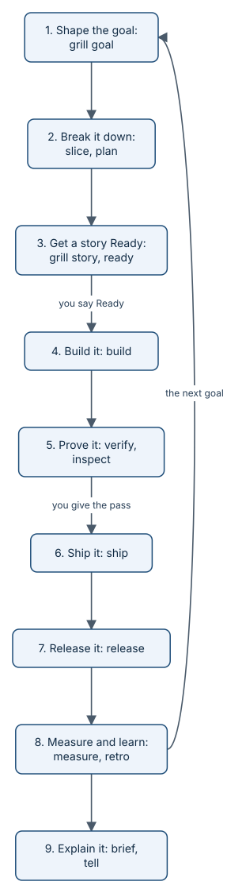

# Prologue: one Monday at Example Co

> *Monday 12 October 2026, just after seven in the morning.* Priya scrolls through the HR inbox again. A question
> about the dental deductible, asked twelve days ago, still open. Someone wants to know how much the company puts
> into their health savings account. Someone else asks about a colleague's claim, which HR must never answer. Priya counts. Of the last 120
> people who asked HR a benefits question, 31 got an answer from the plan documents within a week. She turns to Sam. "Can we fix this? This
> week?"

Priya founded Example Co. Sam is its one engineer. Together with aayudha's agent seats, they are about to try to get
employees an answer to their benefits questions within a week, quoted straight from the plan documents.

The stakes are not only speed. A slow answer costs people time. A wrong answer is worse: someone picks a dental plan
on a guess. And an answer about another person's claim would be a breach. Whatever they build has to be fast, right,
and private, and they need to know it is, not hope.

> **In the story:** Priya and Sam are illustrative. They stand for the two jobs a small team does: deciding what
> matters, and building it. Everything that happens to them happened in this repository on Monday 12 October 2026.
> The issues, pull requests, reviews, checks, and numbers are real and linked or numbered so you can check them.
> The 120 employees and their data are synthetic, generated from a fixed seed. In the real run, one person did both
> Priya's and Sam's jobs, which is why solo mode shows up in chapters 2 and 6.

## The arc

*The arc of the day. Two decisions belong to people: "Ready" and "yes". The gate can send work back as often as it
needs to.*

## What they built by the evening

| Level | What | Number |
|---|---|---|
| Goal | Example Co employees get benefits answers within a week | 125 |
| Initiative (the bet) | Self-serve answers quoted from the plan documents | 126 |
| Features | [Grounded answers API](https://github.com/rahulnakmol/agentic-ayudha/issues/127), [Answer analytics](https://github.com/rahulnakmol/agentic-ayudha/issues/128), [Ask page](https://github.com/rahulnakmol/agentic-ayudha/issues/129) | 127, 128, 129 |
| Stories | Load the plan documents; quote the best passage; the API; the analytics export; the Ask page | 130 to 134 |
| Pull requests that merged | One per story, each proven in CI | 142, 148, 155, 158, 160 |
| Pull requests thrown away | Sent back twice by review, closed, and rebuilt | 135, 140, 151, 156 |
| Release | The snapshot `rolling-2026-10-12.4` | 144 |

The numbers are GitHub issue and pull request numbers in this repository. Only the three Features are links: this
site links work only when every story under it shipped with proof, and those three qualify.

## The chapters

1. [The goal](journey-1-shape.md). 07:20. An interview that will not accept "faster" as an answer.
2. [The plan](journey-2-break-down.md). Five stories, nine layers, and three plans nobody else could review.
3. [The promises](journey-3-ready.md). What "done" means, written down before a line of code, including what the app
   must refuse to answer.
4. [The build](journey-4-build.md). The agent works; Sam goes for coffee. A budget keeps watch.
5. [The gate says no](journey-5-prove.md). Seventeen reviews. Four pull requests thrown away. One email check that
   would not die.
6. [The yes](journey-6-ship.md). Sam reaches for the approve button, and GitHub says no.
7. [The release](journey-7-release.md). 14:47. A gate, a tag, and a date in November.
8. [The number](journey-8-learn.md). 0.258 became 0.917. What that number is, and what it is not yet.
9. [The telling](journey-9-explain.md). The summary for the boss is refused, for one sentence.

Then an [epilogue](built-with-itself.md): how aayudha was built the same way, with its own gates saying no to it.

> **Tip:** every chapter ends with an "Under the hood" box for engineers who want the mechanics, and a "What's next"
> that leads into the next chapter. You can also read the [How it works](how-it-works.md) track on its own.

## What's next

07:20. Priya asks her agent to write the Goal, and the agent starts asking questions:
[chapter 1, the goal](journey-1-shape.md).
