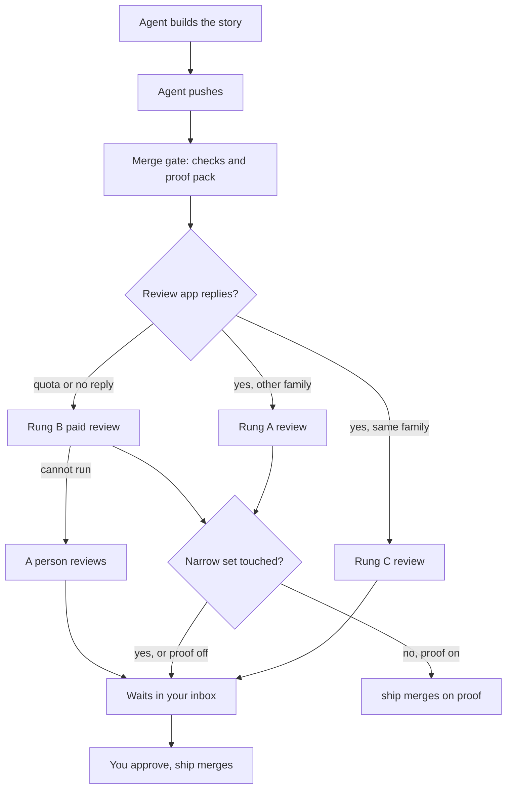

# aayu v0.3.0: proven work merges by itself

> [!NOTE]
> v0.3.0 is not tagged yet. This page lists only work that has merged into `dev`. We update it before the tag.

aayu v0.3.0 lets one person run a repository with a team of agents. We use it on our own repository first.
agentic-ayudha has one person, @rahulnakmol, and a team of agent seats. With merge on proof on, `aayu ship` merges an
agent's work into `dev` by itself ([#617](https://github.com/rahulnakmol/agentic-ayudha/issues/617)). It does this only when the checks pass and the proof pack verifies. By
default, the review must also come from another model family ([#617](https://github.com/rahulnakmol/agentic-ayudha/issues/617)). A small, named set of files and settings always waits for a
person ([#617](https://github.com/rahulnakmol/agentic-ayudha/issues/617)). For you, this means less time on routine merges. You keep your attention for the changes that can hurt
you.

Merge on proof is off by default. You turn it on with `[autonomy] proof = true` ([#617](https://github.com/rahulnakmol/agentic-ayudha/issues/617)). No Feature is called proven
for this release. The four proven Features, [#37](https://github.com/rahulnakmol/agentic-ayudha/issues/37), [#127](https://github.com/rahulnakmol/agentic-ayudha/issues/127), [#128](https://github.com/rahulnakmol/agentic-ayudha/issues/128), and [#129](https://github.com/rahulnakmol/agentic-ayudha/issues/129), shipped in v0.1.0. The full list of changes is in
the [changelog](../../CHANGELOG.md#v030).

## In one minute

- **What it gives you:** proven agent work merges into `dev` by itself, and you approve only the rest
  ([what you can do now](#what-you-can-do-now)).
- **What you must do:** six upgrade steps, each with an `aayu doctor` check ([upgrade first](#upgrade-first)).
- **What breaks:** nothing so far ([breaking changes](#breaking-changes)).
- **What to watch:** six open Bugs in `aayu ship`, the merge gate, and the docs, each with a workaround
  ([known limits](#known-limits)).
- **What changed, in depth:** tables by area ([for engineers](#for-engineers)) and the full
  [changelog](../../CHANGELOG.md#v030).

## Upgrade first

> [!WARNING]
> Steps 2, 3, and 6 change protected files. A person runs each one and merges its pull request.

1. Update the binary with `aayu self-update`. Check: `aayu version` shows v0.3.0.
2. Run `aayu upgrade` to see the changes, then `aayu upgrade --apply` to move your config and state to this version.
   Check: the `config` and `schema` rows of `aayu doctor` pass.
3. Run `aayu init --gates` and commit the result through a pull request ([#500](https://github.com/rahulnakmol/agentic-ayudha/issues/500), [#538](https://github.com/rahulnakmol/agentic-ayudha/issues/538)). Check: the `security-workflow`
   and `host-config` rows of `aayu doctor` pass.
4. Run `aayu install --apply`, and `aayu install --env --apply` for the pre-push gate ([#418](https://github.com/rahulnakmol/agentic-ayudha/issues/418)). Check: the
   `host-config` and `skills-copies` rows of `aayu doctor` pass.
5. Read the `review-rung` row of `aayu doctor` ([#522](https://github.com/rahulnakmol/agentic-ayudha/issues/522)). It shows your rung and how to move up a rung. To add rung B,
   set `[inspect] paid_reviewer` and add the provider's key ([#550](https://github.com/rahulnakmol/agentic-ayudha/issues/550)).
6. If you want merge on proof, set `[autonomy] proof = true` in `.aayudha/config.toml` ([#617](https://github.com/rahulnakmol/agentic-ayudha/issues/617)). This file is in the
   narrow set, so a person merges the change. Check: on the next Story pull request, `aayu ship` says "merged on
   proof".

## Breaking changes

All breaking changes in v0.3.0 are in this table. Each row gives the type of change, what replaces it, and the step
to take. A removal names the version that deprecated it and the version that removed it.

| Change | Type | What replaces it | What you do |
|---|---|---|---|
| None has merged yet. | — | — | — |

## What you can do now

- **You approve only what matters.** Routine work merges on proof. The rest waits in `aayu inbox`, with a
  recommendation from the seat that owns it ([#617](https://github.com/rahulnakmol/agentic-ayudha/issues/617), [#442](https://github.com/rahulnakmol/agentic-ayudha/issues/442), [#587](https://github.com/rahulnakmol/agentic-ayudha/issues/587)).
- **You approve from any device.** A human-only step asks for a GitHub device code. A batch of up to 10 steps takes
  one comment from a separate approver ([#467](https://github.com/rahulnakmol/agentic-ayudha/issues/467), [#501](https://github.com/rahulnakmol/agentic-ayudha/issues/501)).
- **Every pull request that is not docs-only gets a review.** The merge gate records how independent the review was, on a ladder from A to C
  ([#466](https://github.com/rahulnakmol/agentic-ayudha/issues/466), [#483](https://github.com/rahulnakmol/agentic-ayudha/issues/483)).
- **A review that runs out of quota falls back by itself.** On the next inspect run, a paid reviewer of another
  model family takes over. If it cannot, a person reviews ([#634](https://github.com/rahulnakmol/agentic-ayudha/issues/634)).
- **Incidents get a postmortem from evidence.** `aayu investigate` follows the signal to the deployed code. Then
  `aayu respond` writes a blameless postmortem and files the follow-up Bug ([#343](https://github.com/rahulnakmol/agentic-ayudha/issues/343), [#358](https://github.com/rahulnakmol/agentic-ayudha/issues/358)).
- **Old code gets a map before you change it.** `aayu survey` reads a codebase with no docs and writes `SURVEY.md`
  ([#292](https://github.com/rahulnakmol/agentic-ayudha/issues/292), [#495](https://github.com/rahulnakmol/agentic-ayudha/issues/495)).
- **Decisions come with numbered options.** You pick one by its number ([#498](https://github.com/rahulnakmol/agentic-ayudha/issues/498)). In solo mode, a reversible Decision
  applies its recommendation provisionally after 24 business hours ([#445](https://github.com/rahulnakmol/agentic-ayudha/issues/445)).

### How a pull request merges now

The gate checks the pull request first. Then the review runs. Last, `aayu ship` reads the narrow set and your
`[autonomy]` settings ([#617](https://github.com/rahulnakmol/agentic-ayudha/issues/617), [#634](https://github.com/rahulnakmol/agentic-ayudha/issues/634), [#577](https://github.com/rahulnakmol/agentic-ayudha/issues/577)).

## For engineers

### Merge and review

| Change | Pull request |
|---|---|
| With `[autonomy] proof` on, `aayu ship` merges into `dev` with no person's pass when the pack verifies and the floors hold. @rahulnakmol decided this in Decision [#593](https://github.com/rahulnakmol/agentic-ayudha/issues/593). | [#617](https://github.com/rahulnakmol/agentic-ayudha/issues/617), [#621](https://github.com/rahulnakmol/agentic-ayudha/issues/621) |
| Merge on proof also needs inspect at `merge` with a rung in `[autonomy] proof_rungs`. The default is A and B. | [#617](https://github.com/rahulnakmol/agentic-ayudha/issues/617) |
| Every required check must be green. The exception is `protected-paths`, which the ship record lists. | [#617](https://github.com/rahulnakmol/agentic-ayudha/issues/617) |
| The narrow set always waits for a person: the `always_person` paths and 20 config tables. | [#617](https://github.com/rahulnakmol/agentic-ayudha/issues/617) |
| The narrow set also holds a workflow with a credential, any `action.yml` or `action.yaml`, and any changed symbolic link. | [#617](https://github.com/rahulnakmol/agentic-ayudha/issues/617) |
| The merge gate reviews every pull request that is not docs-only. `aayu build` asks for the review after each push. | [#466](https://github.com/rahulnakmol/agentic-ayudha/issues/466) |
| The gate records the builder's model family and the review rung: A app, B paid, C same family. | [#483](https://github.com/rahulnakmol/agentic-ayudha/issues/483) |
| The autonomy streak counts only rung A, rung B, and a person's review. | [#510](https://github.com/rahulnakmol/agentic-ayudha/issues/510) |
| The ship record, `aayu audit`, and `aayu status --streak` show each merge's rung. | [#518](https://github.com/rahulnakmol/agentic-ayudha/issues/518) |
| Rung B is an opt-in paid reviewer. Name a model in `[inspect] paid_reviewer` and add its key. | [#550](https://github.com/rahulnakmol/agentic-ayudha/issues/550) |
| `[inspect] paid_effort` sets the reviewer's effort. Only authors with write or admin access get a paid review. | [#579](https://github.com/rahulnakmol/agentic-ayudha/issues/579) |
| A quota reply moves the review to rung B. So does no reply when inspect runs again 30 minutes or more after the request. | [#634](https://github.com/rahulnakmol/agentic-ayudha/issues/634) |
| A paid review asks for priority serving from xAI and OpenAI. The budget charges the priority rate for xAI. | [#634](https://github.com/rahulnakmol/agentic-ayudha/issues/634) |
| inspect makes one paid review call per head commit, and none on a reply event. | [#623](https://github.com/rahulnakmol/agentic-ayudha/issues/623) |
| inspect stops after three rounds until a person reopens the review. It tags findings outside the diff as pre-existing. | [#583](https://github.com/rahulnakmol/agentic-ayudha/issues/583) |
| Agents run `aayu ship` on their Story pull requests. A pull request that needs only your yes shows as Ready to ship. | [#577](https://github.com/rahulnakmol/agentic-ayudha/issues/577) |

### Identity and trust

| Change | Pull request |
|---|---|
| A human-only command in an agent's shell runs only after you approve it through GitHub's device flow. | [#192](https://github.com/rahulnakmol/agentic-ayudha/issues/192), [#467](https://github.com/rahulnakmol/agentic-ayudha/issues/467) |
| `aayu decide a,b --accept x,y` puts up to 10 human-only steps in one batch for a separate approver. | [#501](https://github.com/rahulnakmol/agentic-ayudha/issues/501) |
| inspect reads its own state only from a comment that its trusted writer posted. | [#605](https://github.com/rahulnakmol/agentic-ayudha/issues/605) |
| `aayu init --identity` stops at once in a remote shell and creates no App. | [#603](https://github.com/rahulnakmol/agentic-ayudha/issues/603) |
| `aayu init --identity` refuses an App with another owner, an extra permission or event, or another webhook. | [#603](https://github.com/rahulnakmol/agentic-ayudha/issues/603) |
| `aayu seat` creates the codeowner review ruleset when a second person joins. | [#516](https://github.com/rahulnakmol/agentic-ayudha/issues/516) |

### Config and policy

| Change | Pull request |
|---|---|
| A checkout's config cannot send a stored integration key to another host. | [#602](https://github.com/rahulnakmol/agentic-ayudha/issues/602) |
| `aayu init --gates` puts every host's executable config under CODEOWNERS. `aayu doctor` fails when it drifts. | [#538](https://github.com/rahulnakmol/agentic-ayudha/issues/538) |
| A floor waiver counts only when the floor-waiver authority accepted it. | [#624](https://github.com/rahulnakmol/agentic-ayudha/issues/624) |
| Every Decision offers at least two numbered options. | [#498](https://github.com/rahulnakmol/agentic-ayudha/issues/498), [#551](https://github.com/rahulnakmol/agentic-ayudha/issues/551) |
| `aayu build` stops before a Ready story that you did not ask an agent to build. | [#280](https://github.com/rahulnakmol/agentic-ayudha/issues/280) |

### Security floors

| Change | Pull request |
|---|---|
| `aayu init --gates` installs a security workflow. It scans each push to `dev`, `rolling`, and `main`, and each tip nightly. | [#500](https://github.com/rahulnakmol/agentic-ayudha/issues/500) |
| A PostHog or Sentry call that the host guard recognises may only read. | [#489](https://github.com/rahulnakmol/agentic-ayudha/issues/489), [#525](https://github.com/rahulnakmol/agentic-ayudha/issues/525) |
| Each PostHog or Sentry read that the host guard sees is logged. Inline tokens are redacted. | [#494](https://github.com/rahulnakmol/agentic-ayudha/issues/494), [#517](https://github.com/rahulnakmol/agentic-ayudha/issues/517) |
| Recordings, replays, and feedback reads need `allow_pii`, committed on the `dev` branch. | [#523](https://github.com/rahulnakmol/agentic-ayudha/issues/523), [#531](https://github.com/rahulnakmol/agentic-ayudha/issues/531) |
| The host guard covers PostHog and Sentry calls under GitHub Copilot. | [#537](https://github.com/rahulnakmol/agentic-ayudha/issues/537), [#556](https://github.com/rahulnakmol/agentic-ayudha/issues/556) |
| `aayu doctor` tries each PostHog and Sentry capability with one cheap read and names the fix. | [#499](https://github.com/rahulnakmol/agentic-ayudha/issues/499) |

### New seats and verbs

| Change | Pull request |
|---|---|
| A Production Engineer seat owns reliability, incidents, and investigation. | [#337](https://github.com/rahulnakmol/agentic-ayudha/issues/337) |
| `aayu investigate` goes from bounded telemetry queries to the deployed revision and the code. | [#343](https://github.com/rahulnakmol/agentic-ayudha/issues/343), [#526](https://github.com/rahulnakmol/agentic-ayudha/issues/526), [#536](https://github.com/rahulnakmol/agentic-ayudha/issues/536), [#590](https://github.com/rahulnakmol/agentic-ayudha/issues/590) |
| `aayu slo` and `aayu runbook` define SLOs and runbooks, and gate releases on them. | [#352](https://github.com/rahulnakmol/agentic-ayudha/issues/352), [#547](https://github.com/rahulnakmol/agentic-ayudha/issues/547), [#540](https://github.com/rahulnakmol/agentic-ayudha/issues/540), [#560](https://github.com/rahulnakmol/agentic-ayudha/issues/560) |
| `aayu respond` writes a checked postmortem and files the follow-up Bug. | [#358](https://github.com/rahulnakmol/agentic-ayudha/issues/358), [#625](https://github.com/rahulnakmol/agentic-ayudha/issues/625) |
| A Data & AI Architect seat owns `measure` and the new `aayu chart`. | [#293](https://github.com/rahulnakmol/agentic-ayudha/issues/293), [#325](https://github.com/rahulnakmol/agentic-ayudha/issues/325) |
| `aayu survey` indexes a codebase, including Fortran, COBOL, Pascal, and Visual Basic, and renders `SURVEY.md`. | [#292](https://github.com/rahulnakmol/agentic-ayudha/issues/292), [#336](https://github.com/rahulnakmol/agentic-ayudha/issues/336), [#346](https://github.com/rahulnakmol/agentic-ayudha/issues/346), [#495](https://github.com/rahulnakmol/agentic-ayudha/issues/495) |
| `aayu counsel` asks Atri, the Founder's Sage, and answers with cited sources. It never reviews. | [#493](https://github.com/rahulnakmol/agentic-ayudha/issues/493) |
| `aayu inbox` shows each human-only step as one card, with the seat's counsel. `--list` prints it for agents. | [#442](https://github.com/rahulnakmol/agentic-ayudha/issues/442), [#587](https://github.com/rahulnakmol/agentic-ayudha/issues/587), [#620](https://github.com/rahulnakmol/agentic-ayudha/issues/620) |

### Writing and docs

| Change | Pull request |
|---|---|
| `aayu tell` refuses a draft that names a Feature without proof packs or uses a superlative. | [#284](https://github.com/rahulnakmol/agentic-ayudha/issues/284) |
| tell restates the criteria and does not extrapolate. | [#291](https://github.com/rahulnakmol/agentic-ayudha/issues/291) |
| Every skill has its own page in the guide, made from the verb registry. | [#455](https://github.com/rahulnakmol/agentic-ayudha/issues/455) |
| New guides cover the delivery loop, solo work, growing from an MVP, and read-only PostHog and Sentry. | [#463](https://github.com/rahulnakmol/agentic-ayudha/issues/463), [#473](https://github.com/rahulnakmol/agentic-ayudha/issues/473), [#474](https://github.com/rahulnakmol/agentic-ayudha/issues/474), [#507](https://github.com/rahulnakmol/agentic-ayudha/issues/507) |

### Evals, CI, and installs

| Change | Pull request |
|---|---|
| Promotion waits on more eval groups: tell, host-skills, and retro. | [#304](https://github.com/rahulnakmol/agentic-ayudha/issues/304), [#427](https://github.com/rahulnakmol/agentic-ayudha/issues/427), [#447](https://github.com/rahulnakmol/agentic-ayudha/issues/447) |
| CI fails a pull request that lowers a skill-eval bar without an accepted waiver. | [#407](https://github.com/rahulnakmol/agentic-ayudha/issues/407) |
| `aayu release --to rolling` promotes only a `dev` commit that has eval results. It never starts evals. | [#524](https://github.com/rahulnakmol/agentic-ayudha/issues/524) |
| Agents run `aayu release` behind the full gate. Promotion to `main` needs a person's stable-release request. | [#443](https://github.com/rahulnakmol/agentic-ayudha/issues/443) |
| `aayu install --env --apply` installs a pre-push hook that runs your local gate. | [#418](https://github.com/rahulnakmol/agentic-ayudha/issues/418) |
| `aayu build` has a 60 USD limit on metered spend, and pauses at a subscription's usage limit. | [#490](https://github.com/rahulnakmol/agentic-ayudha/issues/490) |
| GitHub Copilot is a host: `aayu install --host copilot --apply` writes its skills, MCP server, and hooks. | [#491](https://github.com/rahulnakmol/agentic-ayudha/issues/491), [#549](https://github.com/rahulnakmol/agentic-ayudha/issues/549) |

## Known limits

| Type | Item | Owner | Status or mitigation |
|---|---|---|---|
| Risk | Merge on proof is off by default, so nothing merges by itself until you turn it on ([#617](https://github.com/rahulnakmol/agentic-ayudha/issues/617)). | You | Set `[autonomy] proof = true` in a reviewed pull request. |
| Issue | ship reads the required checks once. A check that turns red later can pass under a bypass identity ([#632](https://github.com/rahulnakmol/agentic-ayudha/issues/632), from Codex's review of [#617](https://github.com/rahulnakmol/agentic-ayudha/issues/617)). | Drona | Open. Do not run ship under a bypass identity. |
| Issue | ship and the reply job can read a newer skipped check over the gate's pass ([#643](https://github.com/rahulnakmol/agentic-ayudha/issues/643), seen on [#634](https://github.com/rahulnakmol/agentic-ayudha/issues/634) and [#603](https://github.com/rahulnakmol/agentic-ayudha/issues/603)). | Drona | Open. Run the gate's job again. |
| Issue | ship takes its human-pass policy from the checkout that runs it ([#645](https://github.com/rahulnakmol/agentic-ayudha/issues/645), from the deep review of [#617](https://github.com/rahulnakmol/agentic-ayudha/issues/617)). | Drona | Open. Give agents no second account. |
| Issue | ship reads only the first page of gate runs, artifacts, and jobs ([#646](https://github.com/rahulnakmol/agentic-ayudha/issues/646), from the deep review of [#617](https://github.com/rahulnakmol/agentic-ayudha/issues/617)). | Drona | Open. It refuses; it never merges wrongly. |
| Issue | A person's `/aayu review again` comment does not start the reply job ([#662](https://github.com/rahulnakmol/agentic-ayudha/issues/662), found by @rahulnakmol on [#641](https://github.com/rahulnakmol/agentic-ayudha/issues/641)). | Drona | Open. Push again or run the gate again. |
| Issue | AGENTS.md and the ship guide describe the narrow set too narrowly ([#633](https://github.com/rahulnakmol/agentic-ayudha/issues/633), from CodeRabbit's review of [#617](https://github.com/rahulnakmol/agentic-ayudha/issues/617)). | Sauti | Open. The full set is in [CONSTRAINTS.md](../../CONSTRAINTS.md). |
| Risk | The host guard misses a CLI in a script file or alias, and a server behind a generic proxy. | Nala | Known gap, in the [integrations guide](../guide/guide-integrations.md). |
| Assumption | The production, data and AI, survey, and counsel eval groups report but do not gate promotion. | Yama | By design in `evals/eval.toml` (`gate = "advisory"`). |
| Dependency | Agents in this repository still write under @rahulnakmol's account. The bot App waits on [#594](https://github.com/rahulnakmol/agentic-ayudha/issues/594). | @rahulnakmol | Open. See the [ledger guide](../guide/how-ledger.md). |

## Thanks and what's next

Thank you to everyone who reviewed during the freeze. Codex, CodeRabbit, and a deep review of [#617](https://github.com/rahulnakmol/agentic-ayudha/issues/617) found four of
the Bugs above. @rahulnakmol found [#662](https://github.com/rahulnakmol/agentic-ayudha/issues/662) on [#641](https://github.com/rahulnakmol/agentic-ayudha/issues/641).

Planned next, for v0.4:

- The gate picks the reviewer's model from the builder's model, with a shipped pairing table ([#648](https://github.com/rahulnakmol/agentic-ayudha/issues/648)).
- You create your aayudha GitHub App once, from your phone, and its key never leaves the token exchange ([#594](https://github.com/rahulnakmol/agentic-ayudha/issues/594)).
- ship reads the gate's passing check, not a newer skipped one ([#643](https://github.com/rahulnakmol/agentic-ayudha/issues/643)).
- A person's `/aayu review again` comment starts the review at once ([#662](https://github.com/rahulnakmol/agentic-ayudha/issues/662)).
