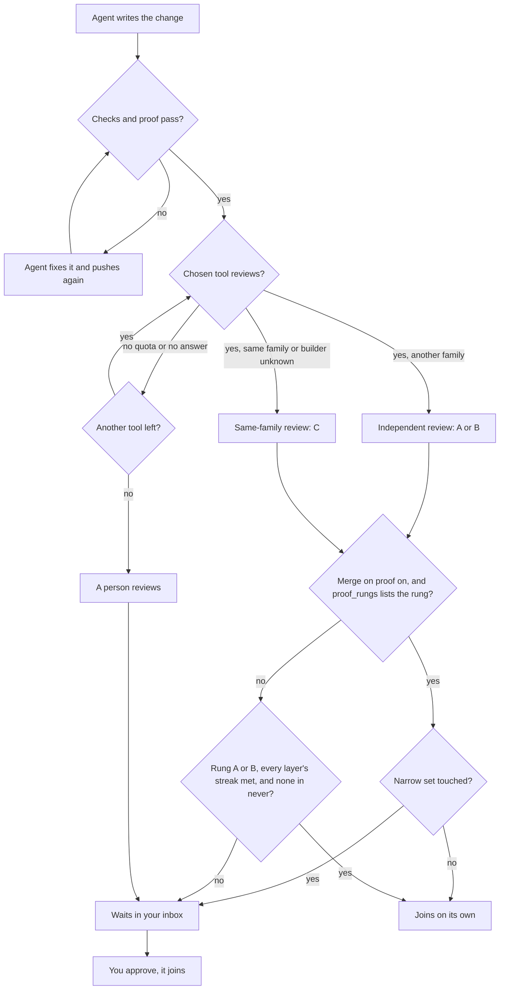

# aayu v0.3.0: proven work merges by itself

> [!NOTE]
> v0.3.0 is not tagged yet. This page lists only work that has merged into `dev`. We update it before the tag.

v0.3.0 follows v0.2.0 (2026-10-17) and lets aayu merge a proven change on its own ([#617](https://github.com/rahulnakmol/agentic-ayudha/issues/617)). By default, the merge gate now reviews each
change with a model you choose ([#657](https://github.com/rahulnakmol/agentic-ayudha/issues/657)). Two new seats handle production problems and data designs ([#337](https://github.com/rahulnakmol/agentic-ayudha/issues/337), [#293](https://github.com/rahulnakmol/agentic-ayudha/issues/293)).
A new survey maps old code before you change it ([#292](https://github.com/rahulnakmol/agentic-ayudha/issues/292)).

aayu helps one person, or a product team, run software work with AI agents. The agents write the changes. aayu checks
each change and gets it reviewed. People decide only what matters.

In this release, a change made for a story can join your shared code on its own ([#617](https://github.com/rahulnakmol/agentic-ayudha/issues/617)). This happens only when the checks pass and the
proof matches the story. The review must also find nothing to fix. By default, that review can come from a model
of the builder's own family; remove C from `[autonomy] proof_rungs` to require another vendor ([#617](https://github.com/rahulnakmol/agentic-ayudha/issues/617), [#657](https://github.com/rahulnakmol/agentic-ayudha/issues/657)). Changes to a small, named set of
files and settings always wait for a person ([#617](https://github.com/rahulnakmol/agentic-ayudha/issues/617)). This is off until you turn it on ([#617](https://github.com/rahulnakmol/agentic-ayudha/issues/617)). For you, this means less time on routine changes. You keep your
attention for the changes that can hurt you.

We use aayu on its own code first. In this repository, one person, @rahulnakmol, works with a team of agents.

No Feature is called proven for this release. The four proven Features, [#37](https://github.com/rahulnakmol/agentic-ayudha/issues/37), [#127](https://github.com/rahulnakmol/agentic-ayudha/issues/127),
[#128](https://github.com/rahulnakmol/agentic-ayudha/issues/128), and [#129](https://github.com/rahulnakmol/agentic-ayudha/issues/129), shipped in v0.1.0. The full list of changes is in the [changelog](../../CHANGELOG.md#v030).

## In one minute

- **What is new:** a change made for a story joins your shared code on its own, once the checks, the proof, and the review all
  pass. You decide the rest ([what's new](#whats-new)).
- **What changed:** the merge gate reviews in your CI by default, a person's review counts only from their own terminal,
  and a few defaults are stricter
  ([what changed for you](#what-changed-for-you)).
- **New to aayu?** Three steps get you to your first story ([get started](#get-started)).
- **Already use aayu?** Six upgrade steps, each with a check that tells you it worked ([upgrade](#upgrade)).
- **What to watch:** known problems, each with a way around it ([known limits](#known-limits)).
- **The detail:** tables for engineers ([for engineers](#for-engineers)) and the full
  [changelog](../../CHANGELOG.md#v030).

## Read this if you are…

| You are | Read first | Then |
|---|---|---|
| Working alone: one person and the agents | [What's new](#whats-new), then [Get started](#get-started) or [Upgrade](#upgrade) | [Known limits](#known-limits) |
| A small team: two to a few engineers who share one repository | [What changed for you](#what-changed-for-you) and [Breaking changes](#breaking-changes) | [Upgrade](#upgrade), and agree on steps 4 and 6 |
| A medium team: engineers, a product manager, paired seats, CODEOWNERS, and more than one reviewer | [Breaking changes](#breaking-changes) and [Upgrade](#upgrade), with your repository admin | [For engineers](#for-engineers) and [Known limits](#known-limits) |

## Words used on this page

- **Change request** (a *pull request*): a proposed change to your code. It waits for checks and a review before it
  joins.
- **Shared code** (the `dev` *branch*): the copy of your code that your team and agents work on together.
- **Agent**: an AI program that writes code for you.
- **Checks**: tests that run by themselves on each change request.
- **Story**: one small piece of work, with the results it must show.
- **Proof** (a *proof pack*): the record that shows a change gives the results its story promised.
- **Review**: another AI model, a review service, or a person reads the change and reports problems.
- **Code-review environment**: a GitHub environment named `code-review` that holds the review model's settings and
  key. Only your base branches and default branch can reach it ([#657](https://github.com/rahulnakmol/agentic-ayudha/issues/657)).
- **Narrow set**: the files and settings that decide who may approve and what is trusted. With merge on proof on,
  changes to them always wait for a person. With it off, ship does not read the narrow set ([#617](https://github.com/rahulnakmol/agentic-ayudha/issues/617)).

## What's new

Each item says what changed, who it helps, how to start, and one limit. Where a person working alone and a team see it
differently, a line says so. The commands are for the person who runs aayu.

- **Approve only what matters.** For you if routine changes take too much of your time. A change made for a story joins your
  shared code on its own, once the checks, the proof, and the review all pass. A change that needs only your yes waits in your inbox as Ready to ship, with a recommendation
  ([#617](https://github.com/rahulnakmol/agentic-ayudha/issues/617), [#442](https://github.com/rahulnakmol/agentic-ayudha/issues/442), [#587](https://github.com/rahulnakmol/agentic-ayudha/issues/587)). *Start:* turn on merge on proof (`[autonomy] proof = true`), and open your inbox with
  `aayu inbox`. *Limit:* it is off by default, and the narrow set always waits for a person ([#617](https://github.com/rahulnakmol/agentic-ayudha/issues/617)).
  - *Alone:* you merge each narrow-set change yourself. A protected file still takes your recorded solo-mode bypass
    ([run it alone](../guide/guide-solo-founder.md)).
  - *Team:* a person other than the author approves each narrow-set change. Where CODEOWNERS covers the file, a code
    owner reviews it.
- **Approve from any device, your phone included.** For you if you are not at your computer when a step needs you. A
  step that needs you asks for a code that you confirm on GitHub ([#467](https://github.com/rahulnakmol/agentic-ayudha/issues/467)). A recorded approver can also approve a group
  of up to 10 steps with one reply ([#501](https://github.com/rahulnakmol/agentic-ayudha/issues/501)). *Start:* nothing to set for the code; aayu asks when a step needs you.
  *Limit:* a step that you cannot undo always needs the code ([#501](https://github.com/rahulnakmol/agentic-ayudha/issues/501)).
  - *Alone:* you use the code until you install the aayudha App and record yourself in `[approvals] approvers`. A
    reply cannot count while agents write as you.
  - *Team:* record the people who may approve by reply in `[approvals] approvers`. Any of them can approve a group.
- **Get a review on every change.** For you if you want a second reader before code joins. Each change, other than a
  change to documents only, gets a review. aayu records how independent it was ([#466](https://github.com/rahulnakmol/agentic-ayudha/issues/466), [#483](https://github.com/rahulnakmol/agentic-ayudha/issues/483)). *Start:* agents ask for
  it after each push; a person can run `aayu inspect <number>`. *Limit:* a change to documents only gets no review
  ([#466](https://github.com/rahulnakmol/agentic-ayudha/issues/466)).
  - *Team:* a paid review runs only for authors with write or admin access. For other authors, the next tool or a
    person reviews ([#579](https://github.com/rahulnakmol/agentic-ayudha/issues/579)).
- **Review in your own CI.** For you if a review app runs out of quota and work stops. By default, the merge gate
  sends each change to a review model you choose, with your key ([#657](https://github.com/rahulnakmol/agentic-ayudha/issues/657)). Review apps, such as CodeRabbit or Greptile,
  are optional. When the chosen tool cannot review, an installed app does, and then a person ([#641](https://github.com/rahulnakmol/agentic-ayudha/issues/641), [#634](https://github.com/rahulnakmol/agentic-ayudha/issues/634), [#657](https://github.com/rahulnakmol/agentic-ayudha/issues/657)).
  *Start:* `aayu init --gates` creates the `code-review` environment. Add your key as the secret
  `AAYU_REVIEW_MODEL_KEY` ([code review in the merge gate](../guide/how-review.md)). *Limit:* until the key is set,
  the review fails and names what is missing ([#657](https://github.com/rahulnakmol/agentic-ayudha/issues/657)).
  - *Alone:* you pay for each review. `[budget] per_pr_inspect_max` caps each pull request, at 5 USD by default ([#657](https://github.com/rahulnakmol/agentic-ayudha/issues/657)).
  - *Team:* one model or app serves the whole repository, so agree on it together. Only the recorded approver's
    review clears the person step ([#647](https://github.com/rahulnakmol/agentic-ayudha/issues/647)).
- **Find the cause of a production problem from evidence.** For you if something breaks and you must explain why. aayu
  follows the error to the code that runs in production. Then it writes a blameless report and opens the follow-up
  work ([#343](https://github.com/rahulnakmol/agentic-ayudha/issues/343), [#358](https://github.com/rahulnakmol/agentic-ayudha/issues/358)). *Start:* `aayu investigate`, then `aayu respond`. *Limit:* it proposes a fix but never runs it
  ([#343](https://github.com/rahulnakmol/agentic-ayudha/issues/343)).
- **Map old code before you change it.** For you if you take over code with no documents. aayu reads the code and
  writes a plain summary of what it does ([#292](https://github.com/rahulnakmol/agentic-ayudha/issues/292), [#495](https://github.com/rahulnakmol/agentic-ayudha/issues/495)). *Start:* `aayu survey`. *Limit:* it adds work items only from a
  summary that you reviewed ([#298](https://github.com/rahulnakmol/agentic-ayudha/issues/298)).
- **Decide with numbered options.** For you if a decision waits on you. Each decision gives at least two options, and
  you choose one by its number ([#498](https://github.com/rahulnakmol/agentic-ayudha/issues/498), [#551](https://github.com/rahulnakmol/agentic-ayudha/issues/551)). *Start:* decisions wait in `aayu inbox`. *Limit:* a waiver, a seat
  change, or a step only a person may take never applies by itself ([#445](https://github.com/rahulnakmol/agentic-ayudha/issues/445)).
  - *Alone:* a decision that you can undo applies the recommended option after 24 business hours ([#445](https://github.com/rahulnakmol/agentic-ayudha/issues/445)).
  - *Team:* a decision waits for the person with authority, such as a seat's paired person ([#445](https://github.com/rahulnakmol/agentic-ayudha/issues/445)).

### How a change joins your code now

First the checks and the proof must pass. If they fail, the change does not reach review or your inbox ([#577](https://github.com/rahulnakmol/agentic-ayudha/issues/577)).
Then the review runs. Last, aayu reads the narrow set and your settings. Then the change joins or waits for you
([#617](https://github.com/rahulnakmol/agentic-ayudha/issues/617), [#634](https://github.com/rahulnakmol/agentic-ayudha/issues/634), [#641](https://github.com/rahulnakmol/agentic-ayudha/issues/641), [#577](https://github.com/rahulnakmol/agentic-ayudha/issues/577)). With merge on proof off, a change can still join on its own. Every layer it touches must
have a long enough correction-free streak, and none may be in `[autonomy] never` ([#89](https://github.com/rahulnakmol/agentic-ayudha/issues/89)). On that path, ship does not read the narrow set ([#617](https://github.com/rahulnakmol/agentic-ayudha/issues/617)). With `ci`, the default, the review model goes first. When it
cannot review, the installed apps review in a fixed order, then a person. With an app chosen, the next installed app
reviews, then the review model, then a person ([#641](https://github.com/rahulnakmol/agentic-ayudha/issues/641), [#657](https://github.com/rahulnakmol/agentic-ayudha/issues/657)). `[autonomy] proof_rungs` lists A, B, and C by default.
So a same-family review can let a change join on proof, but it never counts toward the streak ([#510](https://github.com/rahulnakmol/agentic-ayudha/issues/510), [#657](https://github.com/rahulnakmol/agentic-ayudha/issues/657)).

## What changed for you

If you already use aayu, these things now work in a different way.

- **A person's review counts only from their own terminal.** When inspect falls back to a person, the approver runs
  `aayu inspect <pr> --approve --reason "<what you checked>"` after each push. A comment alone no longer clears that
  fallback ([#647](https://github.com/rahulnakmol/agentic-ayudha/issues/647)). A pull request that waits for a person in ship, such as a narrow-set change, still takes an
  ordinary GitHub approval of its head ([#617](https://github.com/rahulnakmol/agentic-ayudha/issues/617)). See [Breaking changes](#breaking-changes).
  - *Alone:* you are the approver. Set `[autonomy] approver` to your login.
  - *Team:* only the one recorded approver can clear the fallback. Other reviewers' comments do not count.
- **The merge gate reviews in your CI.** `[inspect] reviewer` defaults to `ci`, and aayu no longer picks an app for
  you ([#641](https://github.com/rahulnakmol/agentic-ayudha/issues/641), [#657](https://github.com/rahulnakmol/agentic-ayudha/issues/657)). Until you add the key or choose an app, the gate fails and says what is missing. See
  [Breaking changes](#breaking-changes).
- **A same-family review counts for merge on proof.** `[autonomy] proof_rungs` now lists A, B, and C. A review of a
  builder whose family is unknown is rung C too ([#657](https://github.com/rahulnakmol/agentic-ayudha/issues/657)). Set `proof_rungs = ["A", "B"]` to require another vendor.
- **An agent cannot run a step that only a person may take.** When an agent starts one, a person approves it first:
  with a code on GitHub, or with a reply from a recorded approver ([#192](https://github.com/rahulnakmol/agentic-ayudha/issues/192), [#467](https://github.com/rahulnakmol/agentic-ayudha/issues/467), [#501](https://github.com/rahulnakmol/agentic-ayudha/issues/501)).
- **A build stops before work that nobody gave to an agent.** aayu says what to ask you first ([#280](https://github.com/rahulnakmol/agentic-ayudha/issues/280)).
- **A build has a cost limit.** It stops at 60 USD of metered spend, and pauses at a subscription's usage limit ([#490](https://github.com/rahulnakmol/agentic-ayudha/issues/490)).
- **A floor waiver counts only when the right person accepts it** ([#624](https://github.com/rahulnakmol/agentic-ayudha/issues/624)).
  - *Alone:* that person is you, as the recorded approver.
  - *Team:* set the person in `[decisions] authority`, for example the Quality Architect seat's paired person.
- **Your agents' config files have code owners.** `aayu init --gates` adds them to CODEOWNERS, and `aayu doctor`
  fails when they drift ([#538](https://github.com/rahulnakmol/agentic-ayudha/issues/538)).
  - *Team:* a code owner reviews each change to them.
- **A second person turns on code-owner review.** When you add a second person with `aayu seat`, it adds the rule that
  asks code owners to review ([#516](https://github.com/rahulnakmol/agentic-ayudha/issues/516)).
  - *Team:* this rule is new on a repository that `aayu init` set up for one person.
- **New issues get their labels sooner.** The `triage-daily` loop runs at 09:00, 13:00, 17:00, and 21:00 each
  weekday, not once each morning ([#682](https://github.com/rahulnakmol/agentic-ayudha/issues/682)).
- **A rolling release waits for eval results.** `aayu release --to rolling` promotes only a commit that has them, and
  never starts evals itself ([#524](https://github.com/rahulnakmol/agentic-ayudha/issues/524)).

### Breaking changes

If your project let aayu pick its review tool, the merge gate now calls a review model in your CI instead. Until a
person adds its key, or names a review app, the gate fails. A person's review in inspect now counts only through a
command in their own terminal.

All breaking changes in v0.3.0 are in this table. Each row gives the type of change, what replaces it, and the step
to take. A removal names the version that deprecated it and the version that removed it.

| Type | Change | What replaces it | Who is affected | What you do |
|---|---|---|---|---|
| Removed in v0.3.0. No version deprecated them; v0.2.0 used `auto` as the default. | `[inspect] reviewer = "auto"` and `[inspect] reviewer = "amp"` ([#641](https://github.com/rahulnakmol/agentic-ayudha/issues/641)) | `[inspect] reviewer` names one tool: `ci` (the default), `codex`, `coderabbit`, `greptile`, `claude`, `cursor`, or `human`. `model` stays for aayu's own evals, and needs a model key in CI | A project whose config sets `auto` or `amp` | Do [upgrade](#upgrade) step 4. Until then, a person reviews every pull request that is not docs-only. `aayu install --apply` asks for a tool again ([#657](https://github.com/rahulnakmol/agentic-ayudha/issues/657)). |
| Changed in v0.3.0. No version deprecated it. | With no `[inspect] reviewer` set, the gate reviewed through an installed app ([#657](https://github.com/rahulnakmol/agentic-ayudha/issues/657)) | The gate calls the model that the `code-review` environment names, with the secret `AAYU_REVIEW_MODEL_KEY` | A project whose config names no review tool | Do [upgrade](#upgrade) steps 3 and 4. Until the key is set, the gate fails and names what is missing. |
| Changed in v0.3.0. No version deprecated it. | A person's review comment counts in inspect's human fallback ([#647](https://github.com/rahulnakmol/agentic-ayudha/issues/647)) | Only the `[autonomy] approver`'s `aayu inspect <pr> --approve --reason "<what you checked>"` for that exact head counts | A project where a person reviews: `[inspect] reviewer = "human"`, no tool chosen, or every tool unable to review | Set `[autonomy] approver`. The approver runs the command in their own terminal after each push. |

**Am I affected?** If your `.aayudha/config.toml` already names an app, `human`, or `model` in `[inspect] reviewer`, you
can skip the first two changes. `amp` is not one of them. If a model or an app always reviews your pull requests, the
third change does not reach you.

## Get started

New to aayu? These three steps take you to your first story. [Your first hour](../guide/start.md) shows each step in
full, with what you should see.

1. **Install aayu.** Run
   `curl -fsSL https://raw.githubusercontent.com/rahulnakmol/agentic-ayudha/main/install.sh | sh`. It checks the
   release's signature before it copies anything.
2. **Take the tour.** In a clone of your repository, run `aayu tour`. It checks your machine, sets up the repository,
   and connects your agent. It asks before each change.
   - *Team:* a repository admin runs this step, because `aayu init` needs admin access.
3. **Ask for your first story.** Ask your agent to use the grill skill to write a story. Then run `aayu ready <issue>`
   to freeze what you agreed.

## Upgrade

If you already run aayu on a project, you or an engineer on your team does these steps. Do them once, after v0.3.0 is
published. Each step says who does it on a team.

> [!WARNING]
> Steps 2 to 6 change protected files. A person runs each one and merges its pull request.

1. Update the binary with `aayu self-update`. It installs only a published release. If you installed aayu with
   Homebrew, Scoop, or winget, self-update only prints that tool's upgrade command, so run that command. Check:
   `aayu version` shows v0.3.0. *Who:* each person, on their own machine.
2. Run `aayu upgrade` to see the changes, then `aayu upgrade --apply` to move your config and state to this version.
   Check: the `config` and `schema` rows of `aayu doctor` pass. *Who:* a person with admin access to the repository,
   because it rewrites protected files.
3. Run `aayu init --gates` and commit the result through a pull request ([#500](https://github.com/rahulnakmol/agentic-ayudha/issues/500), [#538](https://github.com/rahulnakmol/agentic-ayudha/issues/538)). It also creates the
   `code-review` environment, with Grok 4.7 at `https://api.x.ai/v1` filled in ([#657](https://github.com/rahulnakmol/agentic-ayudha/issues/657)). Check: the `security-workflow`
   and `host-config` rows of `aayu doctor` pass, and init's report has an `environment code-review` line. *Who:* a repository admin; on a team, a code owner reviews it.
4. Choose the review before step 5. For `ci`, the default, add the secret `AAYU_REVIEW_MODEL_KEY` in **Settings →
   Environments → code-review**. To use another model, change `AAYU_REVIEW_MODEL_URL` and `AAYU_REVIEW_MODEL`. A
   gateway with one wire format also needs `AAYU_REVIEW_MODEL_API_STYLE` ([#657](https://github.com/rahulnakmol/agentic-ayudha/issues/657)). For an app, set `[inspect] reviewer`
   to its name. List each reviewer app installed on the repository in `[inspect] apps`. The gate falls back only to
   apps listed there ([#641](https://github.com/rahulnakmol/agentic-ayudha/issues/641)). If a person may review, set `[autonomy] approver` to that person's login ([#647](https://github.com/rahulnakmol/agentic-ayudha/issues/647)). If you
   skip this step, `aayu install --apply` in step 5 asks, and Enter picks `ci`. Check: open a pull request. For `ci`,
   the inspect comment's first line names the model, for example `different-family review (B, paid): grok-4.7
   (xai)`. doctor cannot read the environment, so the gate is where a missing setting shows. For an app, the
   `reviewer-apps` row of `aayu doctor` passes, but it cannot tell whether the app is installed for this repository.
   Check that on the app's own installation page. *Who:* alone, you; on a team, agree first, then another person
   reviews the change.
5. Run `aayu install --apply`, and `aayu install --env --apply` for the pre-push gate ([#418](https://github.com/rahulnakmol/agentic-ayudha/issues/418)). Check: the
   `host-config` and `skills-copies` rows of `aayu doctor` pass, and the output says "installed the pre-push hook". Your next
   `git push` runs the local gate first. *Who:* a person with admin access, because these
   files govern the agents.
6. If you want merge on proof, set `[autonomy] proof = true` in `.aayudha/config.toml` ([#617](https://github.com/rahulnakmol/agentic-ayudha/issues/617)). Merge this change
   yourself after a review. While proof is still off on the base branch, ship does not hold it for a person (Bug [#680](https://github.com/rahulnakmol/agentic-ayudha/issues/680)). Check: `aayu config show` lists `proof = true` under `[autonomy]`. A
   later Story pull request that meets every condition shows "merged on proof" in `aayu ship`. *Who:* alone, you; on a team, agree first, then another person reviews the change.

## For engineers

This part is for the engineers who set up and run aayu. Nobody else needs to act on it.

### Merge and review

| Change | Pull request |
|---|---|
| With `[autonomy] proof` on, `aayu ship` merges into `dev` with no person's pass when the pack verifies and the floors hold. @rahulnakmol decided this in Decision [#593](https://github.com/rahulnakmol/agentic-ayudha/issues/593). | [#617](https://github.com/rahulnakmol/agentic-ayudha/issues/617), [#621](https://github.com/rahulnakmol/agentic-ayudha/issues/621) |
| Merge on proof also needs inspect at `merge` with a rung in `[autonomy] proof_rungs`. The default is A, B, and C. | [#617](https://github.com/rahulnakmol/agentic-ayudha/issues/617), [#657](https://github.com/rahulnakmol/agentic-ayudha/issues/657) |
| Every required check must pass, but ship counts a skipped or neutral check as passing (see [#643](https://github.com/rahulnakmol/agentic-ayudha/issues/643)). The exception is `protected-paths`, which the ship record lists. | [#617](https://github.com/rahulnakmol/agentic-ayudha/issues/617) |
| With merge on proof on, the narrow set always waits for a person: the `always_person` paths and 20 config tables. | [#617](https://github.com/rahulnakmol/agentic-ayudha/issues/617) |
| The narrow set also holds a workflow with a credential, any `action.yml` or `action.yaml`, and any changed symbolic link. | [#617](https://github.com/rahulnakmol/agentic-ayudha/issues/617) |
| The merge gate reviews every pull request that is not docs-only. `aayu build` asks for the review after each push. | [#466](https://github.com/rahulnakmol/agentic-ayudha/issues/466) |
| The gate records the builder's model family and the review rung: A app, B paid, C same family. | [#483](https://github.com/rahulnakmol/agentic-ayudha/issues/483) |
| The autonomy streak counts only rung A, rung B, and a person's review. A review of a builder whose family is unknown is rung C. | [#510](https://github.com/rahulnakmol/agentic-ayudha/issues/510), [#657](https://github.com/rahulnakmol/agentic-ayudha/issues/657) |
| The ship record, `aayu audit`, and `aayu status --streak` show each merge's rung. | [#518](https://github.com/rahulnakmol/agentic-ayudha/issues/518) |
| `[inspect] reviewer = "ci"`, the default, calls the model that the `code-review` environment names: `AAYU_REVIEW_MODEL_URL`, `AAYU_REVIEW_MODEL`, the secret `AAYU_REVIEW_MODEL_KEY`, and the optional `AAYU_REVIEW_MODEL_API_STYLE` (`chat`, `responses`, or `messages`). It is rung B when the model is of another family. | [#657](https://github.com/rahulnakmol/agentic-ayudha/issues/657) |
| `aayu init --gates` creates the `code-review` environment. Only the base branches and the default branch can deploy to it, and init removes every other rule. | [#657](https://github.com/rahulnakmol/agentic-ayudha/issues/657) |
| The CI review fails closed and names the missing setting. It refuses a URL with a key, a query, or an operation path such as `/chat/completions`. A docs-only pull request is skipped first. | [#657](https://github.com/rahulnakmol/agentic-ayudha/issues/657) |
| Rung B is a paid review model. `[inspect] paid_reviewer` names it when `AAYU_REVIEW_MODEL` names none, and as the fallback. | [#550](https://github.com/rahulnakmol/agentic-ayudha/issues/550), [#657](https://github.com/rahulnakmol/agentic-ayudha/issues/657) |
| `[inspect] paid_effort` sets every review call's effort. Empty, it is high, or medium for Claude Opus, Claude Fable, and GPT-6 Astra. Only authors with write or admin access get a paid review. | [#579](https://github.com/rahulnakmol/agentic-ayudha/issues/579), [#657](https://github.com/rahulnakmol/agentic-ayudha/issues/657) |
| `[inspect] reviewer` names one tool: `ci` (the default), `codex`, `coderabbit`, `greptile`, `claude`, `cursor`, or `human`. `model` stays for aayu's own evals, and needs a model key in CI. `aayu install --apply` asks again for a value the gate cannot use, and Enter picks `ci`. | [#641](https://github.com/rahulnakmol/agentic-ayudha/issues/641), [#657](https://github.com/rahulnakmol/agentic-ayudha/issues/657) |
| A review from CodeRabbit or Greptile counts as rung A for any builder. @rahulnakmol decided this on [#635](https://github.com/rahulnakmol/agentic-ayudha/issues/635). | [#641](https://github.com/rahulnakmol/agentic-ayudha/issues/641) |
| A quota reply moves the review to the next installed app, then the CI review, then a person. So does no reply when inspect runs again 30 minutes or more after the request. When the CI review is the chosen tool and cannot review, the apps review, then a person. | [#634](https://github.com/rahulnakmol/agentic-ayudha/issues/634), [#641](https://github.com/rahulnakmol/agentic-ayudha/issues/641), [#657](https://github.com/rahulnakmol/agentic-ayudha/issues/657) |
| Every review call asks for fast (priority) serving where the endpoint offers it. The budget charges the priority rate for xAI. | [#634](https://github.com/rahulnakmol/agentic-ayudha/issues/634), [#657](https://github.com/rahulnakmol/agentic-ayudha/issues/657) |
| inspect makes one paid review call per head commit, and none on a reply event. | [#623](https://github.com/rahulnakmol/agentic-ayudha/issues/623) |
| inspect stops after three rounds until a person reopens the review. It tags findings outside the diff as pre-existing. | [#583](https://github.com/rahulnakmol/agentic-ayudha/issues/583) |
| Agents run `aayu ship` on their Story pull requests. A pull request that needs only your yes shows as Ready to ship. | [#577](https://github.com/rahulnakmol/agentic-ayudha/issues/577) |

### Identity and trust

| Change | Pull request |
|---|---|
| A human-only command in an agent's shell runs only after a person approves it: through GitHub's device flow, or, for a reversible batch with comment approvals on, a recorded approver's `/aayu approve` reply. | [#192](https://github.com/rahulnakmol/agentic-ayudha/issues/192), [#467](https://github.com/rahulnakmol/agentic-ayudha/issues/467), [#501](https://github.com/rahulnakmol/agentic-ayudha/issues/501) |
| `aayu decide a,b --accept x,y` puts up to 10 human-only steps in one batch for a separate approver. | [#501](https://github.com/rahulnakmol/agentic-ayudha/issues/501) |
| inspect reads its own state only from a comment that its trusted writer posted. | [#605](https://github.com/rahulnakmol/agentic-ayudha/issues/605) |
| `aayu inspect <pr> --approve --reason "<what you checked>"` records the approver's review of the head on the ledger, after the device flow every time. It is the only person's review that clears inspect's human fallback. | [#647](https://github.com/rahulnakmol/agentic-ayudha/issues/647) |
| `aayu init --identity` stops at once in a remote shell and creates no App. | [#603](https://github.com/rahulnakmol/agentic-ayudha/issues/603) |
| `aayu init --identity` refuses an App with another owner, an extra permission or event, or another webhook. | [#603](https://github.com/rahulnakmol/agentic-ayudha/issues/603) |
| `aayu seat` creates the codeowner review ruleset when a second person joins. | [#516](https://github.com/rahulnakmol/agentic-ayudha/issues/516) |

### Config and policy

| Change | Pull request |
|---|---|
| A checkout's config cannot send a stored integration key to another host. | [#602](https://github.com/rahulnakmol/agentic-ayudha/issues/602) |
| `aayu init --gates` puts every host's executable config under CODEOWNERS. `aayu doctor` fails when it drifts. | [#538](https://github.com/rahulnakmol/agentic-ayudha/issues/538) |
| A floor waiver counts only when the floor-waiver authority accepted it. | [#624](https://github.com/rahulnakmol/agentic-ayudha/issues/624) |
| Every Decision offers at least two numbered options. | [#498](https://github.com/rahulnakmol/agentic-ayudha/issues/498), [#551](https://github.com/rahulnakmol/agentic-ayudha/issues/551) |
| `aayu build` stops before a Ready story that you did not ask an agent to build. | [#280](https://github.com/rahulnakmol/agentic-ayudha/issues/280) |

### Security floors

| Change | Pull request |
|---|---|
| `aayu init --gates` installs a security workflow. It scans each push to `dev`, `rolling`, and `main`, and each tip nightly. | [#500](https://github.com/rahulnakmol/agentic-ayudha/issues/500) |
| A PostHog or Sentry call that the host guard recognises may only read. | [#489](https://github.com/rahulnakmol/agentic-ayudha/issues/489), [#525](https://github.com/rahulnakmol/agentic-ayudha/issues/525) |
| Each PostHog or Sentry read that the host guard sees is logged. Inline tokens are redacted. | [#494](https://github.com/rahulnakmol/agentic-ayudha/issues/494), [#517](https://github.com/rahulnakmol/agentic-ayudha/issues/517) |
| Recordings, replays, and feedback reads need `allow_pii`, committed on the `dev` branch. | [#523](https://github.com/rahulnakmol/agentic-ayudha/issues/523), [#531](https://github.com/rahulnakmol/agentic-ayudha/issues/531) |
| The host guard covers PostHog and Sentry calls under GitHub Copilot. | [#537](https://github.com/rahulnakmol/agentic-ayudha/issues/537), [#556](https://github.com/rahulnakmol/agentic-ayudha/issues/556) |
| `aayu doctor` tries each PostHog and Sentry capability with one cheap read and names the fix. | [#499](https://github.com/rahulnakmol/agentic-ayudha/issues/499) |

### New seats and verbs

| Change | Pull request |
|---|---|
| A Production Engineer seat owns reliability, incidents, and investigation. | [#337](https://github.com/rahulnakmol/agentic-ayudha/issues/337) |
| `aayu investigate` goes from bounded telemetry queries to the deployed revision and the code. | [#343](https://github.com/rahulnakmol/agentic-ayudha/issues/343), [#526](https://github.com/rahulnakmol/agentic-ayudha/issues/526), [#536](https://github.com/rahulnakmol/agentic-ayudha/issues/536), [#590](https://github.com/rahulnakmol/agentic-ayudha/issues/590) |
| `aayu slo` and `aayu runbook` define SLOs and runbooks, and gate releases on them. | [#352](https://github.com/rahulnakmol/agentic-ayudha/issues/352), [#547](https://github.com/rahulnakmol/agentic-ayudha/issues/547), [#540](https://github.com/rahulnakmol/agentic-ayudha/issues/540), [#560](https://github.com/rahulnakmol/agentic-ayudha/issues/560) |
| `aayu respond` writes a checked postmortem and files the follow-up Bug. | [#358](https://github.com/rahulnakmol/agentic-ayudha/issues/358), [#625](https://github.com/rahulnakmol/agentic-ayudha/issues/625) |
| A Data & AI Architect seat owns `measure` and the new `aayu chart`. | [#293](https://github.com/rahulnakmol/agentic-ayudha/issues/293), [#325](https://github.com/rahulnakmol/agentic-ayudha/issues/325) |
| `aayu survey` indexes a codebase, including Fortran, COBOL, Pascal, and Visual Basic, and renders `SURVEY.md`. | [#292](https://github.com/rahulnakmol/agentic-ayudha/issues/292), [#336](https://github.com/rahulnakmol/agentic-ayudha/issues/336), [#346](https://github.com/rahulnakmol/agentic-ayudha/issues/346), [#495](https://github.com/rahulnakmol/agentic-ayudha/issues/495) |
| `aayu counsel` asks Atri, the Founder's Sage, and answers with cited sources. It never reviews. | [#493](https://github.com/rahulnakmol/agentic-ayudha/issues/493) |
| `aayu inbox` shows each human-only step as one card, with the seat's counsel. `--list` prints it for agents. | [#442](https://github.com/rahulnakmol/agentic-ayudha/issues/442), [#587](https://github.com/rahulnakmol/agentic-ayudha/issues/587), [#620](https://github.com/rahulnakmol/agentic-ayudha/issues/620) |

### Writing and docs

| Change | Pull request |
|---|---|
| `aayu tell` refuses a draft that names a Feature without proof packs or uses a superlative. | [#284](https://github.com/rahulnakmol/agentic-ayudha/issues/284) |
| tell restates the criteria and does not extrapolate. | [#291](https://github.com/rahulnakmol/agentic-ayudha/issues/291) |
| Every skill has its own page in the guide, made from the verb registry. | [#455](https://github.com/rahulnakmol/agentic-ayudha/issues/455) |
| New guides cover the delivery loop, solo work, growing from an MVP, and read-only PostHog and Sentry. | [#463](https://github.com/rahulnakmol/agentic-ayudha/issues/463), [#473](https://github.com/rahulnakmol/agentic-ayudha/issues/473), [#474](https://github.com/rahulnakmol/agentic-ayudha/issues/474), [#507](https://github.com/rahulnakmol/agentic-ayudha/issues/507) |

### Evals, CI, and installs

| Change | Pull request |
|---|---|
| Promotion waits on more eval groups: tell, host-skills, and retro. | [#304](https://github.com/rahulnakmol/agentic-ayudha/issues/304), [#427](https://github.com/rahulnakmol/agentic-ayudha/issues/427), [#447](https://github.com/rahulnakmol/agentic-ayudha/issues/447) |
| CI fails a pull request that lowers a skill-eval bar without an accepted waiver. | [#407](https://github.com/rahulnakmol/agentic-ayudha/issues/407) |
| `aayu release --to rolling` promotes only a `dev` commit that has eval results. It never starts evals. | [#524](https://github.com/rahulnakmol/agentic-ayudha/issues/524) |
| Agents run `aayu release` behind the full gate. Promotion to `main` needs a person's stable-release request. | [#443](https://github.com/rahulnakmol/agentic-ayudha/issues/443) |
| `aayu install --env --apply` installs a pre-push hook that runs your local gate. | [#418](https://github.com/rahulnakmol/agentic-ayudha/issues/418) |
| `triage-daily` runs four times each weekday. A loop whose local hour falls on the next day in UTC gets one cron per UTC day. | [#682](https://github.com/rahulnakmol/agentic-ayudha/issues/682) |
| `aayu build` has a 60 USD limit on metered spend, and pauses at a subscription's usage limit. | [#490](https://github.com/rahulnakmol/agentic-ayudha/issues/490) |
| GitHub Copilot is a host: `aayu install --host copilot --apply` writes its skills, MCP server, and hooks. | [#491](https://github.com/rahulnakmol/agentic-ayudha/issues/491), [#549](https://github.com/rahulnakmol/agentic-ayudha/issues/549) |

Everything else that changed in v0.3.0 is in the [changelog](../../CHANGELOG.md#v030), with its pull request.

## Known limits

| Type | Item | Owner | Status or mitigation |
|---|---|---|---|
| Risk | Merge on proof is off by default ([#617](https://github.com/rahulnakmol/agentic-ayudha/issues/617)). With it off, a change still merges without a person when every layer it touches has a long enough correction-free streak and none is in `[autonomy] never` ([#89](https://github.com/rahulnakmol/agentic-ayudha/issues/89)). ship does not read the narrow set on that path, so it can merge a narrow-set change (Bug [#680](https://github.com/rahulnakmol/agentic-ayudha/issues/680)). | You | Set `[autonomy] proof = true` in a reviewed pull request. Read `aayu status --streak` to see each layer's streak. |
| Issue | ship reads the required checks once. A check that turns red later can pass under a bypass identity ([#632](https://github.com/rahulnakmol/agentic-ayudha/issues/632), from Codex's review of [#617](https://github.com/rahulnakmol/agentic-ayudha/issues/617)). | Drona | Open. Do not run ship under a bypass identity. |
| Issue | ship and the reply job can read a newer skipped check over the gate's pass ([#643](https://github.com/rahulnakmol/agentic-ayudha/issues/643), seen on [#634](https://github.com/rahulnakmol/agentic-ayudha/issues/634) and [#603](https://github.com/rahulnakmol/agentic-ayudha/issues/603)). | Drona | Open. Run the gate's job again. |
| Issue | ship takes its human-pass policy from the checkout that runs it ([#645](https://github.com/rahulnakmol/agentic-ayudha/issues/645), from the deep review of [#617](https://github.com/rahulnakmol/agentic-ayudha/issues/617)). | Drona | Open. Give agents no second account. |
| Issue | ship reads only the first page of gate runs, artifacts, and jobs ([#646](https://github.com/rahulnakmol/agentic-ayudha/issues/646), from the deep review of [#617](https://github.com/rahulnakmol/agentic-ayudha/issues/617)). | Drona | Open. It refuses; it never merges wrongly. |
| Issue | A person's `/aayu review again` comment does not start the reply job ([#662](https://github.com/rahulnakmol/agentic-ayudha/issues/662), found by @rahulnakmol on [#641](https://github.com/rahulnakmol/agentic-ayudha/issues/641)). | Drona | Open. Push again or run the gate again. |
| Risk | With `[autonomy] proof` on, a same-family review (C) merges on proof by default. So does a review of a builder whose family is unknown ([#657](https://github.com/rahulnakmol/agentic-ayudha/issues/657)). | You | Set `proof_rungs = ["A", "B"]` to require another vendor. doctor's `review-rung` row says when this applies. |
| Issue | A private repository on GitHub Free has no environments, so the CI review cannot run there ([#657](https://github.com/rahulnakmol/agentic-ayudha/issues/657)). | You | init says so. Choose a review app, or make the repository public or upgrade. |
| Issue | In CI, the fallback never asks an app that reviews only when mentioned, such as Claude or Cursor ([#644](https://github.com/rahulnakmol/agentic-ayudha/issues/644), from CodeRabbit's review of [#641](https://github.com/rahulnakmol/agentic-ayudha/issues/641)). | Drona | Open. Run `aayu inspect <pr>` outside CI to ask it. |
| Issue | AGENTS.md and the ship guide describe the narrow set too narrowly ([#633](https://github.com/rahulnakmol/agentic-ayudha/issues/633), from CodeRabbit's review of [#617](https://github.com/rahulnakmol/agentic-ayudha/issues/617)). | Sauti | Open. The full set is in [CONSTRAINTS.md](../../CONSTRAINTS.md). |
| Risk | The host guard misses a CLI in a script file or alias, and a server behind a generic proxy. | Nala | Known gap, in the [integrations guide](../guide/guide-integrations.md). |
| Assumption | The production, data and AI, survey, and counsel eval groups report but do not gate promotion. | Yama | By design in `evals/eval.toml` (`gate = "advisory"`). |
| Dependency | Agents in this repository still write under @rahulnakmol's account. The bot App waits on [#594](https://github.com/rahulnakmol/agentic-ayudha/issues/594). | @rahulnakmol | Open. See the [ledger guide](../guide/how-ledger.md). |

## Thanks and what's next

Thank you, @rahulnakmol. You chose one review tool per project and the CodeRabbit and Greptile rule on [#635](https://github.com/rahulnakmol/agentic-ayudha/issues/635). You chose
the CI review as the default, and A, B, and C as the default rungs, on [#657](https://github.com/rahulnakmol/agentic-ayudha/issues/657). You also found [#662](https://github.com/rahulnakmol/agentic-ayudha/issues/662) on [#641](https://github.com/rahulnakmol/agentic-ayudha/issues/641).

Planned next, for v0.4:

- The gate picks the reviewer's model from the builder's model, with a shipped pairing table ([#648](https://github.com/rahulnakmol/agentic-ayudha/issues/648)).
- You create your aayudha GitHub App once, from your phone, and its key never leaves the token exchange ([#594](https://github.com/rahulnakmol/agentic-ayudha/issues/594)).
- ship reads the gate's passing check, not a newer skipped one ([#643](https://github.com/rahulnakmol/agentic-ayudha/issues/643)).
- A person's `/aayu review again` comment starts the review at once ([#662](https://github.com/rahulnakmol/agentic-ayudha/issues/662)).
- A guide shows how to run XERJ code search beside aayu, and what to watch for ([#673](https://github.com/rahulnakmol/agentic-ayudha/issues/673)).
