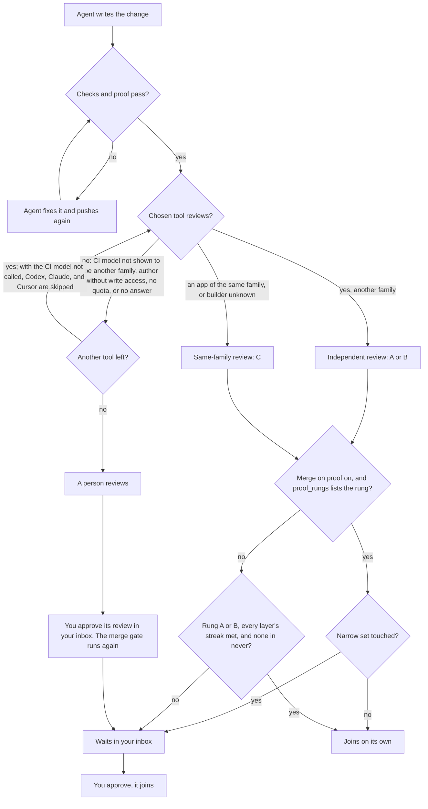

# aayu v0.3.0: proven work merges by itself

> [!NOTE]
> v0.3.0 is not tagged yet. This page lists only work that has merged into `dev`. We update it before the tag.

v0.3.0 follows v0.2.0 (2026-10-17) and lets aayu merge a proven change on its own ([#617](https://github.com/rahulnakmol/agentic-ayudha/issues/617)). By default, once its checks and proof pass ([#577](https://github.com/rahulnakmol/agentic-ayudha/issues/577)), the merge
gate now reviews each change that is ready for review and not docs-only with a model you choose, when that model's family differs from the
builder's and the author has write access; otherwise CodeRabbit or Greptile, when listed, or a person reviews; the gate then skips a listed Codex, Claude, or Cursor, which review only when a person asks them ([#657](https://github.com/rahulnakmol/agentic-ayudha/issues/657), [#579](https://github.com/rahulnakmol/agentic-ayudha/issues/579), [#724](https://github.com/rahulnakmol/agentic-ayudha/issues/724)). Two new seats handle production problems and data designs ([#337](https://github.com/rahulnakmol/agentic-ayudha/issues/337), [#293](https://github.com/rahulnakmol/agentic-ayudha/issues/293)).
A new survey maps old code before you change it ([#292](https://github.com/rahulnakmol/agentic-ayudha/issues/292)).

aayu helps one person, or a product team, run software work with AI agents. The agents write the changes. aayu checks
each change that is ready for review. When the checks and proof pass and the change is not docs-only, aayu gets it
reviewed ([#466](https://github.com/rahulnakmol/agentic-ayudha/issues/466), [#577](https://github.com/rahulnakmol/agentic-ayudha/issues/577)). People decide only what matters.

In this release, a change made for a story can join your shared code on its own ([#617](https://github.com/rahulnakmol/agentic-ayudha/issues/617)). This happens only when the checks pass and the
proof matches the story. The review must also end at `merge`: no P0 or P1 finding, and no criterion judged unmet. By default, that review can come from a model
of the builder's own family; remove C from `[autonomy] proof_rungs` to require another vendor ([#617](https://github.com/rahulnakmol/agentic-ayudha/issues/617), [#657](https://github.com/rahulnakmol/agentic-ayudha/issues/657)). Changes to a small, named set of
files and settings always wait for a person ([#617](https://github.com/rahulnakmol/agentic-ayudha/issues/617)). This is off until you turn it on ([#617](https://github.com/rahulnakmol/agentic-ayudha/issues/617)). For you, this means less time on routine changes. You keep your
attention for the changes that can hurt you.

We use aayu on its own code first. In this repository, one person, @rahulnakmol, is the recorded approver
(`[autonomy] approver` in `.aayudha/config.toml`). A pull request that an agent opens carries the
`agent-authored` label (AGENTS.md, "Every agent PR declares itself").

No Feature is called proven for this release. The four proven Features, [#37](https://github.com/rahulnakmol/agentic-ayudha/issues/37), [#127](https://github.com/rahulnakmol/agentic-ayudha/issues/127),
[#128](https://github.com/rahulnakmol/agentic-ayudha/issues/128), and [#129](https://github.com/rahulnakmol/agentic-ayudha/issues/129), shipped in v0.1.0. The full list of changes is in the [changelog](../../CHANGELOG.md#v030).

## In one minute

- **What is new:** with merge on proof on (`[autonomy] proof = true`, off by default), a change made for a story joins
  your shared code on its own once the checks, the proof, and a review whose rung `[autonomy] proof_rungs` lists all
  pass, unless it touches the narrow set ([#617](https://github.com/rahulnakmol/agentic-ayudha/issues/617)). With it off, a change joins on its own only with a review of another
  family (rung A or B) and a long enough streak on every layer it touches, none of them in `[autonomy] never` ([#510](https://github.com/rahulnakmol/agentic-ayudha/issues/510),
  [#89](https://github.com/rahulnakmol/agentic-ayudha/issues/89)), and never when it touches the narrow set ([#686](https://github.com/rahulnakmol/agentic-ayudha/issues/686)). You decide the rest ([what's new](#whats-new)).
- **Already use aayu?** Six upgrade steps, each with a check that tells you it worked ([upgrade](#upgrade)).
- **What changed:** the merge gate reviews in your CI by default, a person's review counts only from their own terminal,
  and a few defaults are stricter ([breaking changes](#breaking-changes),
  [what changed for you](#what-changed-for-you)).
- **New to aayu?** Three steps get you to your first story ([get started](#get-started)).
- **What to watch:** known problems, each with a way around it ([known limits](#known-limits)).
- **The detail:** tables for engineers ([for engineers](#for-engineers)) and the full
  [changelog](../../CHANGELOG.md#v030).

## Read this if you are…

| You are | Read first | Then |
|---|---|---|
| Working alone: one person and the agents | [What's new](#whats-new), then [Get started](#get-started) or [Upgrade](#upgrade) | [Known limits](#known-limits) |
| A small team: two to a few engineers who share one repository | [What changed for you](#what-changed-for-you) and [Breaking changes](#breaking-changes) | [Upgrade](#upgrade), and agree on steps 4 and 6 |
| A medium team: engineers, a product manager, paired seats, CODEOWNERS, and more than one reviewer | [Breaking changes](#breaking-changes) and [Upgrade](#upgrade), with your repository admin | [For engineers](#for-engineers) and [Known limits](#known-limits) |

## Words used on this page

- **Change request** (a *pull request*): a proposed change to your code. It waits for checks and a review before it
  joins.
- **Shared code** (your integration *branch*, `dev` unless `[branches] dev` names another): the copy of your code
  that your team and agents work on together.
- **Agent**: an AI program that writes code for you.
- **Checks**: tests that run by themselves on each change request.
- **Story**: one small piece of work, with the results it must show.
- **Proof** (a *proof pack*): the record that shows a change gives the results its story promised.
- **Review**: another AI model, a review service, or a person reads the change and reports problems.
- **Code-review environment**: a GitHub environment named `code-review` that holds the review model's settings and
  key. Only your base branches and default branch can reach it ([#657](https://github.com/rahulnakmol/agentic-ayudha/issues/657)).
- **Narrow set**: the files and settings that decide who may approve and what is trusted. With merge on proof on,
  changes to them always wait for a person, whether a change would merge on proof or on a correction-free streak
  ([#617](https://github.com/rahulnakmol/agentic-ayudha/issues/617), [#686](https://github.com/rahulnakmol/agentic-ayudha/issues/686)).

## Upgrade

If you already run aayu on a project, you or an engineer on your team does these steps. Do them once, after v0.3.0 is
published. Each step says who does it on a team.

> [!WARNING]
> Steps 3, 5, and 6 change protected files, and so do step 2 when it lists changes and step 4 when you edit `[inspect]`. A person runs each one
> and merges its pull request. The `AAYU_REVIEW_MODEL_KEY` secret goes only in GitHub's environment settings, never in
> a commit.

1. Update the binary with `aayu self-update`. It installs only a published release. If you installed aayu with
   Homebrew, Scoop, or winget, self-update only prints that tool's upgrade command, so run that command. The winget
   id is `AkmolsInc.AgenticAyudha` ([#831](https://github.com/rahulnakmol/agentic-ayudha/issues/831)). Check:
   `aayu version` prints `aayu 0.3.0` (`internal/cli/version.go:21`). *Who:* each person, on their own machine.
2. Run `aayu upgrade` to check your config and state. v0.3.0 adds no schema migration (`internal/upgrade/upgrade.go`),
   so a project on v0.1.0 or v0.2.0 sees `repository schema is current; nothing to upgrade`. Only if it lists changes,
   run `aayu upgrade --apply` and merge the result through a pull request. Check: the `config` and `schema` rows of
   `aayu doctor` pass. *Who:* a person with admin access to the repository, because `--apply` rewrites protected
   files.
3. Run `aayu init --gates` and commit the result through a pull request ([#500](https://github.com/rahulnakmol/agentic-ayudha/issues/500), [#538](https://github.com/rahulnakmol/agentic-ayudha/issues/538)). It also creates the
   `code-review` environment, with Grok 4.7 at `https://api.x.ai/v1` filled in ([#657](https://github.com/rahulnakmol/agentic-ayudha/issues/657)). Check: the `security-workflow`
   row of `aayu doctor` says the workflow is installed (it warns until the first nightly run), and init's report has an `environment code-review` line. If you
   choose an app or `human` in step 4, put that `.aayudha/config.toml` change in this same pull request. The gate
   reads the config from the base branch, so a later pull request is checked with `ci` and fails without the key.
   *Who:* a repository admin; on a team, a code owner reviews it.
4. Choose the review before step 5. For `ci`, the default, add the secret `AAYU_REVIEW_MODEL_KEY` in **Settings →
   Environments → code-review**. To use another model, change `AAYU_REVIEW_MODEL_URL` and `AAYU_REVIEW_MODEL`. The
   endpoint must take a bearer key. Anthropic's API does not, so reach Claude through a gateway ([how review works](../guide/how-review.md)). A
   gateway with one wire format also needs `AAYU_REVIEW_MODEL_API_STYLE` ([#657](https://github.com/rahulnakmol/agentic-ayudha/issues/657)). A private repository on GitHub Free
   has no environments, so init cannot create `code-review` there: choose an app or `human` instead ([#657](https://github.com/rahulnakmol/agentic-ayudha/issues/657)). For an app, set `[inspect] reviewer`
   to its name. For a person, set `[inspect] reviewer = "human"` and `[autonomy] approver` to that person's login. List each reviewer app installed on the repository in `[inspect] apps`. The gate falls back only to
   apps listed there ([#641](https://github.com/rahulnakmol/agentic-ayudha/issues/641)). If a person may review, set `[autonomy] approver` to that person's login ([#647](https://github.com/rahulnakmol/agentic-ayudha/issues/647)). If you
   skip this step, `aayu install --apply` in step 5 asks, and Enter picks `ci`. An app or `human` chosen there misses step 3's pull request, so choose it here. Check: open a ready pull request that changes code and passes the gate's checks and proof; if they fail, inspect is
   skipped. For `ci`,
   the inspect comment's **Review:** field, under its heading, names the model, for example `different-family review (B, paid): grok-4.7
   (xai)`. It does so only when the model's family differs from the builder's and the author has write access.
   Otherwise it names the app or person that reviews instead, and any listed Codex, Claude, or Cursor it skipped ([#724](https://github.com/rahulnakmol/agentic-ayudha/issues/724)). doctor cannot read the environment, so the gate is where a missing setting shows. For an app, the
   `reviewer-apps` row of `aayu doctor` passes, but it cannot tell whether the app is installed for this repository.
   Check that on the app's own installation page. *Who:* alone, you; on a team, agree first, then another person
   reviews the change.
5. Run `aayu install --apply`, and `aayu install --env --apply` for the pre-push gate ([#418](https://github.com/rahulnakmol/agentic-ayudha/issues/418)). Check: the
   `host-config` and `skills-copies` rows of `aayu doctor` pass, and the output says "installed the pre-push hook". Your next
   `git push` runs the local gate first. *Who:* a person with admin access, because these
   files govern the agents.
6. If you want merge on proof, set `[autonomy] proof = true` in `.aayudha/config.toml` ([#617](https://github.com/rahulnakmol/agentic-ayudha/issues/617)). Merge this change
   yourself after a review: ship holds it for a person, because `[autonomy]` is in the narrow set ([#686](https://github.com/rahulnakmol/agentic-ayudha/issues/686)). Check: `aayu config show` lists `proof = true` under `[autonomy]`. A
   later Story pull request that meets every condition shows "merged on proof" in `aayu ship`. *Who:* alone, you; on a team, agree first, then another person reviews the change.

## Breaking changes

If your project let aayu pick its review tool, the merge gate now calls a review model in your CI instead. Until a
person adds its key, or names a review app, the gate fails. A person's review in inspect now counts only through a
command in their own terminal.

All breaking changes in v0.3.0 are in this table. Each row gives the type of change, what replaces it, and the step
to take. A removal names the version that deprecated it and the version that removed it.

| Type | Change | What replaces it | Who is affected | What you do |
|---|---|---|---|---|
| Removed in v0.3.0. No version deprecated them; v0.2.0 used `auto` as the default. | `[inspect] reviewer = "auto"` and `[inspect] reviewer = "amp"` ([#641](https://github.com/rahulnakmol/agentic-ayudha/issues/641)) | `[inspect] reviewer` names one tool: `ci` (the default), `codex`, `coderabbit`, `greptile`, `claude`, `cursor`, or `human`. `model` stays for aayu's own evals, and needs a model key in CI | A project whose config sets `auto` or `amp` | Do [upgrade](#upgrade) step 4. Until then, a person reviews every pull request that is not docs-only, once it is ready for review and its checks and proof pass. `aayu install --apply` asks for a tool again ([#657](https://github.com/rahulnakmol/agentic-ayudha/issues/657)). |
| Changed in v0.3.0. No version deprecated it. | With no `[inspect] reviewer` set, the gate reviewed through an installed app ([#657](https://github.com/rahulnakmol/agentic-ayudha/issues/657)) | The gate calls the model that the `code-review` environment names, with the secret `AAYU_REVIEW_MODEL_KEY` | A project whose config names no review tool | Do [upgrade](#upgrade) steps 3 and 4. Until the key is set, the gate fails and names what is missing. |
| Changed in v0.3.0. No version deprecated it. | A person's review comment counts in inspect's human fallback ([#647](https://github.com/rahulnakmol/agentic-ayudha/issues/647)) | Only the `[autonomy] approver`'s approval of that exact head counts: `aayu inspect <pr> --approve --reason "<what you checked>"`, or approving its card in `aayu inbox` ([#678](https://github.com/rahulnakmol/agentic-ayudha/issues/678)) | A project where a person reviews: `[inspect] reviewer = "human"`, or every tool unable to review | Set `[autonomy] approver`. After each push, the approver runs the command in their own terminal or approves the card in `aayu inbox`. |

**Am I affected?** If your `.aayudha/config.toml` already names an app, `human`, or `model` in `[inspect] reviewer`, you
can skip the first two changes. `amp` is not one of them. If a model or an app always reviews your pull requests, the
third change does not reach you.

## What's new

Each item says what changed, who it helps, how to start, and one limit. Where a person working alone and a team see it
differently, a line says so. The commands are for the person who runs aayu.

- **Approve only what matters.** For you if routine changes take too much of your time. A change made for a story joins your
  shared code on its own, once the checks and the proof pass and the review ends at `merge` from a rung that `[autonomy] proof_rungs` lists. A change that needs only your yes waits in your inbox as Ready to ship, with a recommendation
  ([#617](https://github.com/rahulnakmol/agentic-ayudha/issues/617), [#442](https://github.com/rahulnakmol/agentic-ayudha/issues/442), [#587](https://github.com/rahulnakmol/agentic-ayudha/issues/587)). *Start:* turn on merge on proof (`[autonomy] proof = true`), and open your inbox with
  `aayu inbox`. *Limit:* it is off by default, and the narrow set always waits for a person ([#617](https://github.com/rahulnakmol/agentic-ayudha/issues/617)).
  - *Alone:* you merge each narrow-set change yourself. A protected file still takes your recorded solo-mode bypass
    ([run it alone](../guide/guide-solo-founder.md)).
  - *Team:* a person other than the author approves each narrow-set change. Where CODEOWNERS covers the file, a code
    owner reviews it.
- **Approve from any device, your phone included.** For you if you are not at your computer when a step needs you. A
  step that needs you asks for a code that you confirm on GitHub ([#467](https://github.com/rahulnakmol/agentic-ayudha/issues/467)). A recorded approver can also accept up to
  10 Decisions with one reply, when you batch them with `aayu decide a,b --accept x,y` ([#501](https://github.com/rahulnakmol/agentic-ayudha/issues/501)). *Start:* nothing to set for the code; aayu asks when a step needs you.
  *Limit:* a step that you cannot undo always needs the code ([#501](https://github.com/rahulnakmol/agentic-ayudha/issues/501)).
  - *Alone:* you use the code until you install the aayudha App and record yourself in `[approvals] approvers`. A
    reply cannot count while agents write as you.
  - *Team:* record the people who may approve by reply in `[approvals] approvers`. Any of them can approve a group.
- **Get a review before code joins.** For you if you want a second reader before code joins. Each change, other than a
  change to documents only, gets a review. aayu records how independent it was ([#466](https://github.com/rahulnakmol/agentic-ayudha/issues/466), [#483](https://github.com/rahulnakmol/agentic-ayudha/issues/483)). *Start:* agents ask for
  it after each push; a person can run `aayu inspect <number>`. *Limit:* a change to documents only gets no review
  ([#466](https://github.com/rahulnakmol/agentic-ayudha/issues/466)), a draft gets none until you mark it ready, and the review runs only after the checks and proof pass ([#577](https://github.com/rahulnakmol/agentic-ayudha/issues/577)).
  After three reviewed heads, inspect stops asking for a review until a person with write access comments `/aayu review again` ([#583](https://github.com/rahulnakmol/agentic-ayudha/issues/583)). That comment starts the review again, with no push ([#849](https://github.com/rahulnakmol/agentic-ayudha/issues/849)).
  Without `--delegate`, `aayu build` also has a model of another vendor review the branch before each push, when such a
  model can be called. That review never counts: the merge gate still decides ([#663](https://github.com/rahulnakmol/agentic-ayudha/issues/663)).
  - *Team:* a paid review runs only for authors with write or admin access. For other authors, CodeRabbit or
    Greptile, when listed, or a person reviews ([#579](https://github.com/rahulnakmol/agentic-ayudha/issues/579)). The gate skips a listed Codex, Claude, or Cursor then, and a
    person reviews when CodeRabbit or Greptile has still not replied when inspect runs again 30 minutes or more after the
    head's first inspect run ([#724](https://github.com/rahulnakmol/agentic-ayudha/issues/724)).
- **Review in your own CI.** For you if a review app runs out of quota and work stops. By default, the merge gate
  sends each change to a review model you choose, with your key ([#657](https://github.com/rahulnakmol/agentic-ayudha/issues/657)). That model reviews only when its family
  differs from the builder's and the author has write access; otherwise CodeRabbit or Greptile, when listed, or a person reviews ([#579](https://github.com/rahulnakmol/agentic-ayudha/issues/579)). The gate then skips a listed app that reviews only when mentioned ([#724](https://github.com/rahulnakmol/agentic-ayudha/issues/724)). Review apps, such as CodeRabbit or Greptile,
  are optional. When the chosen tool cannot review, an installed app does, and then a person ([#641](https://github.com/rahulnakmol/agentic-ayudha/issues/641), [#634](https://github.com/rahulnakmol/agentic-ayudha/issues/634), [#657](https://github.com/rahulnakmol/agentic-ayudha/issues/657)). An app that reviews only when mentioned is the exception ([#644](https://github.com/rahulnakmol/agentic-ayudha/issues/644), see [Known limits](#known-limits)).
  *Start:* `aayu init --gates` creates the `code-review` environment. Add your key as the secret
  `AAYU_REVIEW_MODEL_KEY` ([code review in the merge gate](../guide/how-review.md)). A private repository on GitHub
  Free has no environments, so init says it could not create `code-review` and continues: choose an app or `human`
  there instead ([#657](https://github.com/rahulnakmol/agentic-ayudha/issues/657)). *Limit:* until the key is set, the review fails and names what is missing ([#657](https://github.com/rahulnakmol/agentic-ayudha/issues/657)).
  - *Alone:* you pay for each review. `[budget] per_pr_inspect_max` caps each pull request, at 5 USD by default ([#657](https://github.com/rahulnakmol/agentic-ayudha/issues/657)).
    A diff over 120 kB can go past it by the review parts already started ([#714](https://github.com/rahulnakmol/agentic-ayudha/issues/714), see [Known limits](#known-limits)).
  - *Team:* one model or app serves the whole repository, so agree on it together. Only the recorded approver's
    review clears the person step ([#647](https://github.com/rahulnakmol/agentic-ayudha/issues/647)).
- **Find the cause of a production problem from evidence.** For you if something breaks and you must explain why. aayu
  follows the error to the code that runs in production. Then it writes a blameless report and opens the follow-up
  work ([#343](https://github.com/rahulnakmol/agentic-ayudha/issues/343), [#358](https://github.com/rahulnakmol/agentic-ayudha/issues/358)). *Start:* `aayu investigate`, then `aayu respond`. *Limit:* it proposes a fix but never runs it
  ([#343](https://github.com/rahulnakmol/agentic-ayudha/issues/343)).
- **Map old code before you change it.** For you if you take over code with no documents. aayu reads the code and
  writes a plain summary of what it does ([#292](https://github.com/rahulnakmol/agentic-ayudha/issues/292), [#495](https://github.com/rahulnakmol/agentic-ayudha/issues/495)). *Start:* `aayu survey`. *Limit:* it adds work items only from a
  summary that you reviewed ([#298](https://github.com/rahulnakmol/agentic-ayudha/issues/298)).
- **Keep what the product is, and why.** For you if the reasons behind your product leave with the people who knew
  them. `aayu brain` keeps the vision, principles, objectives, decisions, and capabilities as linked notes on a `brain`
  branch. Obsidian shows them as a graph. Each note links issues and never copies them, and a seat owns it ([#674](https://github.com/rahulnakmol/agentic-ayudha/issues/674)).
  *Start:* `aayu brain init`, then `aayu brain open`. *Limit:* on a public repository the `brain` branch is public, so
  write only what is already public ([#674](https://github.com/rahulnakmol/agentic-ayudha/issues/674)).
- **Decide with numbered options.** For you if a decision waits on you. Each decision gives at least two options, and
  you choose one by its number ([#498](https://github.com/rahulnakmol/agentic-ayudha/issues/498), [#551](https://github.com/rahulnakmol/agentic-ayudha/issues/551)). *Start:* decisions wait in `aayu inbox`. *Limit:* a waiver, a seat
  change, or a step only a person may take never applies by itself ([#445](https://github.com/rahulnakmol/agentic-ayudha/issues/445)).
  - *Alone:* a decision that you can undo applies the recommended option after 24 business hours ([#445](https://github.com/rahulnakmol/agentic-ayudha/issues/445)).
  - *Team:* a decision waits for the person with authority, such as a seat's paired person ([#445](https://github.com/rahulnakmol/agentic-ayudha/issues/445)).

### How a change joins your code now

First the checks and the proof must pass. If they fail, the change does not reach review or your inbox ([#577](https://github.com/rahulnakmol/agentic-ayudha/issues/577)).
Then the review runs. Last, aayu reads the narrow set and your settings. Then the change joins or waits for you
([#617](https://github.com/rahulnakmol/agentic-ayudha/issues/617), [#634](https://github.com/rahulnakmol/agentic-ayudha/issues/634), [#641](https://github.com/rahulnakmol/agentic-ayudha/issues/641), [#577](https://github.com/rahulnakmol/agentic-ayudha/issues/577)). With merge on proof off, a change can still join on its own. Every layer it touches must
have a long enough correction-free streak, none may be in `[autonomy] never` ([#89](https://github.com/rahulnakmol/agentic-ayudha/issues/89)), and the current head needs a
review of another family, rung A or B ([#510](https://github.com/rahulnakmol/agentic-ayudha/issues/510)). On that path too, a change that touches the narrow set waits for you ([#686](https://github.com/rahulnakmol/agentic-ayudha/issues/686)). With `ci`, the default, the review model goes first. It is not called when its family cannot be
shown to differ from the builder's, or when the author lacks write access. Then, or when it cannot review, the
installed apps review in a fixed order, then a person. When the model call fails and the next app is a Codex, Claude, or Cursor, CI cannot ask it: run `aayu inspect <pr>` outside CI to ask it. If it has not replied 30 minutes later, run `aayu inspect <pr>` again or rerun the merge gate; only then do later apps and a person get their turn ([#644](https://github.com/rahulnakmol/agentic-ayudha/issues/644), [#691](https://github.com/rahulnakmol/agentic-ayudha/issues/691), see [Known limits](#known-limits)). When the model is not called, the gate skips a listed Codex, Claude, or Cursor, which review only when a person asks them, so CodeRabbit or Greptile reviews, else a person ([#724](https://github.com/rahulnakmol/agentic-ayudha/issues/724)). With an app chosen, the next installed app
reviews, then the review model, then a person ([#641](https://github.com/rahulnakmol/agentic-ayudha/issues/641), [#657](https://github.com/rahulnakmol/agentic-ayudha/issues/657)). `[autonomy] proof_rungs` lists A, B, and C by default.
So a same-family review can let a change join on proof, but it never counts toward the streak ([#510](https://github.com/rahulnakmol/agentic-ayudha/issues/510), [#657](https://github.com/rahulnakmol/agentic-ayudha/issues/657)).

## What changed for you

If you already use aayu, these things now work in a different way.

- **A person's review counts only from their own terminal.** When inspect falls back to a person, after each push the approver
  runs `aayu inspect <pr> --approve --reason "<what you checked>"`, or approves its card in `aayu inbox` ([#678](https://github.com/rahulnakmol/agentic-ayudha/issues/678)). A comment alone no longer clears that
  fallback ([#647](https://github.com/rahulnakmol/agentic-ayudha/issues/647)). A pull request that waits for a person in ship, such as a narrow-set change, still takes an
  ordinary GitHub approval of its head ([#617](https://github.com/rahulnakmol/agentic-ayudha/issues/617)). See [Breaking changes](#breaking-changes).
  - *Alone:* you are the approver. Set `[autonomy] approver` to your login. `aayu inbox` shows each pull request
    that waits for your review as a card, and one device code covers the session ([#678](https://github.com/rahulnakmol/agentic-ayudha/issues/678)).
  - *Team:* only the one recorded approver can clear the fallback. Other reviewers' comments do not count.
- **The merge gate reviews in your CI.** `[inspect] reviewer` defaults to `ci`, and aayu no longer picks an app for
  you ([#641](https://github.com/rahulnakmol/agentic-ayudha/issues/641), [#657](https://github.com/rahulnakmol/agentic-ayudha/issues/657)). Until you add the key or choose an app, the gate fails and says what is missing. See
  [Breaking changes](#breaking-changes).
- **A same-family review counts for merge on proof.** `[autonomy] proof_rungs` now lists A, B, and C. A review of a
  builder whose family is unknown is rung C too ([#657](https://github.com/rahulnakmol/agentic-ayudha/issues/657)). Set `proof_rungs = ["A", "B"]` to require another vendor.
- **An agent cannot run a step that only a person may take.** When an agent starts one, a person approves it first:
  with a code on GitHub, or with a reply from a recorded approver ([#192](https://github.com/rahulnakmol/agentic-ayudha/issues/192), [#467](https://github.com/rahulnakmol/agentic-ayudha/issues/467), [#501](https://github.com/rahulnakmol/agentic-ayudha/issues/501)).
- **A build stops before work that nobody gave to an agent.** aayu says what to ask you first ([#280](https://github.com/rahulnakmol/agentic-ayudha/issues/280)).
- **A build has a cost limit.** It stops at 60 USD of metered spend, and pauses at a subscription's usage limit ([#490](https://github.com/rahulnakmol/agentic-ayudha/issues/490)).
- **Web and API apps get a security scan.** When `[verify] platforms` lists web or api, verify runs a ZAP scan (DAST)
  under Docker or Podman. It attacks only an app that `[verify] seed` started on this machine, or a URL that
  `.aayudha/config.toml` opts in; any other URL gets a passive scan. A high alert, or a story with nothing to scan, blocks ship from 2026-11-14 unless a floor waiver names
  dast ([#509](https://github.com/rahulnakmol/agentic-ayudha/issues/509)). `aayu doctor` shows what it will scan and how.
- **A floor waiver counts only when the right person accepts it** ([#624](https://github.com/rahulnakmol/agentic-ayudha/issues/624)).
  - *Alone:* that person is you, as the recorded approver.
  - *Team:* set the person in `[decisions] authority`, for example the Quality Architect seat's paired person.
- **Your agents' config files have code owners.** `aayu init --gates` adds them to CODEOWNERS, and `aayu doctor`
  fails when they drift ([#538](https://github.com/rahulnakmol/agentic-ayudha/issues/538)).
  - *Team:* a code owner reviews each change to them.
- **A second person turns on code-owner review.** When you add a second person with `aayu seat`, it adds the rule that
  asks code owners to review ([#516](https://github.com/rahulnakmol/agentic-ayudha/issues/516)).
  - *Team:* this rule is new on a repository that `aayu init` set up for one person.
- **New issues get their labels sooner.** The `triage-daily` loop runs at 09:00, 13:00, 17:00, and 21:00 each
  weekday, not once each morning ([#682](https://github.com/rahulnakmol/agentic-ayudha/issues/682)). In Amp and Cursor, the new `triage-opened` loop triages an intake issue
  when it opens. Claude Code and Codex have no trigger for that event, so `triage-daily` covers them ([#684](https://github.com/rahulnakmol/agentic-ayudha/issues/684)).
- **A rolling release waits for eval results.** `aayu release --to rolling` promotes only a commit that has them, and
  never starts evals itself ([#524](https://github.com/rahulnakmol/agentic-ayudha/issues/524)).

## Get started

New to aayu? These three steps take you to your first story. [Your first hour](../guide/start.md) shows each step in
full, with what you should see.

1. **Install aayu.** Run
   `curl -fsSL https://raw.githubusercontent.com/rahulnakmol/agentic-ayudha/main/install.sh | sh`. It checks the
   release's signature before it copies anything.
2. **Take the tour.** In a clone of your repository, run `aayu tour`. It checks your machine, sets up the repository,
   and connects your agent. It asks before each change.
   - *Team:* a repository admin runs this step, because `aayu init` needs admin access.
3. **Ask for your first story.** Ask your agent to use the grill skill to write a story. Then run `aayu ready <issue>`
   to freeze what you agreed.

## For engineers

This part is for the engineers who set up and run aayu. Nobody else needs to act on it.

### Merge and review

| Change | Pull request |
|---|---|
| With `[autonomy] proof` on, `aayu ship` merges into your integration branch (`[branches] dev`, `dev` by default) with no person's pass when the pack verifies and the floors hold. @rahulnakmol decided this in Decision [#593](https://github.com/rahulnakmol/agentic-ayudha/issues/593). | [#617](https://github.com/rahulnakmol/agentic-ayudha/issues/617), [#621](https://github.com/rahulnakmol/agentic-ayudha/issues/621) |
| Merge on proof also needs inspect at `merge` with a rung in `[autonomy] proof_rungs`. The default is A, B, and C. | [#617](https://github.com/rahulnakmol/agentic-ayudha/issues/617), [#657](https://github.com/rahulnakmol/agentic-ayudha/issues/657) |
| Every required check must pass, but ship counts a skipped or neutral check as passing. The exception is `protected-paths`, which the ship record lists. | [#617](https://github.com/rahulnakmol/agentic-ayudha/issues/617) |
| The narrow set always waits for a person, on proof or on a streak: the `always_person` paths and 22 config tables, `[scope]` and `[build]` included. | [#617](https://github.com/rahulnakmol/agentic-ayudha/issues/617), [#686](https://github.com/rahulnakmol/agentic-ayudha/issues/686), [#676](https://github.com/rahulnakmol/agentic-ayudha/issues/676), [#685](https://github.com/rahulnakmol/agentic-ayudha/issues/685) |
| The narrow set also holds a workflow with a credential, any `action.yml` or `action.yaml`, and any changed symbolic link. | [#617](https://github.com/rahulnakmol/agentic-ayudha/issues/617) |
| Every merge ship makes with no person's review, on proof or on a streak, gets the `aayu:audit` label first and comes to your inbox for a look after merge. A correction resets the streak of the layers an agent's pull request touched and opens a pull request that reverts it. | [#661](https://github.com/rahulnakmol/agentic-ayudha/issues/661) |
| ship reads its human-pass policy from the base branch's committed `.aayudha/config.toml` and `LAYERS.md`, and stops when your checkout, an `AAYU_*` variable, or `--set` would loosen it. | [#661](https://github.com/rahulnakmol/agentic-ayudha/issues/661) |
| The merge gate reviews every pull request that is not docs-only, once it is ready for review and the `gate` job passes (`inspect` needs `gate`). `aayu build` asks for the review after each push. | [#466](https://github.com/rahulnakmol/agentic-ayudha/issues/466), [#577](https://github.com/rahulnakmol/agentic-ayudha/issues/577) |
| The gate records the builder's model family and the review rung: A app, B paid, C same family. | [#483](https://github.com/rahulnakmol/agentic-ayudha/issues/483) |
| The autonomy streak counts only rung A, rung B, and a person's review. A review of a builder whose family is unknown is rung C. | [#510](https://github.com/rahulnakmol/agentic-ayudha/issues/510), [#657](https://github.com/rahulnakmol/agentic-ayudha/issues/657) |
| The ship record, `aayu audit`, and `aayu status --streak` show each merge's rung. | [#518](https://github.com/rahulnakmol/agentic-ayudha/issues/518) |
| `[inspect] reviewer = "ci"`, the default, calls the model that the `code-review` environment names: `AAYU_REVIEW_MODEL_URL`, `AAYU_REVIEW_MODEL`, the secret `AAYU_REVIEW_MODEL_KEY`, and the optional `AAYU_REVIEW_MODEL_API_STYLE` (`chat`, `responses`, or `messages`). It is rung B when the model is of another family. | [#657](https://github.com/rahulnakmol/agentic-ayudha/issues/657) |
| `aayu init --gates` creates the `code-review` environment. Only the base branches and the default branch can deploy to it: init removes every other branch or tag rule. It leaves other protection rules, such as required reviewers or a wait timer, as they are, and those can hold the inspect job. | [#657](https://github.com/rahulnakmol/agentic-ayudha/issues/657) |
| The work-items block that `aayu init` writes into AGENTS.md names the CI review (rung B) as the default review, then the named app (rung A), then rung C. | [#683](https://github.com/rahulnakmol/agentic-ayudha/issues/683) |
| The CI review fails closed and names the missing setting. It refuses a URL with a key, a query, or an operation path such as `/chat/completions`. A docs-only pull request is skipped first. | [#657](https://github.com/rahulnakmol/agentic-ayudha/issues/657) |
| Rung B is a paid review model. `[inspect] paid_reviewer` names it when `AAYU_REVIEW_MODEL` names none, and as the fallback. | [#550](https://github.com/rahulnakmol/agentic-ayudha/issues/550), [#657](https://github.com/rahulnakmol/agentic-ayudha/issues/657) |
| `[inspect] paid_effort` sets every review call's effort. Empty, it is high, or medium for Claude Opus, Claude Fable, and GPT-6 Astra. Only authors with write or admin access get a paid review. | [#579](https://github.com/rahulnakmol/agentic-ayudha/issues/579), [#657](https://github.com/rahulnakmol/agentic-ayudha/issues/657) |
| `[inspect] reviewer` names one tool: `ci` (the default), `codex`, `coderabbit`, `greptile`, `claude`, `cursor`, or `human`. `model` stays for aayu's own evals, and needs a model key in CI. `aayu install --apply` asks again for a value the gate cannot use, and Enter picks `ci`. | [#641](https://github.com/rahulnakmol/agentic-ayudha/issues/641), [#657](https://github.com/rahulnakmol/agentic-ayudha/issues/657) |
| A review from CodeRabbit or Greptile counts as rung A for any builder. @rahulnakmol decided this on [#635](https://github.com/rahulnakmol/agentic-ayudha/issues/635). | [#641](https://github.com/rahulnakmol/agentic-ayudha/issues/641) |
| A quota reply moves the review to the next installed app, then the CI review, then a person. So does no reply when inspect runs again 30 minutes or more after the request. When the CI review is the chosen tool and cannot review, the apps review, then a person. In CI, an app that reviews only when mentioned is asked only by `aayu inspect` run outside CI ([#644](https://github.com/rahulnakmol/agentic-ayudha/issues/644)). When the CI model is not called, the gate skips such an app, unless someone asked it for the head, for CodeRabbit or Greptile, whose wait starts at the head's first inspect run whatever family `[inspect] app_families` gives it, then a person. | [#634](https://github.com/rahulnakmol/agentic-ayudha/issues/634), [#641](https://github.com/rahulnakmol/agentic-ayudha/issues/641), [#657](https://github.com/rahulnakmol/agentic-ayudha/issues/657), [#724](https://github.com/rahulnakmol/agentic-ayudha/issues/724), [#792](https://github.com/rahulnakmol/agentic-ayudha/issues/792) |
| Every review call asks for fast (priority) serving where the endpoint offers it. The budget charges the priority rate for xAI. | [#634](https://github.com/rahulnakmol/agentic-ayudha/issues/634), [#657](https://github.com/rahulnakmol/agentic-ayudha/issues/657) |
| inspect runs one paid review per head commit, and none on a reply event. A malformed reply is retried once, inside the per-PR budget. | [#623](https://github.com/rahulnakmol/agentic-ayudha/issues/623) |
| Every model gateway call gets the model call limit, `CallTimeout`, so a CI review that streams past 5 minutes is not cut off. | [#688](https://github.com/rahulnakmol/agentic-ayudha/issues/688) |
| The merge gate's inspect job has 30 minutes instead of 15. One review call and its retry share 25 minutes instead of 12. `aayu init --gates` writes the new limit into your workflow. | [#699](https://github.com/rahulnakmol/agentic-ayudha/issues/699) |
| inspect reviews a diff over the 120 kB prompt cap in parts of whole files, in parallel: the fewest parts that hold the files in order, and at most three. Each part gets the same plan and criteria and only its own files, and all parts share the pull request's budget. The result takes the worst part's disposition. Files after the third part, and a file whose diff alone is over the cap, stay unreviewed with that reason. A head reviewed before this change is reviewed again in parts. | [#714](https://github.com/rahulnakmol/agentic-ayudha/issues/714), [#783](https://github.com/rahulnakmol/agentic-ayudha/issues/783) |
| `aayu ship` reads the autonomy streak only when no human pass is settled. After an approving review, a merge on proof, or a solo-mode bypass, ship records the streak as skipped, with the reason. It no longer spends about two minutes reading GitHub history. | [#703](https://github.com/rahulnakmol/agentic-ayudha/issues/703) |
| `aayu install --loops --host amp --apply` records an Amp event loop's subscription. The setup thread updates and enables an existing equivalent subscription with the current instructions. install waits up to five minutes for the thread's final reply, and takes the subscription ID only from that reply. | [#710](https://github.com/rahulnakmol/agentic-ayudha/issues/710) |
| A re-install with `aayu install --loops --host amp --apply` asks the new setup thread to pause the loop's old schedule, recorded in `loops/active.json`, once its own is set. install names the old thread. Nothing confirms the pause, so open the new thread to check it. A recorded ID that names no thread gets a step to pause it by hand. | [#718](https://github.com/rahulnakmol/agentic-ayudha/issues/718) |
| When the CI review fails on a head, the inspect comment gives the error, with the gateway URL replaced by `<endpoint>`. | [#689](https://github.com/rahulnakmol/agentic-ayudha/issues/689) |
| With merge on proof off, ship reads the narrow set before the proof setting. A narrow-set change no longer merges on a correction-free streak alone: ship stops, names the path or table, and fails closed when it cannot read a file. | [#686](https://github.com/rahulnakmol/agentic-ayudha/issues/686) |
| A paid review whose summary is over 1200 characters keeps its findings, verdicts, and disposition: inspect cuts the summary at a word boundary and ends it with an ellipsis. Every other limit on the reply still rejects it. | [#809](https://github.com/rahulnakmol/agentic-ayudha/issues/809) |
| When a reviewer app or a person reviews, the inspect comment's footer shows the `[budget] per_pr_inspect_max` cap, not 0.00 USD. Only the footer changed; a split review can still spend past the cap (see Known limits). | [#781](https://github.com/rahulnakmol/agentic-ayudha/issues/781), [#714](https://github.com/rahulnakmol/agentic-ayudha/issues/714) |
| A transient CI review failure is retried once: a 429 or 5xx reply (after `Retry-After`, at most 30 seconds), an overload or server error event in the stream, or a stream that ended early or was reset. The call and its retry share one `CallTimeout`. The retry needs 3 minutes left and money left in `per_pr_inspect_max`. The fallback note hides IPv4 and bracketed IPv6 addresses, and names the model that failed. | [#697](https://github.com/rahulnakmol/agentic-ayudha/issues/697) |
| inspect's cache key leaves out CodeRabbit's release-notes block in the PR body. This repository's `.coderabbit.yaml` puts that summary in the walkthrough comment instead. | [#696](https://github.com/rahulnakmol/agentic-ayudha/issues/696) |
| `gateCheckRuns` drops every check run of a reply run: a check suite whose `aayudha/inspect-reply` check was not skipped. ship, the reply job, and the inbox read only the gate's own checks. | [#690](https://github.com/rahulnakmol/agentic-ayudha/issues/690), [#643](https://github.com/rahulnakmol/agentic-ayudha/issues/643), [#693](https://github.com/rahulnakmol/agentic-ayudha/issues/693) |
| Outside CI, with `reviewer = "ci"` and no code-review key, `aayu inspect` posts nothing. It reports the gate's verdict for the head, cached, or `no-reply`. `aayu build` asks no one. Once the gate records a failed CI review on that head, a local run asks the fallback app, then a person. | [#691](https://github.com/rahulnakmol/agentic-ayudha/issues/691) |
| inspect stops after three rounds until a person reopens the review. It tags findings outside the diff as pre-existing. | [#583](https://github.com/rahulnakmol/agentic-ayudha/issues/583) |
| A person's `/aayu review again` at the review cap starts the reply job and runs inspect again on the same head, with no push. Only the owner, members, and collaborators start it. Run `aayu init --gates` to update the gate. | [#849](https://github.com/rahulnakmol/agentic-ayudha/issues/849) |
| Without `--delegate`, `aayu build` has a reviewer model of another family review a verified checkpoint's branch before each push. A delegated build is reviewed only by the merge gate. On `fix`, the push waits until the builder fixes each open item, or declines it with `--decline "<id>: <why>"`. The loop stops after three rounds, and its spend counts against `[budget] per_pr_inspect_max`. A held checkpoint is pushed to `refs/aayudha/held/<branch>`, so `aayu build --resume` continues from it on another machine. With no callable reviewer of another family, no model gateway, or a `[budget] per_pr_inspect_max` of 0, the push goes out without a session review and the PR body says why. The PR body's "Session review (self-attested)" section never counts as a review: the merge gate's inspect decides. | [#663](https://github.com/rahulnakmol/agentic-ayudha/issues/663) |
| Agents run `aayu ship` on their Story pull requests. A pull request that needs only your yes shows as Ready to ship. | [#577](https://github.com/rahulnakmol/agentic-ayudha/issues/577) |
| Every pull request body follows one format, which `aayu init` installs and `aayu build` fills. `aayu inspect` checks it. On an agent's pull request, a missing section or a sentence over 20 words holds it at `fix`. | [#672](https://github.com/rahulnakmol/agentic-ayudha/issues/672) |
| `aayu build` writes an `Aayudha-Effort` line after the model lines. On Amp it reads the model and the effort from the thread. | [#672](https://github.com/rahulnakmol/agentic-ayudha/issues/672) |

### Identity and trust

| Change | Pull request |
|---|---|
| A human-only command in an agent's shell runs only after a person approves it: through GitHub's device flow, or, for a reversible batch of Decisions with comment approvals on, a recorded approver's `/aayu approve` reply. | [#192](https://github.com/rahulnakmol/agentic-ayudha/issues/192), [#467](https://github.com/rahulnakmol/agentic-ayudha/issues/467), [#501](https://github.com/rahulnakmol/agentic-ayudha/issues/501) |
| `aayu decide a,b --accept x,y` puts up to 10 Decision acceptances in one batch for a separate approver. | [#501](https://github.com/rahulnakmol/agentic-ayudha/issues/501) |
| inspect reads its own state only from a comment that its trusted writer posted. | [#605](https://github.com/rahulnakmol/agentic-ayudha/issues/605) |
| `aayu inspect <pr> --approve --reason "<what you checked>"` records the approver's review of the head on the ledger, after the device flow every time. With the inbox card that writes the same record ([#678](https://github.com/rahulnakmol/agentic-ayudha/issues/678)), it is the only person's review that clears inspect's human fallback. | [#647](https://github.com/rahulnakmol/agentic-ayudha/issues/647) |
| `aayu inbox` shows a "Needs your review" card for each pull request held at the human rung. The card writes the same record as `--approve`, so one session's device code approves several. | [#678](https://github.com/rahulnakmol/agentic-ayudha/issues/678) |
| In a shell with an agent marker, the full-screen inbox asks for the session's device-flow approval on its first screen: the code, Enter or `o` to open GitHub where a browser is available, `c` to copy the code, and an expiry countdown. The code is never logged or stored. | [#725](https://github.com/rahulnakmol/agentic-ayudha/issues/725) |
| `aayu init --identity` stops at once in a remote shell and creates no App. | [#603](https://github.com/rahulnakmol/agentic-ayudha/issues/603) |
| `aayu init --identity` refuses an App with another owner, an extra permission or event, or another webhook. | [#603](https://github.com/rahulnakmol/agentic-ayudha/issues/603) |
| `aayu seat` creates the codeowner review ruleset when a second person joins. | [#516](https://github.com/rahulnakmol/agentic-ayudha/issues/516) |
| `aayu init` protects the `brain` branch like the ledger: no force push, no deletion. It never edits an adopted ruleset that misses it, and says what to add. | [#674](https://github.com/rahulnakmol/agentic-ayudha/issues/674) |

### Config and policy

| Change | Pull request |
|---|---|
| `aayu ship` and `aayu proof push` take the proof media bucket and its secret's name only from the defaults, your user config, and the integration branch's committed config, in a repository you can push to. Other values stop the run before a secret is read. | [#681](https://github.com/rahulnakmol/agentic-ayudha/issues/681) |
| `[scope]` and `[build]` join the narrow set, so a change to the scope budget or to `[build] in_flight` waits for a person. | [#676](https://github.com/rahulnakmol/agentic-ayudha/issues/676), [#685](https://github.com/rahulnakmol/agentic-ayudha/issues/685) |
| A checkout's config cannot send a stored integration key to another host. | [#602](https://github.com/rahulnakmol/agentic-ayudha/issues/602) |
| In CI, a committed `.aayudha/config.local.toml` or `config.local.json` is skipped with a notice. `solo_provisional_after_hours` and `allow_pii` count only from `.aayudha/config.toml`. Config keys match only in exact case, so `Allow_PII` is refused. | [#660](https://github.com/rahulnakmol/agentic-ayudha/issues/660) |
| `aayu init --gates` puts every host's executable config under CODEOWNERS. `aayu doctor` fails when it drifts. | [#538](https://github.com/rahulnakmol/agentic-ayudha/issues/538) |
| A floor waiver counts only when the floor-waiver authority accepted it. | [#624](https://github.com/rahulnakmol/agentic-ayudha/issues/624) |
| Every Decision offers at least two numbered options. | [#498](https://github.com/rahulnakmol/agentic-ayudha/issues/498), [#551](https://github.com/rahulnakmol/agentic-ayudha/issues/551) |
| `aayu build` stops before a Ready story that you did not ask an agent to build. | [#280](https://github.com/rahulnakmol/agentic-ayudha/issues/280) |

### Security floors

| Change | Pull request |
|---|---|
| `aayu init --gates` installs a security workflow. It scans each push to the integration, rolling, and main branches that `[branches]` names (`dev`, `rolling`, and `main` by default), and each tip nightly. | [#500](https://github.com/rahulnakmol/agentic-ayudha/issues/500) |
| `aayu verify` runs a ZAP scan (DAST) by default for web and api apps. Its active rules run only against an app the seed started on a loopback host, or a URL that `.aayudha/config.toml` marks `active_scan = true`; other URLs get a passive scan. | [#509](https://github.com/rahulnakmol/agentic-ayudha/issues/509) |
| A DAST high alert, or a web or api story with nothing to scan, is advisory until 2026-11-14 (`[verify] new_floors_blocking_from`), then blocks ship unless a floor waiver names dast. | [#509](https://github.com/rahulnakmol/agentic-ayudha/issues/509) |
| A PostHog or Sentry call that the host guard recognises may only read. | [#489](https://github.com/rahulnakmol/agentic-ayudha/issues/489), [#525](https://github.com/rahulnakmol/agentic-ayudha/issues/525) |
| Each PostHog or Sentry read that the host guard sees is logged. Inline tokens are redacted. | [#494](https://github.com/rahulnakmol/agentic-ayudha/issues/494), [#517](https://github.com/rahulnakmol/agentic-ayudha/issues/517) |
| Recordings, replays, and feedback reads need `allow_pii`, committed on your integration branch (`[branches] dev`). | [#523](https://github.com/rahulnakmol/agentic-ayudha/issues/523), [#531](https://github.com/rahulnakmol/agentic-ayudha/issues/531) |
| The host guard covers PostHog and Sentry calls under GitHub Copilot. | [#537](https://github.com/rahulnakmol/agentic-ayudha/issues/537), [#556](https://github.com/rahulnakmol/agentic-ayudha/issues/556) |
| `aayu doctor` tries each PostHog and Sentry capability with one cheap read and names the fix. | [#499](https://github.com/rahulnakmol/agentic-ayudha/issues/499) |

### New seats and verbs

| Change | Pull request |
|---|---|
| The `build-ready` loop builds Ready work on its own: five times each weekday, it ships its open pull requests, then claims at most one Ready Story or Bug, in the release baseline's order, else by priority and age. | [#685](https://github.com/rahulnakmol/agentic-ayudha/issues/685) |
| `[build] in_flight` (1 by default) caps the items from claim to merge. The cap, the loop's file, and every `[budget]` cap of a loop build, CI minutes included, come from the integration branch you trust, never from the checkout, `AAYU_*`, or `--set`, so a local value can only tighten them. `aayu build <n> --stop "<why>"` blocks a build, and ship holds its pull request while the story is `status:blocked`, even when the ledger state is missing. Ship reads the label again just before the merge. | [#685](https://github.com/rahulnakmol/agentic-ayudha/issues/685), [#827](https://github.com/rahulnakmol/agentic-ayudha/issues/827), [#830](https://github.com/rahulnakmol/agentic-ayudha/issues/830) |
| `aayu scope <release>` plans a release in its version milestone. The Product Strategist's twin drafts it, and a person accepts the baseline in their own terminal or in `aayu inbox`. | [#676](https://github.com/rahulnakmol/agentic-ayudha/issues/676) |
| After the baseline, each change counts as drift in effort points, held to `[scope] budget_percent` (20% by default). A change over budget needs an accepted Decision, and a person accepts it. When two open milestones share a release's title, scope stops rather than guess. | [#676](https://github.com/rahulnakmol/agentic-ayudha/issues/676), [#820](https://github.com/rahulnakmol/agentic-ayudha/issues/820) |
| `aayu brain` keeps the product's lasting knowledge as linked notes on an orphan `brain` branch that Obsidian opens as a vault. Each note has a seat as owner, and links issues without copying them. `checkpoint` refreshes only the generated blocks, and `aayu release` runs it. `check` fails broken links, missing sources, and pasted issue text. | [#674](https://github.com/rahulnakmol/agentic-ayudha/issues/674) |
| A Production Engineer seat owns reliability, incidents, and investigation. | [#337](https://github.com/rahulnakmol/agentic-ayudha/issues/337) |
| `aayu investigate` goes from bounded telemetry queries to the deployed revision and the code. | [#343](https://github.com/rahulnakmol/agentic-ayudha/issues/343), [#526](https://github.com/rahulnakmol/agentic-ayudha/issues/526), [#536](https://github.com/rahulnakmol/agentic-ayudha/issues/536), [#590](https://github.com/rahulnakmol/agentic-ayudha/issues/590) |
| `aayu slo` and `aayu runbook` define SLOs and runbooks, and gate releases on them. | [#352](https://github.com/rahulnakmol/agentic-ayudha/issues/352), [#547](https://github.com/rahulnakmol/agentic-ayudha/issues/547), [#540](https://github.com/rahulnakmol/agentic-ayudha/issues/540), [#560](https://github.com/rahulnakmol/agentic-ayudha/issues/560) |
| `aayu respond` writes a checked postmortem and files the follow-up Bug. | [#358](https://github.com/rahulnakmol/agentic-ayudha/issues/358), [#625](https://github.com/rahulnakmol/agentic-ayudha/issues/625) |
| A Data & AI Architect seat owns `measure` and the new `aayu chart`. | [#293](https://github.com/rahulnakmol/agentic-ayudha/issues/293), [#325](https://github.com/rahulnakmol/agentic-ayudha/issues/325) |
| `aayu survey` indexes a codebase, including Fortran, COBOL, Pascal, and Visual Basic, and renders `SURVEY.md`. | [#292](https://github.com/rahulnakmol/agentic-ayudha/issues/292), [#336](https://github.com/rahulnakmol/agentic-ayudha/issues/336), [#346](https://github.com/rahulnakmol/agentic-ayudha/issues/346), [#495](https://github.com/rahulnakmol/agentic-ayudha/issues/495) |
| `aayu counsel` asks Atri, the Founder's Sage, and answers with cited sources. It never reviews. | [#493](https://github.com/rahulnakmol/agentic-ayudha/issues/493) |
| `aayu inbox` shows each human-only step as one card, with the seat's counsel. `--list` prints it for agents. | [#442](https://github.com/rahulnakmol/agentic-ayudha/issues/442), [#587](https://github.com/rahulnakmol/agentic-ayudha/issues/587), [#620](https://github.com/rahulnakmol/agentic-ayudha/issues/620) |
| The full-screen inbox lists items in groups (Needs you now, Waiting on the review cap, Housekeeping, Done this session) beside the card. Enter runs the write in the background, two at a time and never two on one pull request or issue, and the card shows its progress as a checklist that keeps every finished step, then what changed. Only housekeeping can be selected (`x`, `X`) or cleared in one go (`C`). Tab moves to the next item that needs you. `q` during writes asks whether to wait for all of them or only those under way. | [#707](https://github.com/rahulnakmol/agentic-ayudha/issues/707), [#784](https://github.com/rahulnakmol/agentic-ayudha/issues/784) |
| Each refresh reads every Ready to ship card's pull request again. One that cannot ship moves to Not ready yet, with no ship option, the reason, and its builder's next step. `d` shows the details. | [#802](https://github.com/rahulnakmol/agentic-ayudha/issues/802) |
| A GitHub read can no longer hang the inbox. Each request gives up after 5 minutes by default, and one inbox read stops after 3 minutes, keeps the cards, and says so. A finished refresh says "Up to date." | [#828](https://github.com/rahulnakmol/agentic-ayudha/issues/828) |

### Writing and docs

| Change | Pull request |
|---|---|
| `aayu tell` refuses a draft that names a Feature without proof packs or uses a superlative. | [#284](https://github.com/rahulnakmol/agentic-ayudha/issues/284) |
| tell restates the criteria and does not extrapolate. | [#291](https://github.com/rahulnakmol/agentic-ayudha/issues/291) |
| tell writes release notes in one shape: upgrade steps first, each with a check and who can do it; breaking changes in one table; a "Read this if you are…" block when readers need different sections; and each part only where a source supports it. | [#666](https://github.com/rahulnakmol/agentic-ayudha/issues/666) |
| tell's draft check no longer reads a GitHub alert marker, such as `> [!NOTE]`, as an exclamation mark. A `!` in the alert's text is still refused. | [#666](https://github.com/rahulnakmol/agentic-ayudha/issues/666) |
| Every skill has its own page in the guide, made from the verb registry. | [#455](https://github.com/rahulnakmol/agentic-ayudha/issues/455) |
| New guides cover the delivery loop, solo work, growing from an MVP, and read-only PostHog and Sentry. | [#463](https://github.com/rahulnakmol/agentic-ayudha/issues/463), [#473](https://github.com/rahulnakmol/agentic-ayudha/issues/473), [#474](https://github.com/rahulnakmol/agentic-ayudha/issues/474), [#507](https://github.com/rahulnakmol/agentic-ayudha/issues/507) |

### Evals, CI, and installs

| Change | Pull request |
|---|---|
| Every agent environment has aayu on PATH when setup ends. In aayu's own repository, setup builds it from the checkout; in a product repository, it installs the pinned release after checking its checksum. | [#821](https://github.com/rahulnakmol/agentic-ayudha/issues/821) |
| The workflows `aayu init --gates` writes fetch only aayu directly from GitHub and its dependencies through the Go module proxy, so a go.googlesource.com outage no longer fails them. Run `aayu init --gates` to update. | [#811](https://github.com/rahulnakmol/agentic-ayudha/issues/811) |
| Promotion waits on more eval groups: tell, host-skills, and retro. | [#304](https://github.com/rahulnakmol/agentic-ayudha/issues/304), [#427](https://github.com/rahulnakmol/agentic-ayudha/issues/427), [#447](https://github.com/rahulnakmol/agentic-ayudha/issues/447) |
| CI fails a pull request that lowers a skill-eval bar without an accepted waiver. | [#407](https://github.com/rahulnakmol/agentic-ayudha/issues/407) |
| `aayu release --to rolling` promotes only a commit on your integration branch (`[branches] dev`) that has eval results. It never starts evals. | [#524](https://github.com/rahulnakmol/agentic-ayudha/issues/524) |
| Agents run `aayu release` behind the full gate. Promotion to `main` needs a person's stable-release request. | [#443](https://github.com/rahulnakmol/agentic-ayudha/issues/443) |
| `aayu install --env --apply` installs a pre-push hook that runs your local gate. | [#418](https://github.com/rahulnakmol/agentic-ayudha/issues/418) |
| `triage-daily` runs four times each weekday. A weekday loop whose local hour falls on the next day in UTC gets one cron per UTC day. A day-of-month schedule still refuses such an hour. | [#682](https://github.com/rahulnakmol/agentic-ayudha/issues/682) |
| `loops/triage-opened.toml` runs on `issues.opened` with the label `intake`: an orb spawner in Amp, a `git_label` trigger in Cursor. `aayu doctor` marks it `fallback` in Claude Code and Codex. | [#684](https://github.com/rahulnakmol/agentic-ayudha/issues/684) |
| `install --loops --apply` and `--run-now` in a shell with an agent marker go through `presenceCheck`: at a terminal, a device code that names the loops and says they act as you. With no terminal, `AAYU_AGENT=1`, or `--ci`, exit 4. Claude Code and Codex `--apply` only print prompts and need no code. | [#698](https://github.com/rahulnakmol/agentic-ayudha/issues/698), [#702](https://github.com/rahulnakmol/agentic-ayudha/issues/702) |
| `aayu build` has a 60 USD limit on metered spend, and pauses at a subscription's usage limit. | [#490](https://github.com/rahulnakmol/agentic-ayudha/issues/490) |
| GitHub Copilot is a host: `aayu install --host copilot --apply` writes its skills, MCP server, and hooks. | [#491](https://github.com/rahulnakmol/agentic-ayudha/issues/491), [#549](https://github.com/rahulnakmol/agentic-ayudha/issues/549) |
| The winget package identifier is `AkmolsInc.AgenticAyudha`, published by Akmols Inc. The reverse-DNS identifier `app.akmols.agenticayudha` is reserved for platforms that need one. | [#342](https://github.com/rahulnakmol/agentic-ayudha/issues/342), [#831](https://github.com/rahulnakmol/agentic-ayudha/issues/831) |

Everything else that changed in v0.3.0 is in the [changelog](../../CHANGELOG.md#v030), with its pull request.

## Known limits

| Type | Item | Owner | Status or mitigation |
|---|---|---|---|
| Risk | Merge on proof is off by default ([#617](https://github.com/rahulnakmol/agentic-ayudha/issues/617)). With it off, a change still merges without a person when every layer it touches has a long enough correction-free streak, none is in `[autonomy] never` ([#89](https://github.com/rahulnakmol/agentic-ayudha/issues/89)), and its current head has a review of another family, rung A or B ([#510](https://github.com/rahulnakmol/agentic-ayudha/issues/510)). A change that touches the narrow set still waits for a person ([#686](https://github.com/rahulnakmol/agentic-ayudha/issues/686)). | You | Set `[autonomy] proof = true` in a reviewed pull request. Read `aayu status --streak` to see each layer's streak. |
| Issue | ship reads the required checks once. A check that turns red later can pass under a bypass identity ([#632](https://github.com/rahulnakmol/agentic-ayudha/issues/632), from Codex's review of [#617](https://github.com/rahulnakmol/agentic-ayudha/issues/617)). | Drona | Open. Do not run ship under a bypass identity. |
| Issue | A correction on an audit card that failed partway, then retried as looks right, records a clean sample beside its correction label and its revert pull request (Bug [#687](https://github.com/rahulnakmol/agentic-ayudha/issues/687), from Codex's review of [#661](https://github.com/rahulnakmol/agentic-ayudha/issues/661)). | Drona | Open. If a correction fails partway, finish it as a correction; do not pick looks right. |
| Issue | A correction reuses as its revert pull request any open or merged pull request by the same login into the same base whose body starts `Reverts #N:` (Bug [#712](https://github.com/rahulnakmol/agentic-ayudha/issues/712), from Codex's review of [#661](https://github.com/rahulnakmol/agentic-ayudha/issues/661)). | Drona | Open, after v0.3.0. Check that the revert pull request the card names really reverts the change. |
| Issue | Only `aayu init` creates the `aayu:audit` label, and `aayu upgrade` does not, so on a repository set up before [#661](https://github.com/rahulnakmol/agentic-ayudha/issues/661), ship may be unable to add it. Ship then stops before the merge, so a merge on proof or on a streak waits until the label exists (Bug [#789](https://github.com/rahulnakmol/agentic-ayudha/issues/789)). | Nala | Open, after v0.3.0. Create the `aayu:audit` label once in the repository before the first unreviewed merge. |
| Issue | When ship adds `aayu:audit` and then stops without merging (the pull request or the base moved, or the merge call failed), the label stays. If a person then merges that pull request another way, the inbox shows it as merged unreviewed (Bug [#803](https://github.com/rahulnakmol/agentic-ayudha/issues/803), from CodeRabbit's review of [#686](https://github.com/rahulnakmol/agentic-ayudha/issues/686)). | Drona | Open, after v0.3.0. Before you merge a pull request by hand, remove an `aayu:audit` label that ship left on it. |
| Risk | The parts of a split review start together, before any cost is known, so one round can spend more than what is left of `[budget] per_pr_inspect_max`, by the cost of the part calls already started ([#714](https://github.com/rahulnakmol/agentic-ayudha/issues/714)). | Drona | Open. A reservation before each call is [#704](https://github.com/rahulnakmol/agentic-ayudha/issues/704), after v0.3.0. |
| Issue | ship reads only the first page of gate runs, artifacts, and jobs ([#646](https://github.com/rahulnakmol/agentic-ayudha/issues/646), from the deep review of [#617](https://github.com/rahulnakmol/agentic-ayudha/issues/617)). | Drona | Open. It refuses; it never merges wrongly. |
| Risk | With `[autonomy] proof` on, a same-family review (C) merges on proof by default. So does a review of a builder whose family is unknown ([#657](https://github.com/rahulnakmol/agentic-ayudha/issues/657)). | You | Set `proof_rungs = ["A", "B"]` to require another vendor. doctor's `review-rung` row says when this applies. |
| Issue | A private repository on GitHub Free has no environments, so the CI review cannot run there ([#657](https://github.com/rahulnakmol/agentic-ayudha/issues/657)). | You | init says so. Choose a review app, or set `[inspect] reviewer = "human"` with `[autonomy] approver` set to the person who reviews, or make the repository public or upgrade. |
| Issue | In CI, the fallback never asks an app that reviews only when mentioned, such as Claude or Cursor ([#644](https://github.com/rahulnakmol/agentic-ayudha/issues/644), from CodeRabbit's review of [#641](https://github.com/rahulnakmol/agentic-ayudha/issues/641)). | Drona | Open. With an app named in `[inspect] reviewer`, run `aayu inspect <pr>` outside CI to ask it. Under `ci`, a run outside CI asks no one until the gate records a failed CI review on that head; then it asks the fallback app, then a person ([#691](https://github.com/rahulnakmol/agentic-ayudha/issues/691)). When the CI model is declined because its family is the builder's or the author lacks write access, the gate skips such an app; CodeRabbit or Greptile, or the approver, reviews instead ([#724](https://github.com/rahulnakmol/agentic-ayudha/issues/724)). |
| Issue | AGENTS.md and the ship guide describe the narrow set too narrowly ([#633](https://github.com/rahulnakmol/agentic-ayudha/issues/633), from CodeRabbit's review of [#617](https://github.com/rahulnakmol/agentic-ayudha/issues/617)). | Sauti | Open. The full set is in [CONSTRAINTS.md](../../CONSTRAINTS.md). |
| Risk | The host guard misses a CLI in a script file or alias, and a server behind a generic proxy. | Nala | Known gap, in the [integrations guide](../guide/guide-integrations.md). |
| Assumption | The production, data and AI, survey, and counsel eval groups report but do not gate promotion. | Yama | By design in `evals/eval.toml` (`gate = "advisory"`). |
| Dependency | Agents in this repository still write under @rahulnakmol's account. The bot App waits on [#594](https://github.com/rahulnakmol/agentic-ayudha/issues/594). | @rahulnakmol | Open. See the [ledger guide](../guide/how-ledger.md). |

## Thanks and what's next

Thank you, @rahulnakmol. You chose one review tool per project and the CodeRabbit and Greptile rule on [#635](https://github.com/rahulnakmol/agentic-ayudha/issues/635). You chose
the CI review as the default, and A, B, and C as the default rungs, on [#657](https://github.com/rahulnakmol/agentic-ayudha/issues/657). You also found [#662](https://github.com/rahulnakmol/agentic-ayudha/issues/662) on [#641](https://github.com/rahulnakmol/agentic-ayudha/issues/641), which [#849](https://github.com/rahulnakmol/agentic-ayudha/issues/849) fixes.

Planned next, for v0.4:

- The gate picks the reviewer's model from the builder's model, with a shipped pairing table ([#648](https://github.com/rahulnakmol/agentic-ayudha/issues/648)).
- You create your aayudha GitHub App once, from your phone, and its key never leaves the token exchange ([#594](https://github.com/rahulnakmol/agentic-ayudha/issues/594)).
- A guide shows how to run XERJ code search beside aayu, and what to watch for ([#673](https://github.com/rahulnakmol/agentic-ayudha/issues/673)).
